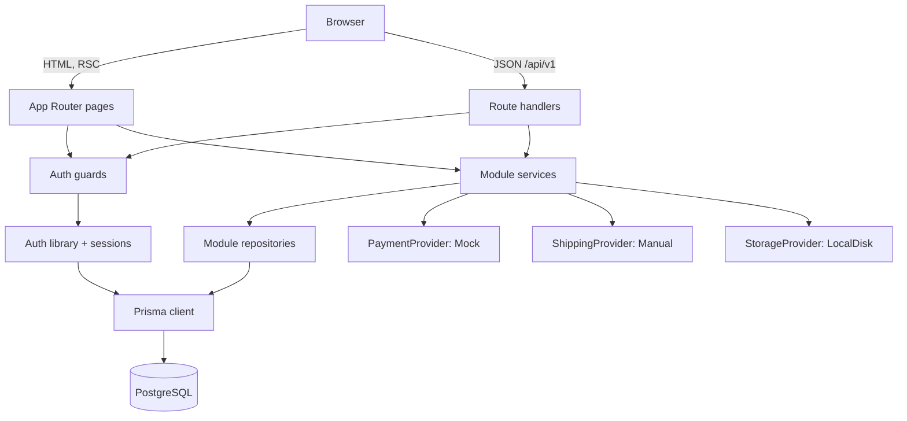
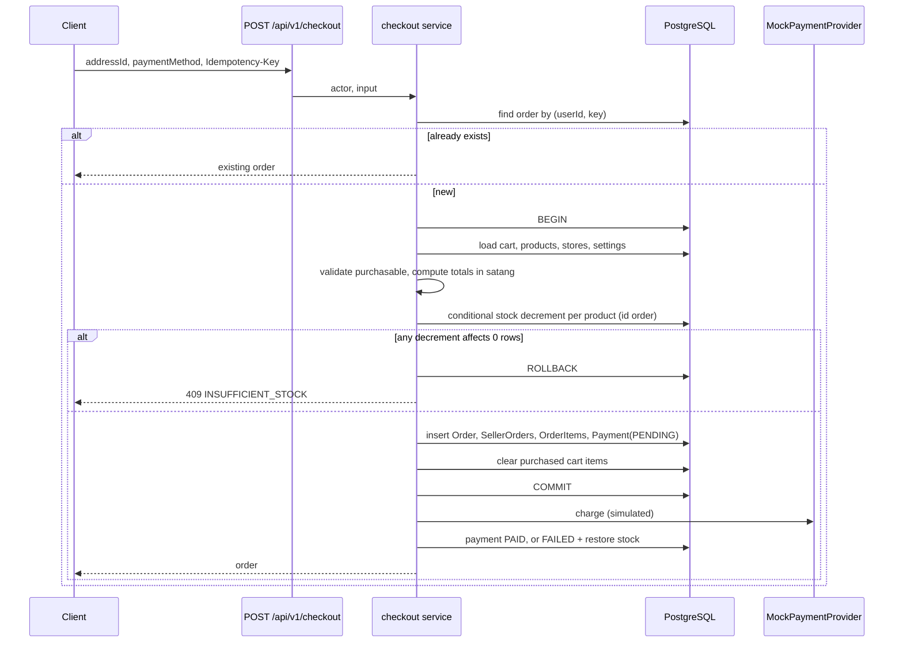

# Architecture

Owner: orchestrator. This describes the **intended** architecture. Nothing here is built yet; see [STATUS.md](STATUS.md).

## Overview

A modular monolith: one Next.js application serving the storefront, the seller dashboard, the admin dashboard, and a JSON API, backed by one PostgreSQL database.



## Layers

| Layer | Location | May import | Responsibility |
| --- | --- | --- | --- |
| Presentation | `src/app/(storefront)`, `src/app/seller`, `src/app/admin`, `src/components` | services (read functions), schemas, UI | Rendering, forms, states |
| API | `src/app/api/v1` | guards, services, schemas | Parse, authenticate, delegate, map errors |
| Domain | `src/modules/<domain>` | repositories, other modules' public exports, providers | Business rules, authorization, transactions |
| Auth | `src/server/auth` | db | Sessions, actor resolution, guards |
| Data | `src/server/db`, `prisma` | Prisma | Client, transaction helper, schema |
| Platform | `src/server` (logger, env, rate limit, errors) | none of the above | Cross-cutting utilities |

Dependencies point downward only. Lint rules (import restrictions) enforce the two hard edges: only `src/server/db` imports the Prisma client, and client components never import server modules.

## Directory layout

```
src/
  app/
    (storefront)/            home, c/[slug], search, p/[slug], s/[slug],
                             cart, checkout, account/*, login, register
    seller/                  apply, dashboard, products, inventory, orders, settings
    admin/                   dashboard, users, applications, stores, products,
                             categories, orders, reports, settings, audit
    api/
      auth/[...all]/         auth library handler
      health/
      v1/                    see API_CONTRACTS.md
  modules/
    catalog/ cart/ checkout/ orders/ inventory/ reviews/
    payments/ shipping/ sellers/ uploads/ admin/ users/
  server/
    auth/ db/ env.ts logger.ts rate-limit.ts errors.ts
  components/
    ui/                      design-system primitives
    ...                      feature components
  i18n/th.ts
  lib/                       formatters, api-client
prisma/                      schema.prisma, migrations/, seed.ts
tests/                       integration, security, helpers
e2e/                         Playwright
scripts/                     bootstrap-admin.ts and others
docs/
```

## Request flow for a mutation

1. Route handler checks the `Origin` header and applies the rate limiter where configured.
2. Body, query, and params are parsed with the module's Zod schema.
3. `requireActor` resolves the session to an `Actor` with role and store loaded from the database.
4. The service is called with `(actor, input)`. It checks role and ownership, opens a transaction when needed, and returns a result or throws a typed domain error.
5. The handler maps the result to the response envelope and logs one structured line with the request id.

## Authorization model

| Resource | Customer | Seller | Admin |
| --- | --- | --- | --- |
| Public catalog | read | read | read |
| Own profile, addresses, cart | full | full | full |
| Own orders | read | read | read all |
| Store profile | none | own store | read all, change status |
| Products | none | own store, when approved | moderate all |
| Seller orders | none | own store | read all, limited transitions |
| Categories, settings, users, audit log | none | none | full |

Ownership is always resolved from the session: `order.userId === actor.userId`, `product.storeId === actor.storeId`, `sellerOrder.storeId === actor.storeId`.

## Checkout sequence



The client never sends a price, total, shipping fee, store id, or user id.

## Cross-cutting concerns

| Concern | Approach |
| --- | --- |
| Validation | Zod at every boundary; schemas shared with the client for feedback |
| Errors | Typed domain errors mapped to one envelope; no internals in responses |
| Logging | JSON to stdout, request id, no secrets or credentials |
| Configuration | Zod-validated environment at startup |
| Rate limiting | In-process limiter on sensitive endpoints (single-instance only) |
| CSRF | `SameSite=Lax` session cookie plus `Origin` check on mutations |
| Security headers | Set in Next.js config; CSP as strict as the framework allows |
| Internationalisation | Thai strings in one file; `th-TH` formatters |
| Uploads | Validated, renamed, stored through `StorageProvider` |
| Audit | Admin actions write `AuditLog` in the same transaction |

## External integrations

| Integration | MVP | Later |
| --- | --- | --- |
| Payment | `MockPaymentProvider` (simulated) | Real gateway with signed, idempotent webhooks |
| Shipping | `ManualShippingProvider` (seller-entered tracking) | Carrier API |
| File storage | Local disk | S3-compatible object storage |
| Email | none | Transactional email provider |
| Search | PostgreSQL `ILIKE` | Trigram index or search service |

## Trade-offs accepted

- One deployable keeps operations simple; it also means the storefront and dashboards scale together.
- In-process rate limiting and local file storage restrict the MVP to a single long-running instance.
- Prisma's schema cannot express every constraint; some integrity rules live in raw SQL migrations.
