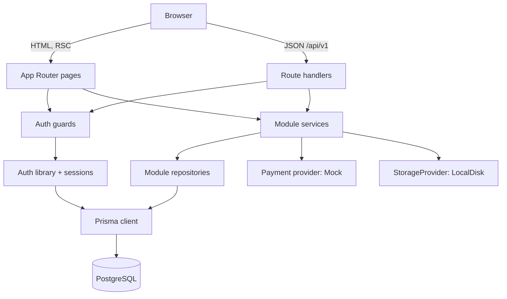
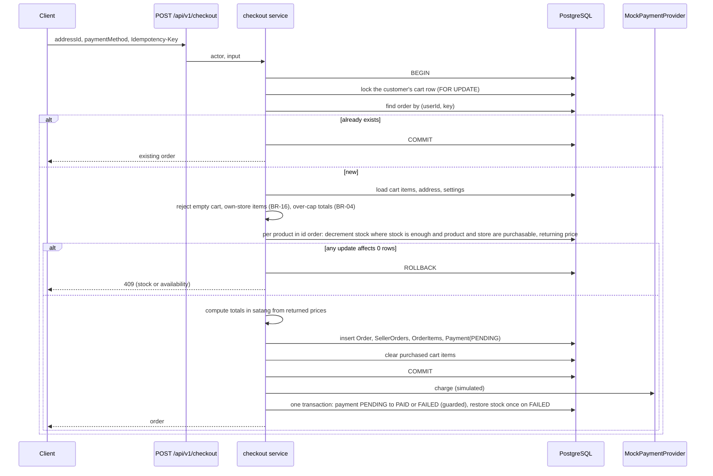

# Architecture

Owner: orchestrator. This describes the architecture of the repository as audited on 2026-10-29 (T-080). Each part is built unless a line says otherwise. Task and verification state are in [STATUS.md](STATUS.md) only.

## Overview

A modular monolith: one Next.js application serving the storefront, the seller dashboard, the admin dashboard, and a JSON API, backed by one PostgreSQL database.



## Layers

| Layer | Location | May import | Responsibility |
| --- | --- | --- | --- |
| Presentation | `src/app/(storefront)`, `src/app/seller`, `src/app/admin`, `src/components` | guards, services (read functions), schemas, UI | Rendering, forms, states |
| API | `src/app/api/v1` | guards, services, schemas | Parse, authenticate, delegate, map errors |
| Domain | `src/modules/<domain>` | repositories, other modules' public exports, providers, `src/server/auth/actor.ts` (D-022) | Business rules, authorization, transactions |
| Auth | `src/server/auth` | db (D-021) | Sessions, actor resolution, guards; `actor.ts` is pure and imports nothing below it |
| Data | `src/server/db`, `prisma` | Prisma | Client, transaction helper, schema |
| Platform | `src/server` (logger, env, rate limit, errors) | none of the above | Cross-cutting utilities |

Dependencies point downward only. Lint rules (import restrictions) enforce the hard edges: only `src/server/db` imports the Prisma client; nothing outside `src/modules` imports `src/server/db` (`scripts/check-import-guards.mjs` checks the rules against a list of import spellings on every `pnpm lint`; the guards stop accidental violations, while inline lint disables and re-exports through an allowed folder are left to review). Keeping client components from importing server modules is not lint-enforced yet; it relies on the framework's build error for server-only APIs until a `server-only` marker is added with the first database-backed module. The full list of code allowed to import `src/server/db` is D-021.

## Directory layout

```
src/
  app/
    (storefront)/            home, categories/[slug], search, products/[slug], stores/[slug],
                             cart, checkout, orders, orders/[id], account, account/addresses,
                             sign-in, sign-up
    seller/                  apply, dashboard (page.tsx), store, products (list, new, [id]),
                             orders (list, [id])
    admin/                   dashboard (page.tsx), users, applications, stores, products
                             (list, [id]), categories, orders (list, [id]), reviews, reports,
                             settings, audit-logs
    api/
      health/
      files/[key]/           serves stored uploads through the storage adapter
      v1/                    auth (sign-up, sign-in, sign-out, session), me, cart, checkout,
                             orders, products, categories, stores, seller, admin;
                             see API_CONTRACTS.md
  modules/
    catalog/ cart/ checkout/ orders/ inventory/ reviews/ payments/ sellers/ uploads/
    profile/ auth/ admin/ rate-limit/
  server/
    auth/ db/ env.ts logger.ts rate-limit.ts errors.ts http.ts health.ts client-address.ts ...
  components/
    ui/                      design-system primitives
    ...                      feature components (account, admin, auth, cart, catalog,
                             checkout, orders, seller, shell)
  i18n/th.ts
  lib/                       formatters, api-client
prisma/                      schema.prisma, migrations/, seed.ts, seed/
tests/                       unit, integration, security, helpers, e2e-support
e2e/                         Playwright
scripts/                     bootstrap-admin.ts, check-import-guards.mjs, container-smoke.ps1,
                             build-probe.ps1
docs/
```

## Request flow for a mutation

The order of refusals is fixed by D-031 point 4 as amended by D-032 point 1; the full ten steps and their status codes are in [API_CONTRACTS.md](API_CONTRACTS.md) section 1.8 and are not repeated here. In outline:

1. The route handler checks the `Origin` header and the `Content-Type` header. Neither needs the body or the session.
2. `requireActor` resolves the session to an `Actor` with role and store loaded from the database, and the access level of the endpoint is judged: the role, then the store status on an endpoint open only to an approved store.
3. The rate limiter is applied where configured.
4. Only then is the body read, within its size limit, and the body, query, and params are parsed with the module's Zod schema. Validation makes no database query.
5. The service is called with `(actor, input)`. It checks role, store status, and ownership again (the check in step 2 is a refusal made sooner, never the control), opens a transaction when needed, and returns a result or throws a typed domain error.
6. The handler maps the result to the response envelope and logs one structured line with the request id.

The handler pattern is documented in the header comment of `src/server/http.ts`; `src/server/auth` exists (`requireActor` in `session.ts`, pure helpers in `actor.ts`). Whether every route handler follows the order was not re-checked in this audit; the route-handler tests under `tests/security` pin it.

## Authorization model

| Resource | Customer | Seller | Admin |
| --- | --- | --- | --- |
| Public catalog | read | read | read |
| Own profile, addresses, cart | full | full | full |
| Own orders | read | read | read all |
| Store profile | none | own store | read all, change status |
| Products | none | own store, when approved | moderate all |
| Seller orders | none | own store | read all, limited transitions |
| Categories, settings, users, audit log | none | none | full |

Ownership is always resolved from the session: `order.userId === actor.userId`, `product.storeId === actor.storeId`, `sellerOrder.storeId === actor.storeId`.

## Checkout sequence



The client never sends a price, total, shipping fee, store id, or user id. The locking, guard, and timeout rules are in D-023 and D-024. An unavailable item stops the whole checkout; there is no partial purchase (BR-22, D-025).

## Cross-cutting concerns

| Concern | Approach |
| --- | --- |
| Validation | Zod at every boundary; schemas shared with the client for feedback |
| Errors | Typed domain errors mapped to one envelope; no internals in responses |
| Logging | JSON to stdout, request id, no secrets or credentials |
| Configuration | Zod-validated environment at startup |
| Rate limiting | In-process limiter on sensitive endpoints (single-instance only) |
| CSRF | `SameSite=Lax` session cookie plus `Origin` check on mutations |
| Security headers | Set in Next.js config; CSP as strict as the framework allows |
| Internationalisation | Thai strings in one file; `th-TH` formatters |
| Uploads | Validated, renamed, stored through `StorageProvider` |
| Audit | Admin actions write `AuditLog` in the same transaction |

## Module copies and process state (measured)

Measured 2026-10-12 with Next.js 16.4.0 (Turbopack), Windows, Node.js runtime for everything. Method: a temporary probe module with a module-scope random id that also wrote a realm id and a log to `globalThis` under `Symbol.for` keys; imported by two route handlers (`/api/probe-a`, `/api/probe-b`), by `src/proxy.ts` (response headers), and by `register` in `src/instrumentation.ts`. Proxy and both routes also called `rateLimiter.consume("probe-subject", RATE_LIMITS.CHECKOUT)` (limit 10). Queried with `curl` to `127.0.0.1`. All probe files were removed afterwards.

| Bundle | `next dev` | `next build` + `next start` |
| --- | --- | --- |
| Route handlers A and B | one module copy (same id) | one module copy (same id) |
| `src/proxy.ts` | its own module copy | its own module copy |
| `instrumentation.ts` hook | its own module copy | its own module copy |
| Process (`pid`) | one for all three | one for all three |
| `globalThis` realm id | one for all three | one for all three |

Evidence (`next start`, NODE_ENV=production, non-placeholder `DATABASE_URL`, `DATABASE_URL_TEST` empty): hook module `9782d37d…`, proxy module `e3f7cb84…`, route A and B module `cebdcf94…`; realm `334ef284…` and pid 19088 in all three. Limiter `remaining` over A, B, A, B: proxy 9, route 8, proxy 7, route 6, proxy 5, route 4, proxy 3, route 2. `next dev` gave the same pattern (hook `ab2ea6d6…`, proxy `3c2afa72…`, routes `b93e7499…`, one realm `a9526686…`, limiter route 7, proxy 6, route 5, proxy 4, route 3).

Consequences:

- A module-scope variable is not shared between the proxy, the hook, and the route handlers: each holds its own copy. Anything that must be one per process lives on `globalThis` under a `Symbol.for` key.
- The rate limiter's slot `globalThis[Symbol.for("marketplace.rateLimit.processState")]` (src/server/rate-limit.ts, SEC-030) is shared by the proxy and the route handlers in both modes: one counter table per process. This holds for the self-hosted Node.js server only; the proxy documentation warns that a platform may run the proxy elsewhere, where no state is shared.
- Matcher pitfall: `matcher: "/api/probe-:path*"` did not match `/api/probe-a` in either mode. The compiled pattern (`.next/server/functions-config-manifest.json`) is `\/api\/probe-(?:\/(…))?`, so a `:path*` parameter needs a leading `/`. List exact paths or use `/api/:path*` style patterns, and test every matcher with a request.

## External integrations

| Integration | MVP | Later |
| --- | --- | --- |
| Payment | Mock provider, `src/modules/payments/provider.ts` (simulated) | Real gateway with signed, idempotent webhooks |
| Shipping | No provider interface; the seller types the carrier and tracking number (simulated) | Carrier API |
| File storage | Local disk | S3-compatible object storage |
| Email | none | Transactional email provider |
| Search | PostgreSQL `ILIKE` | Trigram index or search service |

## Trade-offs accepted

- One deployable keeps operations simple; it also means the storefront and dashboards scale together.
- In-process rate limiting and local file storage restrict the MVP to a single long-running instance.
- Prisma's schema cannot express every constraint; some integrity rules live in raw SQL migrations.
