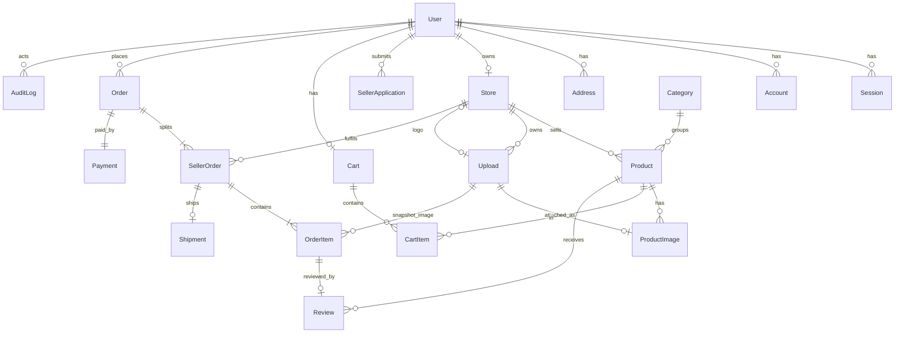

# Data Model

Owner: database agent. This is the **design** for schema v1, corrected on 2026-10-11 after the T-004 planning review ([reviews/T-004-findings.md](reviews/T-004-findings.md)) and the owner answers in [DECISIONS.md](DECISIONS.md) D-025, and again the same day for the second batch of owner answers, D-026 (OQ-25 to OQ-50). **No schema file and no migration exist yet.** T-013 writes `prisma/schema.prisma` from this document; from then on the schema file is authoritative and this document must match it.

Items marked **to validate in T-013** or **to validate in T-015** are technical points that depend on the installed Prisma or Better Auth version. They are not asserted here. Items marked **OPEN (owner)** wait for an owner answer, and items marked **DISAGREEMENT** are points on which two other documents differ; both kinds are listed in [section 19](#19-open-points). For each of them this document says what the data model needs under every reading and does not pick one.

## 1. Conventions

- **Ids.** Rows of the application's own tables have a `String` id generated by Prisma (`cuid`; the exact variant is chosen in T-013). Rows created by the auth library (`User`, `Session`, `Account`, `Verification`) get whatever id the library generates, which is not a cuid. Every id is therefore an **opaque string**: no code, check constraint, or URL pattern may assume a length or shape. Two exceptions with non-string ids are stated where they occur (`MarketplaceSettings`).
- **Time.** All timestamps are UTC (`timestamptz`). Display conversion to Asia/Bangkok happens in the presentation layer.
- **Money.** Stored amounts are integer satang in `Int` columns whose names end in `Satang`. No `Float` and no `Decimal`. Aggregates are a different type, see [section 11](#11-money-types-bounds-and-aggregates).
- **Timestamps.** `createdAt` on every table. `updatedAt` only where rows change after insert.
- **Status changes.** Every status column is changed only by a conditional update whose `WHERE` names the expected current value (D-024), see [section 7](#7-concurrency-and-guarded-writes).
- **Foreign keys.** Every foreign key has a stated `onDelete`, see [section 14](#14-foreign-keys-and-deletion-policy). The default is `Restrict`.

## 2. Entity overview



## 3. Enums

| Enum | Values | Note |
| --- | --- | --- |
| `Role` | `CUSTOMER`, `SELLER`, `ADMIN` | One role per user |
| `ApplicationStatus` | `PENDING`, `APPROVED`, `REJECTED` | On `SellerApplication` only |
| `StoreStatus` | `APPROVED`, `SUSPENDED` | A store row exists only after approval, so no `PENDING` or `REJECTED` (finding B3) |
| `ProductStatus` | `DRAFT`, `PUBLISHED`, `ARCHIVED` | The seller's own switch |
| `ModerationStatus` | `PENDING`, `APPROVED`, `REJECTED`, `TAKEN_DOWN` | The admin's decision. `TAKEN_DOWN` is the target state of a takedown (finding S5) |
| `PaymentStatus` | `PENDING`, `PAID`, `FAILED` | `REFUNDED` is removed from v1: the system records no refund (OQ-08), so the value would be unreachable. Adding an enum value later is a non-destructive migration |
| `PaymentProvider` | `MOCK` | Labels simulated payments permanently (D-011) |
| `FulfilmentStatus` | `PENDING`, `PROCESSING`, `SHIPPED`, `DELIVERED`, `CANCELLED` | |

## 4. State machines

Anything not listed is rejected. Each row is one guarded update ([section 7.6](#76-status-columns-and-what-each-guarded-update-needs)).

### 4.1 Seller application, store, and role (B3)

Application status lives on `SellerApplication`. Store status holds only states a store can actually be in.

| Entity | From | To | Who | Effect |
| --- | --- | --- | --- | --- |
| `SellerApplication.status` | (new row) | `PENDING` | Customer | Only when the user has no store (BR-06) and no other `PENDING` application |
| `SellerApplication.status` | `PENDING` | `APPROVED` | Admin | In **one transaction**: the application becomes `APPROVED`; a `Store` row is **created** with status `APPROVED`, taking `name`, `description`, and `contactPhone` from the application and a generated slug; `User.role` changes `CUSTOMER` to `SELLER` |
| `SellerApplication.status` | `PENDING` | `REJECTED` | Admin, reason required | No store is created. The role stays `CUSTOMER`. The user may submit a new application (a new row) |
| `Store.status` | `APPROVED` | `SUSPENDED` | Admin, reason required | Role stays `SELLER`. Sessions are **not** revoked ([section 6.1](#61-auth-tables-s19)) |
| `Store.status` | `SUSPENDED` | `APPROVED` | Admin, reason required | |

- **When the role changes:** exactly once, in the approval transaction, guarded by `WHERE role = 'CUSTOMER'`. It never changes back: a suspended seller is still a `SELLER`. Because a user has a single role, an `ADMIN` cannot become a seller; an application from a user whose role is not `CUSTOMER` cannot be approved.
- Approval always **creates** the store. "Creates or activates" in REQ-A-03 and in the API contract has no second case, because a user who already owns a store cannot apply.
- A user with a `PENDING` or `REJECTED` application and no store is a `CUSTOMER` with no `Store` row. "Seller, any status" therefore means: role `SELLER` with a store that is `APPROVED` or `SUSPENDED`.
- `ADMIN` is written only by the bootstrap script (OQ-13). No service function sets it.

### 4.2 Product status and moderation (S5, OQ-04, OQ-05, OQ-06, OQ-35, OQ-36, OQ-42)

Two independent columns. `Product.status` is the seller's switch; `Product.moderationStatus` is the admin's decision. Approval is always required: there is no setting that turns it off (OQ-04), and `MarketplaceSettings` has no such column.

`Product.status`:

| From | To | Who |
| --- | --- | --- |
| (new row) | `DRAFT` | Seller |
| `DRAFT` | `PUBLISHED` | Seller |
| `PUBLISHED` | `DRAFT` | Seller (unpublish) |
| `DRAFT`, `PUBLISHED` | `ARCHIVED` | Seller (archive, or delete of a product that orders reference) |

`ARCHIVED` is final in v1: no requirement and no endpoint restores an archived product.

`Product.moderationStatus`:

| From | To | Trigger |
| --- | --- | --- |
| (new row) | `PENDING` | Product created |
| `PENDING` | `APPROVED` | Admin approves |
| `PENDING` | `REJECTED` | Admin rejects, reason required |
| `APPROVED` | `TAKEN_DOWN` | Admin takes down, reason required |
| `APPROVED` | `PENDING` | Seller changes a **moderated field** (OQ-05) |
| `REJECTED`, `TAKEN_DOWN` | `PENDING` | Seller saves a correction, which resubmits the product automatically (OQ-06, OQ-36) |

**Moderated content.** Four things, and nothing else:

1. `title`
2. `description`
3. `categoryId`
4. the **set** of pictures: which uploads are attached to the product, compared as the set of `ProductImage.uploadId` values, **without regard to `sortOrder`**

**Not moderated:** `priceSatang`, `stock`, `sku`, `status`, and **the order of the pictures**, including which picture is first (D-026, OQ-35). A change to these applies at once and does not touch `moderationStatus` (OQ-05).

**Picture change against picture reorder (D-026, OQ-35; DM-Q4 answered).** The owner decided against the reading this section was first written for.

| What the seller did | Set of `uploadId` values | Moderated content changed? |
| --- | --- | --- |
| Added a picture | grows | Yes |
| Removed a picture | shrinks | Yes |
| Replaced a picture (one removed, another added) | same size, different members | Yes |
| Changed the order, or which picture is first | identical | **No** |
| Changed the order and also added, removed, or replaced one | different | Yes |

Why comparing upload ids is enough: an `Upload` row and its bytes never change after insert, and a key is never reused ([section 6.7](#67-upload-s8)). Two saves that attach the same upload ids therefore show exactly the same pictures, so a seller cannot swap what a picture shows and present it as a reorder. Uploading the same file again creates a new upload with a new id; attaching it is a replacement and needs approval.

**How a save is classified.** The seller's edit runs in one transaction that first locks the product row (`SELECT ... FROM "Product" WHERE id = :id AND "storeId" = :actorStoreId FOR UPDATE`), then reads the stored `title`, `description`, `categoryId`, and the product's current `uploadId` values, and compares them with the values about to be stored (text is compared after whatever trimming or normalisation the service applies before storing, so a save that stores the same bytes is "no change"). The row lock makes the comparison and the write one step with respect to a second edit by the same seller and to an admin decision.

| Outcome of the comparison | `contentRevision` | `moderationStatus` | `moderationRequestedAt` |
| --- | --- | --- | --- |
| Moderated content differs | `+ 1` | `APPROVED`, `REJECTED`, `TAKEN_DOWN` become `PENDING`; `PENDING` stays | Set to `now()` only when the status changed to `PENDING` |
| Only the picture order differs | **unchanged** | **unchanged** | unchanged |
| Only non-moderated columns differ | unchanged | unchanged, except for the open case below | unchanged, except for the open case below |
| Nothing differs | unchanged | unchanged (OQ-36: no resubmission without a change) | unchanged |

**A pure reorder does not raise `contentRevision`** (the answer to the point API_CONTRACTS.md section 8.2 left for this document). `contentRevision` is the version of the moderated content and of nothing else: it increases exactly when one of the four things above changes. Reasons:

- The admin still approves what they were shown. A decision is guarded by the `contentRevision` the admin saw, so the title, description, category, and every picture that goes live are the ones on the admin's screen. The only thing that can differ is the order of pictures the admin did see, and the owner decided that the order is not subject to approval.
- A reorder never hides the product: `moderationStatus` is not touched, so an `APPROVED` product stays in the shop and a `PENDING` one keeps its place in the queue (`moderationRequestedAt` unchanged).
- If a reorder raised the revision without changing the status, a seller could keep reordering an `APPROVED` product to make every admin takedown fail on a stale revision while the product stayed on sale. With the rule above, the only edits that invalidate an admin decision are edits that also send the product to `PENDING` and so hide it.
- An admin decision and a reorder that arrive together cannot conflict: neither changes a column the other is guarded by.

A reorder is still a write to the product: `Product.updatedAt` changes and the `ProductImage` link rows are replaced ([section 6.8](#68-productimage)).

**Hidden while waiting.** Visibility requires `APPROVED` ([section 5](#5-visibility-and-purchasability)), so a product that returns to `PENDING` disappears from the shop and cannot be bought until it is approved again. No copy of the previously approved content is kept.

**Resubmission (OQ-06; D-026, OQ-36).** There is no separate resubmit action and no column for one. A `REJECTED` or `TAKEN_DOWN` product returns to `PENDING` as part of the seller's save, in the same statement.

- Certain: a save that changes moderated content resubmits. A save in which nothing differs from the stored values does not, and writes nothing to the three moderation columns.
- **OPEN (owner)**, DM-Q8 (REQUIREMENTS Q31): whether a save of a rejected or taken-down product that changes only non-moderated things (the price, the stock, the SKU, or the picture order) counts as a "correction" and resubmits it. D-026 says "saving a correction"; this section was written for "moderated content only". Not decided here. What each reading needs:

  | Reading | Columns | Statement |
  | --- | --- | --- |
  | Moderated content only | none added | As in the table above: such a save leaves `moderationStatus` alone |
  | Any change, or some named changes (for example the price) | none added | The same save, when the stored status is `REJECTED` or `TAKEN_DOWN` and a named column differs, also sets `moderationStatus = 'PENDING'` and `moderationRequestedAt = now()`. `contentRevision` stays as it is, because the moderated content is the same; the admin decision is still guarded by status and revision. Stock is changed through its own endpoint, so that statement would need the same rule if stock is named |

  Either way the schema is the same, so the point does not block T-013.

`moderationNote` holds the reason of the last rejection or takedown. It stays readable to the seller while they correct the product and is cleared on approval.

**Approving what was actually reviewed.** `contentRevision` (an integer) increases by one in the same statement as every change to moderated content. An admin decision (approve, reject, take down) is guarded by `moderationStatus` **and** by the `contentRevision` the admin was shown. Without it a seller could change the text, or swap a picture, in the moment between the admin opening the product and pressing approve, and the unseen content would go live. A seller's edit holds the product row lock while it writes; an admin decision that arrives meanwhile waits, then evaluates its guard against the new row and affects zero rows, which is a conflict.

**The approval queue (D-026, OQ-42; DM-Q3 answered).** The queue is the products with `moderationStatus = 'PENDING'` **and** `status = 'PUBLISHED'`, ordered by `moderationRequestedAt`, oldest first, then `id`. A product the seller has saved but not yet published is not in it; it enters when the seller publishes it and leaves without a decision if the seller unpublishes or archives it. This is a query filter and changes no column. The state table above is unchanged: an admin decision is guarded by `moderationStatus` and `contentRevision`, not by `status`.

`moderationRequestedAt` is the time the product last entered `PENDING`. Editing a product that is already `PENDING` raises `contentRevision` and leaves `moderationRequestedAt` alone. One consequence of OQ-42 is not settled and is listed in [section 19](#19-open-points): a product created long ago and published today sorts ahead of products that have been in the queue for days, because publishing does not touch this column.

### 4.3 Payment status, on `Order` (M2, OQ-07, D-023)

| From | To | Trigger |
| --- | --- | --- |
| (new row) | `PENDING` | Checkout transaction |
| `PENDING` | `PAID` | Mock provider confirms |
| `PENDING` | `FAILED` | Mock provider declines, or the order stayed `PENDING` past the configured timeout (D-023 point 6) |

`PAID` and `FAILED` are final in v1. A failed order is never paid again (OQ-07); the customer checks out again, which creates a new order with a new idempotency key.

### 4.4 Fulfilment status, on `SellerOrder` (OQ-08, OQ-17, OQ-34, OQ-41)

| From | To | Who | Condition and effect |
| --- | --- | --- | --- |
| (new row) | `PENDING` | Checkout transaction | |
| `PENDING` | `PROCESSING` | Seller | Only when the order's `paymentStatus` is `PAID`, checked in the same statement |
| `PROCESSING` | `SHIPPED` | Seller | Creates the `Shipment` row |
| `SHIPPED` | `DELIVERED` | Seller or admin | Sets `Shipment.deliveredAt`. This is the **only** exit from `SHIPPED` (OQ-17) |
| `PENDING`, `PROCESSING` | `CANCELLED` | Seller or admin | Restores stock once ([section 7.3](#73-stock-is-restored-at-most-once-b5)). Allowed when the order is already `PAID` (OQ-08). A seller can do this only when the order is `PAID`, because a seller does not see the order before that (OQ-41, [section 7.2](#72-payment-completion-and-payment-failure-oq-07-oq-26-oq-27-oq-41)); an admin can do it whatever the payment status |
| `PENDING` | `CANCELLED` | System | Payment failed ([section 7.2](#72-payment-completion-and-payment-failure-oq-07-oq-26-oq-27-oq-41)) |

`DELIVERED` and `CANCELLED` are final.

**Cancelled after payment (OQ-08).** The order's `paymentStatus` stays `PAID`. No refund row, refund amount, or refund status exists anywhere. What the customer is shown is derived, not stored:

| `SellerOrder.fulfilmentStatus` | `Order.paymentStatus` | Meaning |
| --- | --- | --- |
| `CANCELLED` | `PAID` | "ยกเลิกแล้ว คืนเงินนอกระบบ": cancelled, refund handled outside the system |
| `CANCELLED` | `FAILED` | Payment failed; nothing was charged |
| `CANCELLED` | `PENDING` | Cancelled by an admin before the payment finished (rare; a seller cannot, OQ-41; see section 7.2) |

**Sales, revenue, and order counts (OQ-08; D-026, OQ-34).** No figure is stored; each is computed from rows ([section 11](#11-money-types-bounds-and-aggregates)).

- **Which seller orders count.** A seller order counts only when `Order.paymentStatus = 'PAID'` **and** `SellerOrder.fulfilmentStatus <> 'CANCELLED'`.
- **Sales and revenue are the price of the goods only.** Every sales or revenue amount is the sum of `SellerOrder.itemsSubtotalSatang` over the seller orders that count. **`shippingFeeSatang` is never part of any sales or revenue figure**, and neither is `Order.shippingTotalSatang` or `Order.grandTotalSatang`. `Order.itemsSubtotalSatang` must not be used either: it still contains the goods of cancelled seller orders.
- **Order count.** An order counts once when `Order.paymentStatus = 'PAID'` and at least one of its seller orders is not `CANCELLED`. In SQL: `COUNT(DISTINCT "orderId")` over the seller orders that count. An order with only some stores' parts cancelled is therefore one order; an order whose every part is cancelled is not counted; an order whose payment is `PENDING` or `FAILED` is not counted.
- **Per store.** For one store the same rule gives the number of its seller orders that count, because `(orderId, storeId)` is unique.

`SellerOrder.itemsSubtotalSatang` is written once in checkout as the sum of the seller order's `OrderItem.lineTotalSatang`, at the unit prices copied at purchase, and never changes; cancelling removes the whole seller order from the figures rather than changing an amount.

### 4.5 User activation (OQ-14, OQ-31, OQ-32)

| From | To | Who | Effect |
| --- | --- | --- | --- |
| `isActive = true` | `false` | Admin; not self, not the last active admin | Every `Session` row of the user is deleted in the same transaction. **No order, seller order, product, store, or stock value is changed** |
| `isActive = false` | `true` | Admin | The user must log in again. Nothing else is written |

**The store comes back by itself (D-026, OQ-31).** Deactivating a user who owns a store does not change `Store.status` or any product. The store and its products are hidden because visibility reads the owner's `isActive` at the moment of each request ([section 5](#5-visibility-and-purchasability)). Reactivating the owner therefore brings the store and its products back with no further write and no job, in exactly the state from before, including a suspension that was already in place. The same holds for a category that is switched off and on again. This works only because nothing is copied or flagged at deactivation; no code may "hide" products by writing to them.

**Paid orders of a deactivated owner (D-026, OQ-32; DM-Q6 answered).** A deactivated seller cannot log in, so their paid seller orders cannot be moved to `PROCESSING` or `SHIPPED` by anyone (an admin may only cancel or mark delivered). **Nothing is automatic.** The admin cancels those seller orders by hand, one at a time, through the ordinary guarded cancel of [section 7.4](#74-cancelling-a-seller-order), which restores stock once and leaves the payment `PAID`. Deactivation writes nothing to `SellerOrder`; there is no column, trigger, or job for this case. The seller orders that need attention are found with the existing index on `SellerOrder(storeId, fulfilmentStatus, createdAt)`.

## 5. Visibility and purchasability

One definition, used by the catalog, the cart flags, and checkout.

A product is **visible** when all of these hold:

1. `Product.status = 'PUBLISHED'`
2. `Product.moderationStatus = 'APPROVED'`
3. `Store.status = 'APPROVED'` for its store (BR-14)
4. the store owner's `User.isActive = true` (OQ-14)
5. `Category.isActive = true` for its category (OQ-10)

A store page is public when conditions 3 and 4 hold for the store.

A product is **purchasable** in quantity `q` when it is visible and `stock >= q`. Stock is **not** part of visibility: a visible product with `stock = 0` stays in listings and on its page, marked "สินค้าหมด" (OQ-11).

Switching a category off (OQ-10) hides its products everywhere (search, store pages, product pages) and makes them unbuyable, through condition 5 alone; no product row is changed, so switching it back on restores them by themselves (D-026, OQ-31). The same is true of condition 4 and a reactivated store owner ([section 4.5](#45-user-activation-oq-14-oq-31-oq-32)).

A seller cannot create a product in, or move a product to, a category whose `isActive` is false (D-026, OQ-39). This is a service check on the write; the foreign key cannot express it, and a product already in a category that is switched off later keeps its `categoryId`.

### 5.1 Low-stock and sold-out figures (OQ-12; D-026, OQ-33)

Two separate figures for the seller, both counted **only over products that are on sale**:

| Figure | Condition on `stock` |
| --- | --- |
| Low stock | `stock BETWEEN 1 AND 5` |
| Sold out | `stock = 0` |

- A product with `stock = 0` is **not** low stock. The earlier `stock <= 5` is replaced.
- **On sale** excludes, for certain, a product whose `status` is `DRAFT` or `ARCHIVED` and a product whose `moderationStatus` is `REJECTED` or `TAKEN_DOWN` (the four cases D-026 names). A product with `status = 'PUBLISHED'` and `moderationStatus = 'APPROVED'` is on sale.
- **OPEN (owner)**, DM-Q10: whether a product that is `PUBLISHED` but still `PENDING` approval is on sale. D-026 does not name it. REQUIREMENTS.md (Terms, BR-25) and API_CONTRACTS.md (section 5.7.2) both currently read it as **not** on sale. Not decided here. Under "not on sale" the filter is `status = 'PUBLISHED' AND "moderationStatus" = 'APPROVED'`; under "on sale" it is `status = 'PUBLISHED' AND "moderationStatus" IN ('APPROVED', 'PENDING')`.
- **OPEN (owner)**, DM-Q11 (REQUIREMENTS Q32): whether a published, approved product that is hidden because its store is suspended or its category is inactive is counted. Under "counted" the filter reads only the product's own two columns; under "not counted" it also joins `Store.status` and `Category.isActive`.
- Under every one of these readings the figures are query filters over existing columns. No column or index is added: the count is per store and is served by the index on `Product(storeId, status)`.
- The number 5 is a fixed business rule, not an admin setting, so it is not stored in the database: it is one exported constant, `LOW_STOCK_THRESHOLD = 5`, in the seller product module under `src/modules` (backend-api chooses the file), and nothing else repeats the number. The lower end of the range is 1 because 0 is the sold-out figure.
- The public "สินค้าหมด" mark is a different thing: it is simply `stock = 0` on a visible product (OQ-11).

## 6. Tables

`?` marks a nullable column. "timestamps" means `createdAt` and `updatedAt`.

### 6.1 Auth tables (S19)

The auth library is Better Auth (D-004). It owns four tables. **Their exact model names, column names, types, and nullability are to validate in T-015 against the installed version; the list below is the expected shape and is not asserted.** T-013 creates these tables from the library's published schema for the version that will be pinned; if T-015 finds a difference, the database agent adds a new corrective migration (the applied one is not edited).

| Table | Expected columns (to validate in T-015) |
| --- | --- |
| `User` | `id`, `name`, `email` (unique), `emailVerified`, `image?`, `createdAt`, `updatedAt` |
| `Session` | `id`, `userId` FK, `token` (unique), `expiresAt`, `ipAddress?`, `userAgent?`, `createdAt`, `updatedAt` |
| `Account` | `id`, `userId` FK, `accountId`, `providerId`, `password?` (the password hash), provider token columns and their expiry columns (unused with email and password, kept because the library requires them), `scope?`, `createdAt`, `updatedAt` |
| `Verification` | `id`, `identifier`, `value`, `expiresAt`, `createdAt`, `updatedAt` |

Columns this application adds to `User`:

| Column | Type | Written by | Never written by |
| --- | --- | --- | --- |
| `role` | `Role`, default `CUSTOMER` | The application-approval service (`CUSTOMER` to `SELLER`); the admin bootstrap script (`ADMIN`) | Sign-up, profile update, any request body |
| `isActive` | `Boolean`, default `true` | The admin user-management service | Sign-up, profile update, any request body |
| `phone?` | `String` | The profile service (`PATCH /me`), for the acting user only | Sign-up |

- **Not client-settable.** The three columns are declared to the library as additional fields that do not accept input, so a sign-up or library update request carrying `role`, `isActive`, or `phone` cannot set them. The option that does this is to validate in T-015. The database defaults make a row created without them a plain active customer.
- **Ids.** The library generates the id of every row in these four tables, in its own format. See [section 1](#1-conventions): ids are opaque. The seed and the bootstrap script create users through the library so that ids and password hashes have the library's format.
- **Email** is stored lower-cased and is unique. Whether the library normalises the case itself is to validate in T-015; if it does not, uniqueness moves to a unique index on `lower(email)` in raw SQL.
- `emailVerified` and `image` exist only because the library requires them. No feature reads them in the MVP.

**Sessions, suspension, and deactivation.** D-004 says database sessions allow revocation "on logout, deactivation, and suspension". BR-14 requires a suspended store's seller to stay able to log in and fulfil existing orders. The model resolves it this way:

| Event | Sessions | How the restriction takes effect |
| --- | --- | --- |
| Logout | That `Session` row is deleted | |
| **User deactivation** | **All of the user's `Session` rows are deleted**, in the transaction that sets `isActive = false` | Sign-in is refused while inactive; `requireActor` also reads `isActive` on every request |
| **Store suspension** | **Not touched** | `requireActor` reads `Store.status` from the database on every request, so the suspended seller is blocked from creating, publishing, and selling at once, and keeps access to existing seller orders (BR-14) |

No role, status, or store id is cached in the session or the cookie; the library's session cookie cache stays off (to validate in T-015).

**Login IP address and browser details (OQ-22; D-026, OQ-49).** `Session.ipAddress` and `Session.userAgent` are the only place the database stores them. They are personal data. They must disappear when the session ends, and **within one day of its expiry** when nobody ended it:

- logout and deactivation delete the row, at once;
- an expired row is deleted by a purge, `DELETE FROM "Session" WHERE "expiresAt" < now()`. The statement is safe to run at any time and any number of times, and is served by the index on `Session(expiresAt)`;
- the library is expected to delete an expired session when its cookie is presented (to validate in T-015). This cannot be relied on: an abandoned session is never presented again;
- no other table, and no audit entry, copies these two values.

**The limit and the interval.** The binding limit is the owner's: no `Session` row may exist more than **24 hours** after its `expiresAt` (OQ-49). The purge interval this document asks for stays **one hour**, which was the earlier design and is stricter. The reason for keeping it is margin, not a stricter promise: with a purge once a day, a row that expires just after a run already waits almost the full 24 hours, so one late or failed run breaks the limit; with an hourly purge, about a full day of runs in a row has to fail first.

**How it is guaranteed, stated plainly.** At the time of writing **nothing guarantees it**: no session code exists, and nothing in the system runs on a schedule (KNOWN_LIMITATIONS.md; SECURITY.md SR-07). A row can only be deleted by something that runs, and an abandoned session produces no request, so the limit cannot be met by request handling alone. What has to exist, and who owns it:

| Part | What it does | Is it a guarantee? | Owner |
| --- | --- | --- | --- |
| The purge statement above, as one function | Deletes every expired row | It is the mechanism; it guarantees nothing until something calls it | auth (T-015) |
| A run that happens without any visitor, at least hourly | Calls the purge | **Yes, this is the guarantee**, for as long as the thing that triggers it is running. It does not exist yet | devops schedules it; the orchestrator decides what the trigger is, because the MVP has no job runner |
| The same purge called when the application starts and on every sign-in | Shortens the wait on a busy system, and cleans up after downtime before the first visitor is served | No: with no start and no sign-in it never runs | auth |
| A check: `SELECT count(*) FROM "Session" WHERE "expiresAt" < now() - interval '1 day'` must return 0 | Shows that the limit is being met, or that it is not | It proves a breach; it prevents nothing | auth writes the test for T-015; devops may add it to monitoring |

Consequences that follow from this:

- Until the scheduled run exists, the limit is met only by accident. It must exist before any environment that holds real people's sessions; that is a condition on T-015 being `VERIFIED` and on any deployment, and is reported to the orchestrator as a request, not solved in the schema.
- If the scheduler or the whole deployment is stopped for more than a day, expired rows outlive the limit until the next start, when the start-up purge removes them. No mechanism inside the database avoids this: the PostgreSQL image in use has no scheduler of its own, and adding an extension for one would be a new dependency, which is not proposed.
- A database backup holds the `Session` rows that existed when it was taken, with their addresses, until the backup itself is deleted. Backups are kept 30 days (D-026, OQ-50), so the one-day limit describes the live database only. After a restore the purge must run before the application serves requests. See [section 19](#19-open-points) and SECURITY.md SR-07.

The address the library writes must be the one derived by SECURITY.md SR-01, never a client-controlled header (to validate in T-015).

Indexes: `Session(userId)` (revocation), `Session(expiresAt)` (purge), `Account(userId)`.

### 6.2 Address

`id`, `userId` FK, `recipientName`, `phone`, `line1`, `subdistrict`, `district`, `province`, `postalCode`, `isDefault`, timestamps.

- Index `(userId)`.
- At most one default per user: partial unique index on `(userId) WHERE "isDefault"` (raw SQL).
- `CHECK ("postalCode" ~ '^[0-9]{5}$')` (raw SQL).
- An address may be hard-deleted: orders copy the address, they do not reference it.

### 6.3 Store

`id`, `ownerId` FK unique, `name`, `slug` unique, `description?`, `logoUploadId?` FK unique, `contactPhone`, `status` (`StoreStatus`, set to `APPROVED` at creation), `statusReason?`, `isSample` (default false), timestamps.

- Created only by the approval transaction ([section 4.1](#41-seller-application-store-and-role-b3)).
- `slug` is generated once and never changes, also when the store is renamed ([section 9](#9-slugs-s11)).
- `statusReason` holds the reason of the last suspension or reinstatement; the history is in `AuditLog`.
- Index `(status)` for the admin store list.

### 6.4 SellerApplication

`id`, `userId` FK, `storeName`, `description`, `contactPhone`, `status` (`ApplicationStatus`, default `PENDING`), `reviewedById?` FK, `reviewNote?` (required by the service on rejection), `reviewedAt?`, timestamps.

- At most one `PENDING` application per user: partial unique index on `(userId) WHERE status = 'PENDING'` (raw SQL).
- Index `(status, createdAt)` for the admin list filtered by status.

### 6.5 Category

`id`, `name`, `slug` unique, `sortOrder`, `isActive` (default true), `isSample` (default false), timestamps. Flat list in the MVP; no hierarchy. Storefront order is `sortOrder`, then `id`.

### 6.6 Product

`id`, `storeId` FK, `categoryId` FK, `title`, `slug` unique, `description`, `sku`, `priceSatang`, `stock`, `status` (default `DRAFT`), `moderationStatus` (default `PENDING`), `moderationNote?`, `moderationRequestedAt`, `contentRevision` (`Int`, default 1), `isSample` (default false), timestamps.

- SKU is unique per store **among products that are not archived**: partial unique index on `(storeId, sku) WHERE status <> 'ARCHIVED'` (raw SQL). An archived product keeps its SKU value for the record, and the seller may use the same SKU on a new product (M6). Reason: deleting a product that orders reference archives it instead, so to the seller it is gone; refusing its SKU afterwards would be an error they cannot resolve. Order history is unaffected because `OrderItem` stores its own copy of the SKU. This is safe only because `ARCHIVED` is final.
- `slug` is unique across all products for ever, archived ones included. It is never released and never reused (M6). This costs nothing because every slug ends in a random suffix ([section 9](#9-slugs-s11)).
- `CHECK ("priceSatang" BETWEEN 100 AND 100000000)` (BR-02).
- `CHECK (stock BETWEEN 0 AND 1000000000)`. This is the bound of the column, not the seller's entry limit of 1,000,000 (D-026, OQ-40), which is enforced by the guard of the seller's stock statement. [Section 11](#11-money-types-bounds-and-aggregates) explains why the two differ and why the column check cannot be 1,000,000.
- `CHECK ("contentRevision" >= 1)`. It increases only when moderated content changes; a reorder of pictures does not raise it ([section 4.2](#42-product-status-and-moderation-s5-oq-04-oq-05-oq-06-oq-35-oq-36-oq-42)).
- Indexes: `(status, moderationStatus, categoryId, createdAt)` for storefront listings; `(storeId, status)` for the seller's product list and the low-stock and sold-out counts; `(moderationStatus, moderationRequestedAt)` for the admin queue and the admin list filtered by moderation status. The queue's extra condition `status = 'PUBLISHED'` (OQ-42) is applied to the rows that index returns; no second index is added for it, because the rows with `moderationStatus = 'PENDING'` are few. The earlier draft's index on `(priceSatang)` is dropped: at MVP catalog size a single-column price index does not serve the price sort once the visibility filter is applied. Add an index for it only when a measured query needs one.

### 6.7 Upload (S8)

`id`, `storageKey` unique, `storeId` FK, `contentType`, `sizeBytes`, `createdAt`. Rows are immutable: a key is generated once, its bytes are never overwritten, and no column changes after insert. Rules are in [section 8](#8-uploads-and-images-s7-s8).

- `CHECK ("contentType" IN ('image/jpeg', 'image/png', 'image/webp'))`.
- `CHECK ("sizeBytes" BETWEEN 1 AND 5242880)` (5 MB).
- Index `(storeId)`.

### 6.8 ProductImage

`id`, `productId` FK cascade, `uploadId` FK unique, `sortOrder`, `createdAt`. A row is only the link between a product and an upload.

- Unique `(productId, sortOrder)` and `CHECK ("sortOrder" BETWEEN 0 AND 7)`: together they make a ninth picture impossible in the database (REQ-S-05). The picture with the lowest `sortOrder` is the primary one.
- Unique `uploadId`: one upload is attached to at most one product.
- Changing the pictures (add, remove, replace, reorder) replaces the product's link rows inside one transaction (delete, then insert), so the unique constraint on `(productId, sortOrder)` never sees a half-finished order. No deferrable constraint is needed. The transaction locks the `Product` row first and compares the old and new **sets of `uploadId`** before it deletes anything: that comparison, not the fact that rows were replaced, decides whether the product needs approval again ([section 4.2](#42-product-status-and-moderation-s5-oq-04-oq-05-oq-06-oq-35-oq-36-oq-42); D-026, OQ-35). A reorder gives the link rows new ids and new `sortOrder` values and changes nothing else; nothing references a `ProductImage` id.
- `sortOrder` is not moderated content. It decides which picture is the primary one from the moment the reorder commits, on the storefront and for the copy an order item takes at purchase ([section 6.12](#612-orderitem)).

### 6.9 Cart and CartItem

`Cart`: `id`, `userId` FK unique, timestamps. Created by the first add-to-cart and never deleted; it is the row checkout locks ([section 7.1](#71-checkout-d-023-oq-30)).

`CartItem`: `id`, `cartId` FK cascade, `productId` FK cascade, `quantity`, timestamps.

- Unique `(cartId, productId)`.
- `CHECK (quantity BETWEEN 1 AND 99)` (BR-03).
- No price is stored in the cart; prices are read live.

**Cart lines against stock (D-025, OQ-23; D-026, OQ-28 to OQ-30).** `CartItem.quantity` is what the customer last asked for, or what a write lowered it to. The database does **not** constrain it by the product's stock: stock moves after the line is written, and a check across two tables is not a `CHECK` constraint. What each rule needs from the model:

| Rule | What happens to the row | Stored marker |
| --- | --- | --- |
| Adding a sold-out product is refused (OQ-28) | No row is inserted and no row is changed | none |
| Asking for more than the stock, with stock at least 1 (OQ-28) | The write (a `POST` or `PATCH`) stores `quantity` equal to the stock, read in the same transaction as the write | none: the response of that write reports it |
| A product in the cart sells out (OQ-29) | **The row stays as it is.** Nothing deletes it and nothing changes its quantity; a quantity of 0 cannot be stored. It is left out of totals and blocks checkout by being read against `stock = 0` | none: derived as `stock = 0` |
| Stock drops below a line's quantity, with stock at least 1 (OQ-23, OQ-30) | See the two readings below | See below |
| A product is hard-deleted by its seller (OQ-43; DM-Q5 answered) | The row goes by cascade, with no message | none |

**Reporting a lowered quantity on the cart page.** A line is "lowered" when its stored `quantity` is above the product's current `stock` and the stock is at least 1. That is a comparison of two existing columns and can be made on every read. Which request, if any, **stores** the lowered quantity is a **DISAGREEMENT** between TEST_STRATEGY.md (the next cart read stores it) and SECURITY.md TM-16 (a `GET` never changes state), DM-D1. Not decided here. What each reading needs:

| Reading | Rows written by the cart read | What reports the lowering | Columns |
| --- | --- | --- | --- |
| The cart read never writes (TM-16) | none | Derived on every read as `quantity > stock AND stock >= 1`; it stays reportable until the customer's own write stores a new quantity, so a lost response loses nothing | **none added** |
| The cart read stores the lowered quantity | `UPDATE "CartItem" SET quantity = stock` for the lines above stock, taken under the cart row lock so that it cannot interleave with a checkout ([section 7.5](#75-lock-order)); a line whose product has `stock = 0` is not written | Once the quantity is stored it equals the stock, so the comparison no longer shows anything: the lowering is reportable only in the response of the read that made it, unless a marker is stored | To report it after that one response, one nullable column would be needed: `CartItem.loweredFromQuantity` (`Int?`, `CHECK` 1 to 99 and above `quantity`), set by the lowering write and cleared by the customer's next write to the line. Not part of schema v1 unless this reading is chosen |

Schema v1 is written for "none added". Choosing the second reading later means adding one nullable column, which is a non-destructive migration.

**Reporting a lowered quantity at checkout** is in [section 7.1](#71-checkout-d-023-oq-30).

### 6.10 Order

`id`, `orderNumber` unique, `userId` FK, `idempotencyKey`, `paymentStatus` (default `PENDING`), `itemsSubtotalSatang`, `shippingTotalSatang`, `grandTotalSatang`, shipping address copy (`shipRecipientName`, `shipPhone`, `shipLine1`, `shipSubdistrict`, `shipDistrict`, `shipProvince`, `shipPostalCode`), timestamps.

- `orderNumber` is filled by the database, see [section 10](#10-order-numbers-s12).
- Unique `(userId, idempotencyKey)`: the backstop behind the cart lock (D-023 point 2). The key is stored in the one normalised form the API layer defines and compared exactly.
- **`paymentStatus` is the only payment status in the model** (M2).
- Indexes: `(userId, createdAt)` for the customer's history; `(paymentStatus, createdAt)` for the pending-payment timeout sweep and the admin filter.
- Checks: each of the three amounts `>= 0`; `"grandTotalSatang" = "itemsSubtotalSatang"::bigint + "shippingTotalSatang"`; `"grandTotalSatang" <= 2000000000` (BR-04); `"shipPostalCode" ~ '^[0-9]{5}$'`.

### 6.11 SellerOrder

`id`, `orderId` FK, `storeId` FK, `storeName` (the store's name at purchase, OQ-18), `fulfilmentStatus` (default `PENDING`), `itemsSubtotalSatang`, `shippingFeeSatang`, `shippingFeeIsSimulated` (default true), `commissionRateBps` (copy of the setting at purchase), timestamps.

- `storeName` never changes. A later store rename does not alter old orders; order pages read this column, not `Store.name`.
- `shippingFeeIsSimulated` marks the fee as a simulated flat rate, not a carrier quote (M12, BR-08). It is `true` for every row in the MVP and is the stored fact behind the "simulated rate" label.
- Unique `(orderId, storeId)`.
- Index `(storeId, fulfilmentStatus, createdAt)` for the seller's order list.
- Checks: `"itemsSubtotalSatang" >= 0`; `"shippingFeeSatang" BETWEEN 0 AND 100000`; `"commissionRateBps" BETWEEN 0 AND 10000`. The whole-percent rule of OQ-38 is checked on `MarketplaceSettings` only, not here: this column is a copy of what the setting was, and a copy must stay valid whatever rule later applies to the setting ([section 6.16](#616-marketplacesettings)).
- `itemsSubtotalSatang` is the only amount that enters a sales or revenue figure; `shippingFeeSatang` never does ([section 4.4](#44-fulfilment-status-on-sellerorder-oq-08-oq-17-oq-34-oq-41)).
- A seller reads and changes a seller order only when its order's `paymentStatus` is `PAID` (D-026, OQ-41). No column is added for this; every seller statement joins `Order` by its primary key.

### 6.12 OrderItem

`id`, `sellerOrderId` FK, `productId` FK, `productTitle`, `productSku`, `productImageUploadId?` FK, `unitPriceSatang`, `quantity`, `lineTotalSatang`, `stockRestoredAt?`, `cartQuantityBeforeReturn?`, `cartQuantityAfterReturn?`, `createdAt`.

- `productTitle`, `productSku`, and `unitPriceSatang` are copies taken at purchase. `productId` is kept for reference (reviews, re-adding to the cart) and is never used to read a title or a price for an order.
- `productImageUploadId` points at the upload that was the product's primary picture at purchase. Upload rows and their bytes never change, so the reference is a true snapshot, and the foreign key stops the row, and with it the file, from being deleted ([section 8](#8-uploads-and-images-s7-s8), S7).
- `stockRestoredAt` records that this item's stock was put back, and when. It is null until then and is set at most once ([section 7.3](#73-stock-is-restored-at-most-once-b5)).
- `cartQuantityBeforeReturn` and `cartQuantityAfterReturn` are **the stored record of how this item came back to the customer's cart** after its order's payment failed (D-026, OQ-26; the marker backend-api asked for). Both are null for an item that was never returned to a cart. When the item is returned they are set together, once, in the failure transaction ([section 7.2](#72-payment-completion-and-payment-failure-oq-07-oq-26-oq-27-oq-41)):
  - `cartQuantityBeforeReturn`: the quantity the customer's cart line for this product held just before the return; 0 when there was no line.
  - `cartQuantityAfterReturn`: the quantity of that line just after the return.
  - **"A cap applied" is derived, not stored:** `"cartQuantityAfterReturn" < "cartQuantityBeforeReturn" + quantity`. Two numbers are stored instead of a yes-or-no flag so that the flag can never disagree with the quantities, and so that the customer can be told what the line now holds.
  - They describe one moment. A later change to the cart does not change them, and they are not a view of the cart as it is now.
- `stockRestoredAt` and the two return columns are the only columns of this table that change after insert, and each is written at most once.
- An order holds at most one item per product, because the cart it was made from has one line per product.
- Checks: `quantity BETWEEN 1 AND 99`; `"unitPriceSatang" BETWEEN 100 AND 100000000`; `"lineTotalSatang" = "unitPriceSatang"::bigint * quantity`. The `bigint` cast makes an out-of-range product a constraint failure instead of an arithmetic error.
- Checks on the return columns: `("cartQuantityBeforeReturn" IS NULL) = ("cartQuantityAfterReturn" IS NULL)`; `"cartQuantityBeforeReturn" BETWEEN 0 AND 99`; `"cartQuantityAfterReturn" BETWEEN 1 AND 99`; `"cartQuantityAfterReturn" <= "cartQuantityBeforeReturn" + quantity` (a return never adds more than the item held).
- Indexes: `(sellerOrderId)`, `(productId)`.

### 6.13 Payment

`id`, `orderId` FK **unique**, `provider` (`MOCK`), `providerReference?`, `amountSatang`, `failureReason?`, timestamps.

- One row per order, created in the checkout transaction. A failed order is not retried (OQ-07), so there is never a second attempt.
- **There is no status column here** (M2). The earlier draft kept a status on both `Order` and `Payment` with no rule for keeping them equal. `Order.paymentStatus` is the single source; this table holds what the provider reported: its reference on success, a short reason code on failure (for example `SIMULATED_DECLINE`, `TIMEOUT`). The table is kept, rather than folded into `Order`, as the place a real gateway's attempts will go (D-011); a per-attempt status is added then, together with its sync rule.
- `provider = 'MOCK'` is the permanent record that the payment was simulated. "Is simulated" in an API response is derived from it; there is no separate column.
- `CHECK ("amountSatang" BETWEEN 0 AND 2000000000)`. The service writes the order's `grandTotalSatang`.

### 6.14 Shipment

`id`, `sellerOrderId` FK unique, `carrierName?`, `trackingNumber?`, `isSimulated` (default true), `shippedAt`, `deliveredAt?`, timestamps.

- Created by the `PROCESSING` to `SHIPPED` transition. Tracking numbers are only ever entered by the seller; none is generated.
- `CHECK ("deliveredAt" IS NULL OR "deliveredAt" >= "shippedAt")`.

### 6.15 Review

`id`, `orderItemId` FK unique, `productId` FK, `userId` FK, `rating`, `comment?`, `createdAt`. No edit path exists, so there is no `updatedAt`.

- `CHECK (rating BETWEEN 1 AND 5)`.
- Index `(productId, createdAt)`.
- `productId` and `userId` repeat what the order item and its order already say, so that a product's reviews can be listed without two joins. The review service copies them from the order item and never from the request.

### 6.16 MarketplaceSettings

Single row: `id` (`Int`, always 1), `flatShippingFeeSatang`, `commissionRateBps`, `updatedById?` FK, `updatedAt`.

- `requireProductApproval` is **removed** (OQ-04).
- Checks: `id = 1`; `"flatShippingFeeSatang" BETWEEN 0 AND 100000` (0 to 1,000 THB, OQ-16); `"commissionRateBps" BETWEEN 0 AND 10000` (0 to 100 percent, OQ-16); **`"commissionRateBps" % 100 = 0`** (a whole number of percent, D-026, OQ-38).
- **The commission stays in basis points** (the answer to backend-api's question). The column keeps its name, its `Int` type, and its unit; the whole-percent rule is one extra check constraint on this table, so the only values the setting can hold are 0, 100, 200, and so on up to 10,000. Reasons:
  - The rule is the owner's current answer about what an admin may **enter**, not a property of the unit. If decimals are wanted later, the change is dropping one check constraint, which is non-destructive and needs no data change. A column in whole percent would instead need a change of unit on two tables and in the API, with every stored value multiplied.
  - The name says the unit, in the same way `Satang` does for money, and API_CONTRACTS.md already uses `commissionRateBps` with multiples of 100. Nothing in the contract changes.
  - The check is on `MarketplaceSettings` only. `SellerOrder.commissionRateBps` is a copy taken at purchase and keeps only its range check, so that an order written under one rule stays valid if the rule for the setting changes.
- The value shown to and collected from an admin is `commissionRateBps / 100`, an exact integer because of the check.
- The row is inserted by the first **migration** with the confirmed initial values (4,000 satang and 500 basis points, which is 5 percent and passes the new check; D-017), not by the seed, because the seed never runs in production.
- Checkout reads the row inside its transaction and copies both values onto each `SellerOrder`, so a later change never alters an existing order.

### 6.17 AuditLog

`id`, `actorId` FK, `action` (for example `STORE_SUSPENDED`), `targetType`, `targetId`, `metadata` (JSON: reason, before and after summary), `createdAt`.

- Indexes `(createdAt)` and `(targetType, targetId)`.
- Append-only: no update or delete path in application code. Written in the same transaction as the action it records.
- `metadata` never contains a session token, a password hash, an IP address, or a user agent.

## 7. Concurrency and guarded writes

### 7.1 Checkout (D-023, OQ-30)

One transaction:

1. Lock the customer's cart: `SELECT ... FROM "Cart" WHERE "userId" = :actor FOR UPDATE`. No cart row means an empty cart.
2. Inside the lock, look up `Order` by `(userId, idempotencyKey)`. If found, return it. The unique constraint on the pair remains as the backstop.
3. No cart items: the defined empty-cart error. No order.
4. For each cart item, in **product id order**, one statement decrements the stock, requires the product to be purchasable, and returns the price that is charged:

   ```sql
   UPDATE "Product" p
      SET stock = p.stock - :quantity
     FROM "Store" s, "User" u, "Category" c
    WHERE p.id = :productId
      AND s.id = p."storeId" AND u.id = s."ownerId" AND c.id = p."categoryId"
      AND p.status = 'PUBLISHED' AND p."moderationStatus" = 'APPROVED'
      AND s.status = 'APPROVED' AND u."isActive" AND c."isActive"
      AND s."ownerId" <> :actor            -- BR-16
      AND p.stock >= :quantity
   RETURNING p."priceSatang", p.title, p.sku, p."storeId", s.name;
   ```

   Zero rows means the item cannot be bought at its quantity; nothing is ordered (OQ-09). The statement is the exact shape to validate in T-013 (raw query through the transaction client).
5. Read `MarketplaceSettings`; compute totals from the returned prices; reject above the BR-04 cap.
6. Insert `Order`, `SellerOrder` rows (with `storeName`, fee, and rate copies), `OrderItem` rows (with the title, SKU, price, and primary-picture copies), and the `Payment` row; delete the cart's items.

**When a line cannot be bought (OQ-09; D-026, OQ-29, OQ-30).** Checkout **never places an order with a quantity lower than the cart line holds**: the statement of step 4 takes exactly the line's quantity or nothing. The refusal has to name every such line, so step 4 does not stop at the first zero-row result: it goes through all lines, and for each line that returned zero rows it reads, in the same transaction, why (the visibility conditions of [section 5](#5-visibility-and-purchasability), the own-store rule, and the current `stock`). Those reads are of existing columns; nothing is stored to produce the report. Then every stock decrement of this attempt is undone and no order row exists.

- A line whose product is sold out or not visible stays in the cart unchanged (OQ-29).
- Whether the refused checkout **stores** the lowered quantity on a line whose quantity was above a stock of at least 1 is a **DISAGREEMENT**, DM-D2: REQUIREMENTS.md (BR-22 case (b), REQ-C-11) says that after the stop "the cart holds the lowered quantity"; API_CONTRACTS.md section 5.5.3 says that after a refusal "the cart is as it was" and the client stores the new quantity with a `PATCH`. D-026 OQ-30 says only that checkout stops, shows the new quantity and total, and the customer confirms again. Not decided here. What each reading needs:

  | Reading | What the refused checkout writes | Transaction shape |
  | --- | --- | --- |
  | The cart is as it was (API_CONTRACTS.md) | Nothing | The whole transaction rolls back |
  | The cart holds the lowered quantity (REQUIREMENTS.md) | `UPDATE "CartItem" SET quantity = :stock` for each line with `quantity > stock AND stock >= 1`, and nothing else | The stock decrements must be undone while that cart write is kept and the cart row lock is still held: either a savepoint taken before step 4 and rolled back to, or validating every line before the first decrement. Which of the two the installed Prisma supports inside an interactive transaction is to validate in T-013 |

  Neither reading needs a column. Checkout is a `POST`, so TM-16 does not bear on this one.

### 7.2 Payment completion and payment failure (OQ-07, OQ-26, OQ-27, OQ-41)

**Success**, one transaction: `UPDATE "Order" SET "paymentStatus" = 'PAID' WHERE id = :id AND "paymentStatus" = 'PENDING'`. One row affected: write `Payment.providerReference`. Zero rows: someone else finished it; change nothing.

**Failure**, one transaction. A decline by the provider and an order that stayed `PENDING` past the timeout go through **exactly the same steps** (D-026, OQ-27); the only difference is the reason code written in step 6. The steps do not depend on a request from the customer being in progress.

1. Lock the customer's cart row (`FOR UPDATE`), the same first lock checkout takes.
2. `UPDATE "Order" SET "paymentStatus" = 'FAILED' WHERE id = :id AND "paymentStatus" = 'PENDING'`. Zero rows: stop and change nothing. Everything below is done only by the request whose update affected the row.
3. **Seller orders of the failed order:** `UPDATE "SellerOrder" SET "fulfilmentStatus" = 'CANCELLED' WHERE "orderId" = :id AND "fulfilmentStatus" = 'PENDING'`. They can only be `PENDING` or already `CANCELLED`, because leaving `PENDING` for `PROCESSING` requires `PAID`. After this step no seller order of a failed order is left in a state that can be acted on, so a later cancel request finds nothing to cancel.
4. Claim the items and restore their stock ([section 7.3](#73-stock-is-restored-at-most-once-b5)).
5. **Items return to the cart (D-026, OQ-26).** For each item to return, in product id order, with `q` the item's quantity, `e` the quantity of the customer's existing cart line for that product (0 when there is none), and `s` the product's `stock` **as it stands after step 4**:

   - new line quantity `n = min(e + q, 99, s)`;
   - no line: insert a `CartItem` with quantity `n`; a line exists: set its quantity to `n`;
   - record the return on the order item: `UPDATE "OrderItem" SET "cartQuantityBeforeReturn" = :e, "cartQuantityAfterReturn" = :n WHERE id = :id AND "cartQuantityAfterReturn" IS NULL`.

   Which items return: the items claimed in step 4. Whether the items of a seller order that was **cancelled before the payment failed** also return is **OPEN (owner)**, DM-Q9; see below.
6. Write `Payment.failureReason` (for example `SIMULATED_DECLINE`, `TIMEOUT`).

**Why the caps hold, and what they can do.**

- Step 4 has just added `q` back to the stock and still holds that product row's lock, so `s >= q >= 1`. Therefore `n >= 1` always, and the `CHECK` on `CartItem.quantity` (1 to 99) cannot fail in step 5. With no existing line, `n = q`: an item on its own always returns whole.
- A cap applied when `n < e + q`. That is the fact the customer is told (OQ-26). It is not stored as a flag; it is read from the two columns written in this step ([section 6.12](#612-orderitem)).
- If the existing line was already above the stock (`e > s`), the result is `s`, which is lower than the line was. That is the same lowering that OQ-23 applies to any line above stock, and it counts as a cap.
- The stock cap uses the number in `Product.stock` whether or not the product is still visible. An item whose product has since been hidden or archived still returns; its line is then reported as not buyable like any other such line.

**The stored record of a cap (the answer to backend-api's request).** The record is on the **order item**, not on the cart line, as the two columns `cartQuantityBeforeReturn` and `cartQuantityAfterReturn`.

- It is written in the failure transaction itself, so it exists after a **timeout** failure exactly as after a decline, with no checkout response involved.
- It can be read at any later time from the failed order: in the response of the checkout request during which the payment failed, in a repeat of that request with the same idempotency key (which must return the same result as the first time), and in every later read of the order by the customer or the admin. For each returned item: ordered quantity `quantity`, cart quantity `cartQuantityAfterReturn`, capped when `cartQuantityAfterReturn < cartQuantityBeforeReturn + quantity`.
- Why not a marker on `CartItem`: a marker on the cart line would have to be cleared at some point (when the customer has seen it, or changes the line), which needs a rule for when the customer has "been told" and, if a read clears it, runs into the same open point as DM-D1. A fact about what happened to a failed order belongs to the order, is true for ever, and needs no clearing.
- What it does not do: the cart read does not carry it. A client that wants to show the notice on the cart page reads it from the failed order. Whether the customer must be told on the next visit to the cart after a timeout failure, or whether it is enough that the cart shows the quantity it holds, is **OPEN (owner)**, DM-Q12 (REQUIREMENTS Q34). Under "it is enough" nothing more is needed. Under "must be told on the next visit" the facts are already stored here; what would be added is a record that the customer has been told (one nullable timestamp on `Order`), and which request writes it.

**OPEN (owner), DM-Q9 (REQUIREMENTS Q33): items of a seller order cancelled before the payment failed.** REQUIREMENTS.md BR-20 says "every item of the order" returns; this section was written for "only the items claimed in step 4". Since OQ-41 only an admin can cancel a seller order that early. Not decided here. What each reading needs:

| Reading | Items that return in step 5 | Notes |
| --- | --- | --- |
| Only the parts not already cancelled | The items claimed in step 4 | As written above; `s >= q` always holds |
| Every item of the order | Every item of the order whose `cartQuantityAfterReturn` is null, whether step 4 claimed it or an earlier cancel did | The stock of an early-cancelled item was given back earlier and may have been sold since, so `s` can be below `q` and can be 0. A line cannot be stored with quantity 0, so this reading also needs a rule for `s = 0` (return nothing for that item, or return it as a sold-out line with its own quantity) |

The return columns are separate from `stockRestoredAt` so that both readings work without a schema change: "stock given back" and "returned to the cart" are recorded independently, each at most once.

What follows from this:

- The failed order stays in the customer's history and in the admin's views as failed, with no further action possible on it, and is never retried (D-026, OQ-25). Paying again means a new checkout and a new order. No row of a failed order is deleted or hidden by a write; who sees it is a filter.
- **A seller sees a seller order only once its order is paid (D-026, OQ-41; DM-Q2 answered).** Every seller-facing read and write of `SellerOrder` (list, detail, status change, counts, sales) carries the condition `Order.paymentStatus = 'PAID'`. A seller order whose order is `PENDING` or `FAILED` does not exist for the seller. This is a query condition and changes no column.
- Admins see failed orders, with the seller orders shown as cancelled because the payment failed ([section 4.4](#44-fulfilment-status-on-sellerorder-oq-08-oq-17-oq-34-oq-41)).

### 7.3 Stock is restored at most once (B5)

`OrderItem.stockRestoredAt` is the record. Every path that gives stock back (payment failure, seller cancel, admin cancel) uses the same two steps inside its transaction:

1. **Claim:** `UPDATE "OrderItem" SET "stockRestoredAt" = now() WHERE "sellerOrderId" IN (...) AND "stockRestoredAt" IS NULL RETURNING "productId", quantity`.
2. **Restore:** add the quantity back to `Product.stock` for **exactly the rows the claim returned**, in product id order.

An item that was already claimed is not returned by a second claim, so no interleaving of failure and cancellation can add its stock twice. If the installed Prisma cannot return rows from a conditional update, the same statement runs as a raw query (to validate in T-013, review item V9).

The restore adds to whatever the stock is at that moment, including for an archived or hidden product. **It is never refused because of the seller's entry limit of 1,000,000** (D-026, OQ-40): that limit is not a constraint on the column, and the restore statement carries no upper guard. After a restore the stock may stand above 1,000,000 ([section 11](#11-money-types-bounds-and-aggregates)).

### 7.4 Cancelling a seller order

One transaction: `UPDATE "SellerOrder" SET "fulfilmentStatus" = 'CANCELLED' WHERE id = :id AND "fulfilmentStatus" IN ('PENDING', 'PROCESSING')` (a seller's request also carries `AND "storeId" = :actorStoreId` and `AND EXISTS (SELECT 1 FROM "Order" o WHERE o.id = "orderId" AND o."paymentStatus" = 'PAID')`, because a seller acts only on paid orders, OQ-41; an admin's request carries neither). Zero rows is a conflict or a not-found. One row: claim and restore as in 7.3. `Order.paymentStatus` is not touched (OQ-08).

### 7.5 Lock order

To keep transactions from deadlocking, every transaction takes its locks in this order and skips the ones it does not need: `Cart` row, then `Order`, then `SellerOrder`, then `OrderItem`, then `Product` rows in ascending id, then `ProductImage`, then `CartItem`. A seller's product edit locks its one `Product` row before it reads or replaces the `ProductImage` rows ([section 4.2](#42-product-status-and-moderation-s5-oq-04-oq-05-oq-06-oq-35-oq-36-oq-42)). Any transaction that writes cart lines on the customer's behalf outside a plain add or change (the return of step 5 in 7.2, and a lowering write if one of the open readings of [section 6.9](#69-cart-and-cartitem) or 7.1 is chosen) holds the `Cart` row lock first. "Not the last admin" locks the active admin `User` rows it counts (`FOR UPDATE`) before it changes one of them.

### 7.6 Status columns and what each guarded update needs

| Column | Guard in the `WHERE` | Other columns the statement needs |
| --- | --- | --- |
| `User.isActive` | `"isActive" = :expected` | `role` (last-admin count); `Session.userId` (revocation) |
| `User.role` | `role = 'CUSTOMER'` | |
| `SellerApplication.status` | `status = 'PENDING'` | `userId`; unique `Store.ownerId` as the backstop against two stores |
| `Store.status` | `status = :expected` | `statusReason` |
| `Product.status` | `status = :expected` | `storeId` (seller scope) |
| `Product.moderationStatus`, admin | `"moderationStatus" = :expected AND "contentRevision" = :seen` | `moderationNote` |
| `Product.moderationStatus`, seller edit | No status guard. The transaction locks the product row first, compares the moderated content with what is stored, and sets `PENDING` and raises `contentRevision` only when it differs; a pure reorder of pictures changes neither (section 4.2) | `storeId`, `contentRevision`, `moderationRequestedAt`, `ProductImage.uploadId` |
| `Product.stock`, checkout | `stock >= :quantity` plus the purchasability conditions (7.1) | `priceSatang`, `storeId`, `categoryId` |
| `Product.stock`, seller sets a value | `:value BETWEEN 0 AND 1000000` (OQ-40) | `storeId` |
| `Product.stock`, seller adjusts by a delta | `stock + :delta >= 0 AND (:delta < 0 OR stock + :delta <= 1000000)` (OQ-40): a decrease is accepted even when the stock stands above 1,000,000 | `storeId` |
| `Product.stock`, restore | **no guard**: never refused (7.3) | |
| `Order.paymentStatus` | `"paymentStatus" = 'PENDING'` | `createdAt` (timeout sweep) |
| `SellerOrder.fulfilmentStatus` | `"fulfilmentStatus" = :expected`; every seller statement, and the move to `PROCESSING` by anyone, also `EXISTS` an order with `"paymentStatus" = 'PAID'` (OQ-41) | `storeId` (seller scope), `orderId` |
| `OrderItem.stockRestoredAt` | `"stockRestoredAt" IS NULL` | `productId`, `quantity` |
| `OrderItem.cartQuantityAfterReturn` (with `cartQuantityBeforeReturn`) | `"cartQuantityAfterReturn" IS NULL` | `productId`, `quantity`; `CartItem.quantity`; `Product.stock` |
| `Category.isActive` | `"isActive" = :expected` | |

Zero affected rows is a conflict error, never a silent success.

## 8. Uploads and images (S7, S8)

**Who owns a key.** Every stored file has one `Upload` row, written by the upload endpoint in the same request that stores the bytes. `Upload.storeId` is the owner, taken from the session, never from the request. `storageKey` is generated by the server and matches the strict pattern that file serving checks (SECURITY.md TM-18).

**How a key is attached.**

| Target | Link | Limit |
| --- | --- | --- |
| Product picture | a `ProductImage` row (`productId`, `uploadId`, `sortOrder`) | 8 per product, one product per upload |
| Store logo | `Store.logoUploadId` | one per store |

**Validating a key the client sends.** A request that names storage keys (a product's pictures, a store's logo) is resolved by `SELECT ... FROM "Upload" WHERE "storageKey" = :key AND "storeId" = :actorStoreId`. A key with no row, or a row of another store, is refused in the same way, without revealing which. A key is never written to a product or a store without passing through this lookup, and the columns that hold the link are foreign keys to `Upload`, so a string that is not a registered upload cannot be stored at all.

**An order's picture cannot be deleted (S7).** `OrderItem.productImageUploadId` is a foreign key to `Upload` with `onDelete: Restrict`. The storage object is deleted only after its `Upload` row has been deleted, and that delete fails while any order item references the row. Editing a product's pictures or deleting the product removes `ProductImage` link rows only; it never deletes an `Upload` row or a file.

**Orphan cleanup.** An upload is an orphan when no `ProductImage`, no `Store.logoUploadId`, and no `OrderItem` references it and it is older than a grace period (24 hours; a constant in the upload module, long enough for a seller to finish a product form). A cleanup job (a script; backend-api writes the function, devops schedules it) deletes orphan rows with one statement that repeats those conditions, and then deletes the storage object of each row it deleted. The foreign keys make this safe against a concurrent attach: either the attach commits first and the delete skips the row, or the delete commits first and the attach fails its foreign key. If deleting the object fails after its row is gone, a file with no row is left in storage: it can no longer be attached and is not served if serving requires a row (a request to backend-api), and the job logs the key so it can be removed by hand. The cleanup scans by age without an index; it is a batch job on a small table.

## 9. Slugs (S11)

One scheme for `Product.slug`, `Store.slug`, and `Category.slug`:

- **Form:** `<readable part>-<suffix>`, or the suffix alone when the readable part is empty.
- **Readable part:** the title or name, normalised to Unicode NFC and lower-cased, keeping letters, combining marks, and digits of any script (**Thai letters, vowels, and tone marks are kept**); every other run of characters becomes one `-`; leading and trailing `-` are removed; cut to 40 code points.
- **Suffix:** 8 random characters from a lower-case alphabet without look-alike characters (Crockford base 32), from a cryptographic random source.
- **Duplicates:** two products or two stores with the same title or name differ in the suffix. The unique constraint is the guarantee; on the rare collision the insert is retried with a new suffix.
- **Renames:** a slug is written once at creation and **never changes**. Renaming a store, a product, or a category keeps its slug, so existing links keep working. Slugs are never accepted from the client.
- **Archived products** keep their slug; it is never reused ([section 6.6](#66-product)).
- **Lookup** is an exact match on the stored value. The page layer must decode a percent-encoded path segment and normalise it to NFC before the lookup (review item V11, frontend).

Reason for keeping Thai in the slug: titles are Thai, and a slug made only of an id says nothing in a shared link. Reason for the suffix on every slug: it removes the duplicate case and the reuse case in one rule. The generator is a function in `src/modules` (backend-api); the database only enforces uniqueness.

## 10. Order numbers (S12)

`Order.orderNumber` is assigned **by the database** as a column default, from a sequence:

- Form: `OD` + the order date in Asia/Bangkok as `YYMMDD` + the sequence value, zero-padded to at least 7 digits. Example: `OD2610110000042`.
- A PostgreSQL sequence (`order_number_seq`, created by hand-written SQL in the migration) hands out each value once, whatever the number of concurrent checkouts, so uniqueness needs no retry. A retry would be a problem here: a unique violation aborts the whole checkout transaction.
- The unique constraint on `orderNumber` stays as the backstop.
- A rolled-back checkout leaves a gap in the numbers. Gaps are expected and mean nothing.
- The value is opaque to clients: treat it as a string of at most 24 characters.

Whether Prisma accepts a database-generated default that calls a hand-created sequence without reporting drift on the next `migrate dev` is to validate in T-013. Fallback with the same guarantee: fetch `nextval` in the checkout transaction and format the number in the service.

Order numbers count upwards and so reveal roughly how many orders the shop has had. The owner accepted this for the MVP (D-026, OQ-44; DM-Q7 answered). Nothing here needs to change. An order number never gives access to an order.

## 11. Money types, bounds, and aggregates

**Stored amounts** are `Int` satang (32-bit). The bounds below keep every stored value inside the type.

| Value | Bound | Enforced by |
| --- | --- | --- |
| Product price | 100 to 100,000,000 satang (BR-02) | `CHECK` on `Product` and `OrderItem` |
| Cart and order quantity | 1 to 99 (BR-03) | `CHECK` on `CartItem` and `OrderItem` |
| Order grand total | at most 2,000,000,000 satang, which is 20,000,000.00 THB (BR-04) | `CHECK` on `Order` and `Payment`; the service rejects before insert |
| Flat shipping fee | 0 to 100,000 satang, which is 0 to 1,000 THB (OQ-16) | `CHECK` on `MarketplaceSettings` and `SellerOrder` |
| Commission | 0 to 10,000 basis points, which is 0 to 100 percent (OQ-16) | `CHECK` on `MarketplaceSettings` and `SellerOrder` |
| Commission, as an admin may set it | A whole number of percent: a multiple of 100 basis points (D-026, OQ-38) | `CHECK ("commissionRateBps" % 100 = 0)` on `MarketplaceSettings` only ([section 6.16](#616-marketplacesettings)); service validation |
| Stock, bound of the column | 0 to 1,000,000,000 | `CHECK` on `Product` |
| Stock, highest value a seller may enter | **1,000,000** (D-026, OQ-40; DM-Q1 answered) | The guard in the seller's stock statement ([section 7.6](#76-status-columns-and-what-each-guarded-update-needs)) and service validation, on create, on setting a value, and on an increase. **Not** a `CHECK` on the column, for the reason below |

**Why the limit of 1,000,000 is not a check constraint on `Product.stock`.** A check constraint on a column applies to every write, and it cannot tell a seller's entry from stock given back by a cancellation or a failed payment. Such a constraint **can** be hit by a restore, in an ordinary sequence:

1. The seller sets the stock to 1,000,000.
2. A customer buys 99; the stock is 999,901.
3. The seller adds 99; the result is 1,000,000, which is allowed.
4. The order is cancelled. The restore adds 99: 1,000,099.

With `CHECK (stock <= 1000000)` step 4 would fail, and the cancellation, or the failing of the payment, would roll back with it. A cancel that cannot be completed is worse than a stock above the entry limit, and silently restoring less than was taken would lose units. So the limit is enforced where a seller's entry is written and nowhere else:

- by the guard in the seller's own statements, which run in the database and are refused there with zero rows when the limit would be passed;
- by validation in the service before that;
- **not** by the restore, which has no upper guard.

Consequences, all intended (REQUIREMENTS.md BR-34 says the same): after a restore the stock can stand above 1,000,000; the seller can still lower it; the seller cannot raise it, or set it to a value above 1,000,000, until it is back under the limit.

**Can the column bound of 1,000,000,000 ever refuse a restore?** In principle yes, in practice no. A restore can only give back units that an order took, and an order line holds at most 99. To carry the stock from the entry limit past the column bound, more than 999,000,000 units of one product would have to sit in order lines that are still open and uncancelled, while the seller keeps refilling the stock to 1,000,000: more than ten million open order lines of a single product, all cancelled afterwards. If it did happen, the restore would fail its check and the cancellation would roll back with an error; it would not corrupt anything silently. The bound exists to keep the value inside the 32-bit type (2,147,483,647), not to express a business rule.

**Line totals.** `unitPriceSatang * quantity` can reach 9.9 billion at the limits, beyond 32 bits. The service computes in JavaScript numbers (exact to 2^53) and rejects any order above the BR-04 cap before writing; the `CHECK` constraints compute in `bigint`. No stored value can overflow.

**Aggregates (S15).** A sum of satang across rows (seller sales total, admin revenue, any report) can pass 2,147,483,647: two orders at the BR-04 cap are enough.

- No aggregate is stored. Each is computed from rows when asked for.
- In SQL the sum of an `Int` column is `bigint`. Aggregate queries must keep it `bigint` and never cast it back to `integer`.
- In the application an aggregate is a `bigint`, or a `number` only after a check that it is a safe integer (below 2^53, about 90 trillion THB). What type Prisma's `_sum` returns for an `Int` column, and whether it can overflow, is to validate in T-013; if it is not `bigint`, aggregates use a raw query with an explicit `::bigint`.
- In API responses an aggregate is still integer satang with a name ending in `Satang`, documented as able to exceed 32 bits (a request to backend-api).

## 12. Integrity rules and where they are enforced

| Rule | Database | Service |
| --- | --- | --- |
| No negative stock | `CHECK` | conditional decrement |
| No overselling under concurrency | conditional `UPDATE` row count | transaction rollback |
| One checkout per cart at a time | cart row lock | |
| No duplicate order per submission | unique `(userId, idempotencyKey)` | lookup inside the cart lock |
| Stock restored at most once | `stockRestoredAt IS NULL` claim | restore only claimed rows |
| Totals consistent | `CHECK` on `Order` and `OrderItem` | computed from database prices |
| Order totals fit in `Int` | `CHECK` (BR-04 cap) | caps validated before insert |
| One store per seller | unique `ownerId` | |
| One open application per user | partial unique index | |
| SKU unique per store among live products | partial unique index | |
| At most 8 pictures per product | unique `(productId, sortOrder)`, `CHECK` 0 to 7 | |
| An order's picture outlives the product | `Restrict` foreign key to `Upload` | cleanup deletes rows before files |
| One review per purchased item | unique `orderItemId` | eligibility check |
| History survives edits | copied columns, `Restrict` foreign keys | archive instead of delete |
| Settings within limits | `CHECK` | validation |
| Commission is a whole number of percent | `CHECK` (multiple of 100) on `MarketplaceSettings` | validation |
| A seller cannot enter stock above 1,000,000 | guard in the seller's stock statement; no column `CHECK` (section 11) | validation |
| Restored stock is never refused | no upper guard on the restore; column bound 1,000,000,000 | |
| Returned items never exceed 99 or the stock | `CHECK` on `CartItem` (99); the stock cap is not expressible as a `CHECK` | computed under the cart and product row locks (section 7.2) |
| A cap on returned items is on record | `CHECK`s on the two `OrderItem` return columns | written once in the failure transaction |
| A reorder of pictures needs no approval; any other picture change does | not expressible as a constraint | set comparison of `uploadId` under the product row lock (section 4.2) |
| An expired session is gone within one day | index on `Session(expiresAt)`; nothing enforces the time | scheduled purge, which does not exist yet (section 6.1) |
| Sum of seller orders equals the order's totals | not expressible as a `CHECK` | computed once in checkout; covered by an integration test |

## 13. Raw SQL the Prisma schema cannot express

Hand-written in the first migration and kept in sync here. Whether a later `migrate dev` leaves hand-written partial indexes and the sequence alone is to validate in T-013 (review item V9).

**Check constraints**

| Table | Constraint |
| --- | --- |
| `Address` | `postalCode` is 5 digits |
| `Product` | price 100 to 100,000,000; stock 0 to 1,000,000,000 (the seller's entry limit of 1,000,000 is deliberately **not** a check, section 11); `contentRevision >= 1` |
| `Upload` | `contentType` in the three allowed types; `sizeBytes` 1 to 5,242,880 |
| `ProductImage` | `sortOrder` 0 to 7 |
| `CartItem` | quantity 1 to 99 |
| `Order` | three amounts `>= 0`; grand total equals subtotal plus shipping; grand total at most 2,000,000,000; `shipPostalCode` is 5 digits |
| `SellerOrder` | subtotal `>= 0`; shipping fee 0 to 100,000; commission 0 to 10,000 |
| `OrderItem` | quantity 1 to 99; unit price 100 to 100,000,000; line total equals unit price times quantity; the two return columns are both null or both set; `cartQuantityBeforeReturn` 0 to 99; `cartQuantityAfterReturn` 1 to 99 and at most `cartQuantityBeforeReturn + quantity` |
| `Payment` | amount 0 to 2,000,000,000 |
| `Shipment` | `deliveredAt` null or not before `shippedAt` |
| `Review` | rating 1 to 5 |
| `MarketplaceSettings` | `id = 1`; fee 0 to 100,000; commission 0 to 10,000; commission a multiple of 100 (`"commissionRateBps" % 100 = 0`, OQ-38) |

**Partial unique indexes**

- `Address (userId) WHERE "isDefault"`: one default address per user.
- `SellerApplication (userId) WHERE status = 'PENDING'`: one open application per user.
- `Product (storeId, sku) WHERE status <> 'ARCHIVED'`: SKU unique per store among live products. Because this is partial, the Prisma schema has **no** `@@unique([storeId, sku])`; services cannot use a compound-unique lookup on it and must catch the unique violation by index name.

**Other**

- Sequence `order_number_seq` and the default expression of `Order.orderNumber`.
- The single `MarketplaceSettings` row (id 1, fee 4,000, commission 500).
- A unique index on `lower(email)`, only if T-015 finds the library does not normalise the case.

## 14. Foreign keys and deletion policy

`Restrict` unless listed here:

| Foreign key | `onDelete` | Reason |
| --- | --- | --- |
| `ProductImage.productId` | `Cascade` | Link rows have no meaning without the product. The `Upload` rows stay |
| `CartItem.cartId` | `Cascade` | |
| `CartItem.productId` | `Cascade` | A cart is not history; a hard-deleted product leaves carts (S10) |
| `Session.userId`, `Account.userId` | as the auth library defines (expected `Cascade`; to validate in T-015) | Users are never deleted by the application, so it does not fire |

Named `Restrict` keys that matter: `OrderItem.productId`, `OrderItem.productImageUploadId`, `OrderItem.sellerOrderId`, `SellerOrder.orderId`, `SellerOrder.storeId`, `Order.userId`, `Payment.orderId`, `Shipment.sellerOrderId`, `Review.orderItemId`, `Review.productId`, `Review.userId`, `Product.storeId`, `Product.categoryId`, `Store.ownerId`, `Store.logoUploadId`, `ProductImage.uploadId`, `Upload.storeId`, `AuditLog.actorId`. Orders, seller orders, order items, payments, and audit entries are never reachable by a cascade.

| Entity | Policy |
| --- | --- |
| Product referenced by any `OrderItem` | Never deleted. A delete request sets `status = 'ARCHIVED'` (BR-12). Its cart lines stay and are flagged as unavailable; its reviews and order items are untouched |
| Product referenced by no `OrderItem` | Hard-deleted. `ProductImage` and `CartItem` rows go with it by cascade, so it disappears from customers' carts with no message; the owner accepted this for the MVP (D-026, OQ-43; DM-Q5 answered). Its uploads become orphans and are cleaned up later (section 8). Such a product cannot have reviews, because a review needs an order item; `Review.productId` is `Restrict` as the backstop (S10) |
| Archived product | Keeps its slug for ever; its SKU can be used by a new product (section 6.6) |
| User | Never deleted. Deactivated (`isActive = false`), sessions deleted |
| Store | Never deleted. Suspended, or hidden through its owner's deactivation |
| Category with products | Deactivated, not deleted (the foreign key refuses the delete) |
| Address | May be deleted; orders hold their own copy |
| Upload | Deleted only by the orphan cleanup, never while referenced |
| Order, SellerOrder, OrderItem, Payment, Shipment, AuditLog | Never deleted by the application |

The delete-or-archive decision and the delete itself run in one transaction; if an order item appears in between, the `Restrict` key on `OrderItem.productId` fails the delete and the service archives instead.

## 15. Indexes and text ordering

Indexes are listed with their tables in section 6; each serves a query a requirement names. None is added for a query that does not exist yet.

**Thai sort order (open note from T-012).** The local databases use the default collation `en_US.utf8`, which does not sort Thai text the way a Thai reader expects. The approach:

- No query in v1 orders by a Thai text column. Categories are ordered by `sortOrder`; product lists by `createdAt` or `priceSatang`; orders and audit entries by `createdAt`; every ordering ends with `id` as the tie-breaker so pages are stable.
- The database default collation is left as it is. If a list ordered by name is added later, that query names a Thai ICU collation explicitly (`ORDER BY name COLLATE "th-x-icu"`), which needs no change to existing data.
- **To validate in T-013:** that the collation `th-x-icu` exists in the `postgres:18-trixie` image (`SELECT 1 FROM pg_collation WHERE collname = 'th-x-icu'`). If it does not, record that here before any name ordering is built.
- Search (D-013) is a substring match with `ILIKE`; Thai has no letter case, so the collation does not affect which rows match. Unique slugs and SKUs compare exact stored values and do not depend on the collation either.

## 16. Sample-data and simulation markers (M12)

| What | Marker | Set by |
| --- | --- | --- |
| Sample store | `Store.isSample = true`, and the name prefix "ร้านตัวอย่าง" | Seed only |
| Sample product | `Product.isSample = true`, and the title prefix "สินค้าตัวอย่าง" | Seed only |
| Sample category | `Category.isSample = true` | Seed only |
| Sample accounts | Display name prefix "ผู้ใช้ตัวอย่าง" and an email address under a reserved example domain | Seed only |
| Simulated payment | `Payment.provider = 'MOCK'` | Checkout |
| Simulated shipping fee | `SellerOrder.shippingFeeIsSimulated = true` | Checkout |
| Simulated delivery | `Shipment.isSimulated = true` | Shipping transition |

`isSample` is a column because a name prefix can be edited away and the storefront needs a fact to label sample data from (REQ-C-05, REQ-N-09). No request can set it: only the seed writes `true`, and products created through the application always get `false`.

## 17. Migrations and rollback

- Development: `prisma migrate dev`. Deployment: `prisma migrate deploy`, run as a separate step before the new application version starts.
- **Prisma has no automatic down migrations.** Rolling back means restoring a backup or writing a new corrective migration. Take a backup before every production migration.
- Prefer expand-then-contract for breaking changes: add the new column, deploy code that writes both, backfill, switch reads, drop the old column in a later release.
- Destructive migrations require orchestrator sign-off, a written data plan, and human approval before production.
- A migration that has been applied anywhere shared is never edited; a new one is added.

| Migration | Contents | Rollback |
| --- | --- | --- |
| First migration (T-013, not written yet) | Every table and enum in this document, plus the raw SQL of section 13 | No shared or production database exists yet. In development: reset the local database and re-apply. Nothing to restore |

## 18. Seed data

Local development and tests only; refuses to run when `NODE_ENV` is `production`. Creates sample categories, sample stores, sample products, and sample customer and seller accounts, each marked as in section 16, with credentials documented in the README as local-only. Accounts are created through the auth library so that ids and password hashes have its format (T-014 depends on T-015). Sample stores are created with their `APPROVED` application row and the `SELLER` role, the same end state the approval transaction produces. The seed creates no reviews, no orders presented as real, and no admin; the first admin comes from the bootstrap script.

## 19. Open points

### 19.1 Answered by the owner (D-026)

The seven questions this document raised are all answered. The body of the document states the decided rule; nothing below is open.

| Id | Owner question | Question | Answer (D-026) | Where it is written |
| --- | --- | --- | --- | --- |
| DM-Q1 | OQ-40 | Largest stock quantity a seller may enter for one product | 1,000,000 | Sections 11, 7.6, 6.6 |
| DM-Q2 | OQ-41 | Does a seller see an order while its payment is being processed? | No. Only once it is paid | Sections 7.2, 7.4, 7.6, 4.4, 6.11 |
| DM-Q3 | OQ-42 | Does the approval queue include products saved but not yet published? | No | Sections 4.2, 6.6 |
| DM-Q4 | OQ-35 | Does changing only the order of the pictures need approval again? | **No** (the recommendation made here was yes; the owner decided otherwise). Only adding, removing, or replacing a picture does | Sections 4.2, 6.8, 7.6 |
| DM-Q5 | OQ-43 | A never-ordered product deleted by its seller leaves carts with no message. Acceptable? | Yes, for the MVP | Sections 6.9, 14 |
| DM-Q6 | OQ-32 | What happens to the paid orders of a deactivated store owner? | The admin cancels them by hand. Nothing is automatic | Section 4.5 |
| DM-Q7 | OQ-44 | Order numbers count upwards. Acceptable? | Yes, for the MVP | Section 10 |

Other D-026 answers written into this document:

| Owner question | Where |
| --- | --- |
| OQ-25 (a failed order stays visible to the customer and the admin) | Section 7.2 |
| OQ-26 (returned items: added together, capped at 99 and at the stock, the customer is told) | Sections 7.2, 6.12 |
| OQ-27 (a timeout failure behaves the same) | Section 7.2 |
| OQ-28, OQ-29, OQ-30 (cart lines against stock; checkout stops) | Sections 6.9, 7.1 |
| OQ-31 (automatic return on reactivation) | Sections 4.5, 5 |
| OQ-33 (low stock 1 to 5; sold out separate; on-sale products only) | Section 5.1 |
| OQ-34 (sales are goods only; order count) | Section 4.4 |
| OQ-36 (saving a correction resubmits; never without a change) | Section 4.2 |
| OQ-38 (commission in whole percent) | Sections 6.16, 6.11, 11, 13 |
| OQ-39 (no product into a switched-off category) | Section 5 |
| OQ-49 (session details gone within one day of expiry) | Section 6.1 |

OQ-37, OQ-45 to OQ-48, and OQ-50 need nothing from the data model, except that OQ-50 (backups kept 30 days) limits what OQ-49 can promise ([section 6.1](#61-auth-tables-s19)).

### 19.2 Still open

**None of these blocks T-013.** For each one the schema is the same under every reading; the difference is a query filter or which statement writes a row. The reading this document does **not** choose is described at the place given.

**OPEN (owner).** The questions already have an id in REQUIREMENTS.md where one is given.

| Id | Also | Question, in plain words | State of this document | Section |
| --- | --- | --- | --- | --- |
| DM-Q8 | REQUIREMENTS Q31; API_CONTRACTS 8.1 point 4 | A rejected or taken-down product goes back for approval when the seller saves a correction. If the seller changes only the price, the stock, the SKU, or the order of the pictures, does that also send it back? | Both readings described; the certain part (a change to title, description, category, or the set of pictures resubmits; an unchanged save does not) is written as a rule | 4.2 |
| DM-Q9 | REQUIREMENTS Q33; API_CONTRACTS 8.1 point 5 | The admin cancels one store's part of an order while its payment is still being processed, and then the payment fails. Do the items of the part already cancelled also go back into the cart? | Both readings described. The second one needs one more rule (what to do when that product has meanwhile sold out) | 7.2 |
| DM-Q10 | API_CONTRACTS 8.1 point 6 | Does a product that the seller has published but that is still waiting for approval count in the seller's "low stock" and "sold out" figures? | Both filters given. REQUIREMENTS.md and API_CONTRACTS.md currently read it as not counted | 5.1 |
| DM-Q11 | REQUIREMENTS Q32 | Does a published, approved product count in those two figures while it is hidden because its store is suspended or its category is switched off? | Both filters given | 5.1 |
| DM-Q12 | REQUIREMENTS Q34 | After a payment that failed because the payment system never answered, must the customer be told, the next time they open the cart, that a returned quantity was cut by a limit? | The cut is on record on the failed order under either answer. "Must be told on the next visit" would add one column recording that they were told | 7.2 |

**DISAGREEMENT between other documents.** Not for this document to settle.

| Id | Subject | One document | The other | State of this document | Section |
| --- | --- | --- | --- | --- | --- |
| DM-D1 | Does reading the cart store a lowered quantity? | TEST_STRATEGY.md: the next cart read stores it | SECURITY.md TM-16: a `GET` never changes state | Schema v1 has no column for it; the column the first reading would need is described | 6.9 |
| DM-D2 | Does a checkout that stops because a quantity is above stock store the lowered quantity? | REQUIREMENTS.md BR-22 case (b), REQ-C-11: afterwards the cart holds the lowered quantity | API_CONTRACTS.md section 5.5.3: after a refusal the cart is as it was | Both transaction shapes described; no column either way | 7.1 |

**Open, technical, raised by this document.**

| Point | For | Section |
| --- | --- | --- |
| Order of the approval queue after OQ-42. The queue is ordered by `moderationRequestedAt`, the time the product last entered `PENDING`. A product created weeks ago and published today therefore goes to the front, ahead of products that have waited for days. Proposed: publishing a `PENDING` product also sets `moderationRequestedAt = now()`, so the column means "entered the queue". This changes the wording of API_CONTRACTS.md section 5.9.3 ("the time the product last entered `PENDING`") and is not applied until backend-api and the orchestrator agree | orchestrator, backend-api | 4.2 |
| What triggers the session purge, given that nothing runs on a schedule | orchestrator, devops, auth (T-015) | 6.1 |
| Savepoint or validate-first inside an interactive transaction, needed only under one reading of DM-D2 | T-013 | 7.1 |

### 19.3 To validate against installed versions

| Item | During |
| --- | --- |
| Auth tables: model names, column names, types, id generation, the option that blocks input to `role`, `isActive`, `phone`, email case handling, deletion of expired sessions, the source of `Session.ipAddress`, cookie cache off | T-015 |
| Checkout statement and claim statement as raw queries inside an interactive transaction; conditional updates that return rows | T-013 |
| Database default with a hand-created sequence, and hand-written partial indexes, survive `migrate dev` without drift | T-013 |
| Type and overflow behaviour of `_sum` on `Int` columns | T-013 |
| Collation `th-x-icu` present in the database image | T-013 |
| Id variant (`cuid`) offered by the installed Prisma | T-013 |

### 19.4 Known consequences, stated plainly

- **Session details after expiry (OQ-22; D-026, OQ-49).** The owner's answer is that login IP and browser details are deleted when the session ends, and are gone within one day of its expiry. Ending is exact (the row is deleted). Expiry depends on a purge that something must run; the design asks for an hourly run, and **no such run exists yet**, so today the one-day limit is not guaranteed by anything ([section 6.1](#61-auth-tables-s19)).
- **Backups.** A backup keeps the session rows, with their addresses, that existed when it was taken, for as long as the backup is kept: 30 days (D-026, OQ-50). The one-day limit therefore holds for the live database only. SECURITY.md SR-07 records the same point.
- **Stock above the entry limit.** After a cancellation or a failed payment the stock of a product can stand above 1,000,000. This is intended ([section 11](#11-money-types-bounds-and-aggregates)).
- **The cap notice is on the order, not on the cart.** A customer whose returned quantity was cut is told from the failed order's record; the cart read itself carries no such notice ([section 7.2](#72-payment-completion-and-payment-failure-oq-07-oq-26-oq-27-oq-41)).

## 20. Review findings resolved here

| Finding | Section |
| --- | --- |
| B3 | 3, 4.1 |
| B5, D-023, OQ-07 | 4.3, 7.2, 7.3, 6.12 |
| S5, OQ-04, OQ-05, OQ-06 | 3, 4.2, 6.6, 6.16 |
| S7 | 8, 6.12, 14 |
| S8 | 6.7, 6.8, 8 |
| S10 | 14 |
| S11 | 9 |
| S12 | 10 |
| S15 | 11 |
| S19, OQ-22 | 1, 6.1, 4.5 |
| M2 | 4.3, 6.10, 6.13 |
| M6, OQ-16 | 11, 6.6, 6.16, 13 |
| M12 | 16, 6.11 |
| OQ-08 | 4.4 |
| OQ-10, OQ-11, OQ-12 | 5 |
| OQ-13 | 4.1, 18 |
| OQ-14 | 4.5, 5 |
| OQ-17 | 4.4 |
| OQ-18 | 6.11 |
| D-023, D-024 | 7 |
| T-012 collation note | 15 |
| D-026: OQ-25, OQ-26, OQ-27, OQ-41 | 7.2, 6.12, 7.4, 7.6 |
| D-026: OQ-28, OQ-29, OQ-30, OQ-43 | 6.9, 7.1, 14 |
| D-026: OQ-31, OQ-32 | 4.5, 5 |
| D-026: OQ-33 | 5.1 |
| D-026: OQ-34 | 4.4 |
| D-026: OQ-35, OQ-36, OQ-42 | 4.2, 6.6, 6.8 |
| D-026: OQ-38, OQ-40 | 6.16, 6.11, 11, 7.3, 7.6, 13 |
| D-026: OQ-39 | 5 |
| D-026: OQ-44 | 10 |
| D-026: OQ-49 | 6.1, 19.4 |
