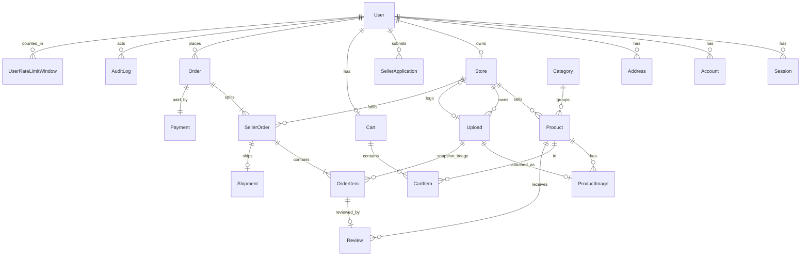

# Data Model

Owner: database agent. This describes schema v1 **as built**; it began as the design and was corrected on 2026-10-11 after the T-004 planning review ([reviews/T-004-findings.md](reviews/T-004-findings.md)) and the owner answers in [DECISIONS.md](DECISIONS.md) D-025, and again the same day for the second batch of owner answers, D-026 (OQ-25 to OQ-50), the follow-up answers, D-028, and the technical rulings, D-029. **Schema v1 exists since T-013 (2026-10-11):** `prisma/schema.prisma` and the migration `prisma/migrations/20261011121529_init_schema_v1`. The schema file and the migration are authoritative and this document must match them. [Section 21](#21-schema-v1-as-built-t-013) lists what was built, every constraint and index by name, and what T-013 validated.

The items that were marked "to validate in T-015" depend on the installed Better Auth version; T-015 settled them against Better Auth 1.7.7, and [section 6.1](#61-auth-tables-s19) gives each result with the test that proves it. The items that were marked "to validate in T-013" have been validated against Prisma 7.10.0 and PostgreSQL 18.6; their results are in [section 19.4](#194-to-validate-against-installed-versions). No owner question is open in this document: every one raised here has been answered, and [section 19](#19-open-points) lists the answers and the few technical points that remain for later tasks.

## 1. Conventions

- **Ids.** Rows of the application's own tables have a `String` id generated by Prisma: `@default(cuid(2))`, which gives 24 lower-case letters and digits (variant chosen in T-013: version 1 of cuid is deprecated by its author and exposes the creation time, and ids appear in URLs). Rows created by the auth library (`User`, `Session`, `Account`, `Verification`) get whatever id the library generates, which is not a cuid. Every id is therefore an **opaque string**: no code, check constraint, or URL pattern may assume a length or shape. Two exceptions with non-string ids are stated where they occur (`MarketplaceSettings`, `MaintenanceStatus`: each a single row with `Int` id 1).
- **Time.** All timestamps are UTC, stored as `timestamptz(3)` (`@db.Timestamptz(3)`). Millisecond precision is the precision of a JavaScript `Date`, so a value read by the application and sent back in a `WHERE` compares equal to the stored one. Display conversion to Asia/Bangkok happens in the presentation layer.
- **Money.** Stored amounts are integer satang in `Int` columns whose names end in `Satang`. No `Float` and no `Decimal`. Aggregates are a different type, see [section 11](#11-money-types-bounds-and-aggregates).
- **Timestamps.** `createdAt` on every table (two exceptions, both single-row tables whose row the migration inserts: `MarketplaceSettings`, [section 6.16](#616-marketplacesettings), and `MaintenanceStatus`, [section 6.19](#619-maintenancestatus-sec-100)). `updatedAt` only where rows change after insert. `createdAt` defaults to the database clock. `updatedAt` of the application's tables has the same database default and is also maintained by the Prisma client on every write made through its model API; **a raw `UPDATE` must set `"updatedAt" = now()` itself**, because nothing in the database does it.
- **Status changes.** Every status column is changed only by a conditional update whose `WHERE` names the expected current value (D-024), see [section 7](#7-concurrency-and-guarded-writes).
- **Foreign keys.** Every foreign key has a stated `onDelete`, see [section 14](#14-foreign-keys-and-deletion-policy). The default is `Restrict`.

## 2. Entity overview



Not drawn, because they have no relationship: `MarketplaceSettings` has only the optional `updatedById` key to `User`, and `MaintenanceStatus` (section 6.19) has no foreign key at all.

## 3. Enums

| Enum | Values | Note |
| --- | --- | --- |
| `Role` | `CUSTOMER`, `SELLER`, `ADMIN` | One role per user |
| `ApplicationStatus` | `PENDING`, `APPROVED`, `REJECTED` | On `SellerApplication` only |
| `StoreStatus` | `APPROVED`, `SUSPENDED` | A store row exists only after approval, so no `PENDING` or `REJECTED` (finding B3) |
| `ProductStatus` | `DRAFT`, `PUBLISHED`, `ARCHIVED` | The seller's own switch |
| `ModerationStatus` | `PENDING`, `APPROVED`, `REJECTED`, `TAKEN_DOWN` | The admin's decision. `TAKEN_DOWN` is the target state of a takedown (finding S5) |
| `PaymentStatus` | `PENDING`, `PAID`, `FAILED` | `REFUNDED` is removed from v1: the system records no refund (OQ-08), so the value would be unreachable. Adding an enum value later is a non-destructive migration |
| `PaymentProvider` | `MOCK` | Labels simulated payments permanently (D-011) |
| `FulfilmentStatus` | `PENDING`, `PROCESSING`, `SHIPPED`, `DELIVERED`, `CANCELLED` | |

## 4. State machines

Anything not listed is rejected. Each row is one guarded update ([section 7.6](#76-status-columns-and-what-each-guarded-update-needs)).

### 4.1 Seller application, store, and role (B3)

Application status lives on `SellerApplication`. Store status holds only states a store can actually be in.

| Entity | From | To | Who | Effect |
| --- | --- | --- | --- | --- |
| `SellerApplication.status` | (new row) | `PENDING` | Customer | Only when the user has no store (BR-06) and no other `PENDING` application |
| `SellerApplication.status` | `PENDING` | `APPROVED` | Admin | In **one transaction**: the application becomes `APPROVED`; a `Store` row is **created** with status `APPROVED`, taking `name`, `description`, and `contactPhone` from the application and a generated slug; `User.role` changes `CUSTOMER` to `SELLER` |
| `SellerApplication.status` | `PENDING` | `REJECTED` | Admin, reason required | No store is created. The role stays `CUSTOMER`. The user may submit a new application (a new row) |
| `Store.status` | `APPROVED` | `SUSPENDED` | Admin, reason required | Role stays `SELLER`. Sessions are **not** revoked ([section 6.1](#61-auth-tables-s19)) |
| `Store.status` | `SUSPENDED` | `APPROVED` | Admin, reason required | |

- **When the role changes:** exactly once, in the approval transaction, guarded by `WHERE role = 'CUSTOMER'`. It never changes back: a suspended seller is still a `SELLER`. Because a user has a single role, an `ADMIN` cannot become a seller; an application from a user whose role is not `CUSTOMER` cannot be approved.
- Approval always **creates** the store (REQ-A-03: "Approval creates the store"). There is no "activate an existing store" case, because a user who already owns a store cannot apply.
- A user with a `PENDING` or `REJECTED` application and no store is a `CUSTOMER` with no `Store` row. "Seller, any status" therefore means: role `SELLER` with a store that is `APPROVED` or `SUSPENDED`.
- `ADMIN` is written only by the bootstrap script (OQ-13). No service function sets it. The script may be run again to create further admins (D-026, OQ-37), and it **only ever inserts a new user** with the role `ADMIN`; it never changes the role of an existing row (D-028):

  | The email given to the script | What the script does | Rows changed |
  | --- | --- | --- |
  | Has no account | Inserts the user with role `ADMIN` and its credential account directly, in the auth library's formats, in one transaction (see below) | one `User`, one `Account` inserted |
  | Belongs to an account whose role is `ADMIN` | Finishes without change (not an error) | none |
  | Belongs to an account whose role is `CUSTOMER` or `SELLER` | **Refuses** | none |

  The unique constraint on the email is the backstop: if the script's lookup and its insert race with a sign-up for the same address, the insert fails and nothing is promoted. A seller therefore can never become an admin, which keeps "one role per user" and "an admin owns no store" true without a constraint.

  **How the admin rows are written (D-035, CR-53).** The script does not go through the auth library. The library declares `role` as a field no input may set (`input: false` in `src/server/auth/auth.ts`), so a user it creates is always a `CUSTOMER`; creating one and then raising its role would be an update of an existing row to `ADMIN`, which [section 7.6](#76-status-columns-and-what-each-guarded-update-needs) forbids ("No statement anywhere updates an existing row to `ADMIN`"). The script (`src/modules/auth/bootstrap-admin.ts`, `bootstrapAdmin`) therefore inserts both rows itself with Prisma, inside one `$transaction`, in the formats the library would write:

  - `User.id` and `Account.id`: the library's id format, 32 characters of `a-z`, `A-Z`, `0-9` (`generateRandomString` from `better-auth/crypto`);
  - `User.email`: trimmed and lower-cased, as the library stores it; `emailVerified` `false`, `isActive` `true`;
  - `Account`: `providerId` `credential`, `accountId` equal to the user id, `password` the library's own `hashPassword` (scrypt, the hasher the instance in `src/server/auth/auth.ts` uses, since it configures no other).

  A unique violation on the email (a racing sign-up or a second run) rolls the whole transaction back, so no user without an account is left behind. The integration test "creates an active ADMIN with a credential account, and the admin can sign in" (`tests/integration/auth/bootstrap-admin.test.ts`) proves the formats: the admin signs in through `POST /api/v1/auth/sign-in`.

  Consequence: **the library's `databaseHooks.user.*` do not run for an admin created this way.** None is configured today (`auth.ts` has only `databaseHooks.session.create.before`, which does run when the admin signs in). Anyone who adds a user hook must make the script do the same work, or record why admins are exempt.

### 4.2 Product status and moderation (S5, OQ-04, OQ-05, OQ-06, OQ-35, OQ-36, OQ-42)

Two independent columns. `Product.status` is the seller's switch; `Product.moderationStatus` is the admin's decision. Approval is always required: there is no setting that turns it off (OQ-04), and `MarketplaceSettings` has no such column.

`Product.status`:

| From | To | Who |
| --- | --- | --- |
| (new row) | `DRAFT` | Seller |
| `DRAFT` | `PUBLISHED` | Seller. When the product's `moderationStatus` is `PENDING`, the same statement sets `moderationRequestedAt = now()`: publishing is what submits it for approval (D-028) |
| `PUBLISHED` | `DRAFT` | Seller (unpublish) |
| `DRAFT`, `PUBLISHED` | `ARCHIVED` | Seller (archive, or delete of a product that orders reference) |

`ARCHIVED` is final in v1: no requirement and no endpoint restores an archived product.

Every row of this table, and every other seller write to a product, is refused while the seller's store is `SUSPENDED` (D-028; [section 7.7](#77-suspended-store-which-statements-carry-the-store-status-d-028)).

`Product.moderationStatus`:

| From | To | Trigger |
| --- | --- | --- |
| (new row) | `PENDING` | Product created |
| `PENDING` | `APPROVED` | Admin approves. **Only when `status = 'PUBLISHED'`** (D-028) |
| `PENDING` | `REJECTED` | Admin rejects, reason required. **Only when `status = 'PUBLISHED'`** (D-028) |
| `APPROVED` | `TAKEN_DOWN` | Admin takes down, reason required. Unchanged by D-028: no condition on `status` |
| `APPROVED` | `PENDING` | Seller changes **moderated content** (OQ-05). A price change does **not** do this |
| `REJECTED`, `TAKEN_DOWN` | `PENDING` | Seller saves a **correction**: a change to moderated content **or to the price** (OQ-06, OQ-36; D-028) |

**Moderated content.** Four things, and nothing else:

1. `title`
2. `description`
3. `categoryId`
4. the **set** of pictures: which uploads are attached to the product, compared as the set of `ProductImage.uploadId` values, **without regard to `sortOrder`**

**Not moderated:** `priceSatang`, `stock`, `sku`, `status`, and **the order of the pictures**, including which picture is first (D-026, OQ-35). A change to these applies at once and does not touch `moderationStatus` (OQ-05), with **one exception for the price**, below.

**The price is treated in two different ways, on purpose (D-025, OQ-05; D-028).**

| Stored `moderationStatus` | A save that changes `priceSatang` and no moderated content |
| --- | --- |
| `APPROVED` | Takes effect at once. The product stays `APPROVED` and on sale. No re-approval (OQ-05) |
| `PENDING` | Takes effect at once. The product stays `PENDING` and keeps its place in the queue |
| `REJECTED`, `TAKEN_DOWN` | **Is a correction: the product returns to `PENDING`** (D-028). A product may have been rejected for its price, so changing the price is a way to answer the rejection |

So the price is never part of the moderated content, and a price change never hides a product that is on sale. It matters to moderation in exactly one place: as a way **out of** `REJECTED` or `TAKEN_DOWN`. A change only to `stock`, only to `sku`, or only to the order of the pictures is not a correction and leaves a rejected or taken-down product where it is.

**Picture change against picture reorder (D-026, OQ-35; DM-Q4 answered).** The owner decided against the reading this section was first written for.

| What the seller did | Set of `uploadId` values | Moderated content changed? |
| --- | --- | --- |
| Added a picture | grows | Yes |
| Removed a picture | shrinks | Yes |
| Replaced a picture (one removed, another added) | same size, different members | Yes |
| Changed the order, or which picture is first | identical | **No** |
| Changed the order and also added, removed, or replaced one | different | Yes |

Why comparing upload ids is enough: an `Upload` row and its bytes never change after insert, and a key is never reused ([section 6.7](#67-upload-s8)). Two saves that attach the same upload ids therefore show exactly the same pictures, so a seller cannot swap what a picture shows and present it as a reorder. Uploading the same file again creates a new upload with a new id; attaching it is a replacement and needs approval.

**How a save is classified.** The seller's edit runs in one transaction that locks the product row (`SELECT ... FROM "Product" WHERE id = :id AND "storeId" = :actorStoreId FOR UPDATE`; it comes after the store's share lock and, when the request sends a category, the category's, [section 7.5](#75-lock-order)), then reads the stored `title`, `description`, `categoryId`, `priceSatang`, `moderationStatus`, and the product's current `uploadId` values, and compares them with the values about to be stored (text is compared after whatever trimming or normalisation the service applies before storing, so a save that stores the same bytes is "no change"). The row lock makes the comparison and the write one step with respect to a second edit by the same seller and to an admin decision.

| Outcome of the comparison | `contentRevision` | `moderationStatus` | `moderationRequestedAt` |
| --- | --- | --- | --- |
| Moderated content differs | `+ 1` | `APPROVED`, `REJECTED`, `TAKEN_DOWN` become `PENDING`; `PENDING` stays | Set to `now()` only when the status changed to `PENDING` |
| Moderated content is the same, the price differs, and the stored status is `REJECTED` or `TAKEN_DOWN` | **`+ 1`** | becomes `PENDING` | Set to `now()` |
| Moderated content is the same, the price differs, and the stored status is `APPROVED` or `PENDING` | unchanged | unchanged | unchanged |
| Only the picture order, the SKU, or both differ | **unchanged** | **unchanged** | unchanged |
| Nothing differs | unchanged | unchanged (OQ-36: no resubmission without a change) | unchanged |

(Stock is changed by its own statement, which never reads or writes these three columns.)

**What `contentRevision` counts.** It increases by one in exactly two cases: the moderated content changed, or the save resubmitted the product (moved it from `REJECTED` or `TAKEN_DOWN` to `PENDING`). The second case is new with D-028 and is the only one in which a price change raises it. Put as one rule: **every seller save that changes what an admin is asked to decide on raises the revision; nothing else does.**

Why a price-only resubmission raises it, although the price is not moderated content: an admin screen that still shows the product as it was **before** it was rejected holds the old revision and the old price. Without the increase, an approve sent from that stale screen would match the product again once the seller's price change returned it to `PENDING`, and the product would go live on a decision made about the rejected price. With the increase the stale decision fails on its revision and the admin reloads and sees the new price.

Why a price change on an `APPROVED` or `PENDING` product does not raise it: the price is not something the admin approves (OQ-05), the seller may change it the moment after approval anyway, and raising the revision without hiding the product would let a seller defeat a takedown by changing the price repeatedly, the same hazard as for a reorder below. Known consequence, accepted with OQ-05: an admin can approve a `PENDING` product whose price changed after they opened it.

**A pure reorder does not raise `contentRevision`** (the answer to the point API_CONTRACTS.md section 8.2 left for this document). Reasons:

- The admin still approves what they were shown. A decision is guarded by the `contentRevision` the admin saw, so the title, description, category, and every picture that goes live are the ones on the admin's screen. The only thing that can differ is the order of pictures the admin did see, and the owner decided that the order is not subject to approval.
- A reorder never hides the product: `moderationStatus` is not touched, so an `APPROVED` product stays in the shop and a `PENDING` one keeps its place in the queue (`moderationRequestedAt` unchanged).
- If a reorder raised the revision without changing the status, a seller could keep reordering an `APPROVED` product to make every admin takedown fail on a stale revision while the product stayed on sale. With the rule above, the only edits that invalidate an admin decision are edits that also send the product to `PENDING` and so hide it.
- An admin decision and a reorder that arrive together cannot conflict: neither changes a column the other is guarded by.

A reorder is still a write to the product: `Product.updatedAt` changes and the `ProductImage` link rows are replaced ([section 6.8](#68-productimage)).

**Hidden while waiting.** Visibility requires `APPROVED` ([section 5](#5-visibility-and-purchasability)), so a product that returns to `PENDING` disappears from the shop and cannot be bought until it is approved again. No copy of the previously approved content is kept.

**Resubmission (OQ-06; D-026, OQ-36).** There is no separate resubmit action and no column for one. A `REJECTED` or `TAKEN_DOWN` product returns to `PENDING` as part of the seller's save, in the same statement.

**What counts as a correction (D-028; DM-Q8 answered).** A change to `title`, `description`, `categoryId`, the set of pictures, **or `priceSatang`**. A save that changes only `stock`, only `sku`, or only the order of the pictures does not resubmit, and neither does a save in which nothing differs from the stored values; such a save writes nothing to the three moderation columns. No column was added for this rule.

`moderationNote` holds the reason of the last rejection or takedown. It stays readable to the seller while they correct the product and is cleared on approval.

**Approving what was actually reviewed.** `contentRevision` (an integer) increases by one in the same statement as every change to moderated content and every resubmission. An admin decision (approve, reject, take down) is guarded by `moderationStatus` **and** by the `contentRevision` the admin was shown. Without it a seller could change the text, or swap a picture, in the moment between the admin opening the product and pressing approve, and the unseen content would go live. A seller's edit holds the product row lock while it writes; an admin decision that arrives meanwhile waits, then evaluates its guard against the new row and affects zero rows, which is a conflict.

**The approval queue (D-026, OQ-42; DM-Q3 answered).** The queue is the products with `moderationStatus = 'PENDING'` **and** `status = 'PUBLISHED'`, ordered by `moderationRequestedAt`, oldest first, then `id`. A product the seller has saved but not yet published is not in it; it enters when the seller publishes it and leaves without a decision if the seller unpublishes or archives it. This is a query filter and changes no column.

**Decisions only on what is in the queue (D-028).** An admin can approve or reject a product only while it is `PENDING` **and** `PUBLISHED`. The guard of both statements is `"moderationStatus" = 'PENDING' AND status = 'PUBLISHED' AND "contentRevision" = :seen`. Opening an unpublished product directly and deciding on it affects zero rows, as does a decision that races with the seller unpublishing or archiving it. Takedown is unchanged: `"moderationStatus" = 'APPROVED' AND "contentRevision" = :seen`, with no condition on `status`.

**`moderationRequestedAt` is the time the product was submitted for approval (D-028; the proposal made here, accepted).** It is set to `now()` by two events, and by nothing else:

1. the product enters `PENDING` (created; an edit of moderated content on an `APPROVED` product; a correction of a `REJECTED` or `TAKEN_DOWN` one);
2. the seller publishes a product whose `moderationStatus` is `PENDING` (`DRAFT` to `PUBLISHED`).

The queue is ordered by it, oldest first, then `id`. A draft that sat unpublished for weeks therefore joins the queue at the back on the day it is published, and unpublishing and publishing again moves a product to the back, never forward. Editing a product that is already `PENDING` raises `contentRevision` and leaves `moderationRequestedAt` alone, so a seller who fixes a typo while waiting does not lose their place.

### 4.3 Payment status, on `Order` (M2, OQ-07, D-023)

| From | To | Trigger |
| --- | --- | --- |
| (new row) | `PENDING` | Checkout transaction |
| `PENDING` | `PAID` | Mock provider confirms. The same statement sets `Order.paidAt = now()` |
| `PENDING` | `FAILED` | Mock provider declines, or the order was still `PENDING` **15 minutes** after it was created (D-023 point 6; D-028) |

`PAID` and `FAILED` are final in v1. A failed order is never paid again (OQ-07); the customer checks out again, which creates a new order with a new idempotency key.

**The payment timeout is 15 minutes (D-028), and it is configuration, not a column.**

- It is one validated configuration value with the default 15 (minutes), read by the function that fails overdue orders. Its name and file are for backend-api and devops (`src/server/env.ts` is where validated configuration lives). It is not a column of `MarketplaceSettings`: no admin screen changes it and no requirement asks for one, and it is not copied onto the order, because an order is overdue by its own `createdAt`.
- Reason for configuration rather than a constant in code: tests of the timeout path must be able to shorten it without waiting 15 minutes.
- An order is overdue when `"paymentStatus" = 'PENDING' AND "createdAt" < now() - :timeout`. The index on `Order(paymentStatus, createdAt)` serves exactly this.
- Failing an overdue order is the guarded failure transaction of [section 7.2](#72-payment-completion-and-payment-failure-oq-07-oq-26-oq-27-oq-41). A confirmation that arrives after the order was failed affects zero rows and changes nothing; a timeout that arrives after the order was paid likewise.
- What calls that function when no customer request does is the same missing piece as for the session purge ([section 6.1](#61-auth-tables-s19)): nothing runs on a schedule yet. Until something does, an overdue order is failed only when a code path that calls the function happens to run (D-023 point 6 names the checkout path and a script). This is a request to the orchestrator and devops, not a schema matter.

### 4.4 Fulfilment status, on `SellerOrder` (OQ-08, OQ-17, OQ-34, OQ-41)

| From | To | Who | Condition and effect |
| --- | --- | --- | --- |
| (new row) | `PENDING` | Checkout transaction | |
| `PENDING` | `PROCESSING` | Seller | Only when the order's `paymentStatus` is `PAID`, checked in the same statement |
| `PROCESSING` | `SHIPPED` | Seller | Creates the `Shipment` row |
| `SHIPPED` | `DELIVERED` | Seller or admin | Sets `Shipment.deliveredAt`. This is the **only** exit from `SHIPPED` (OQ-17) |
| `PENDING`, `PROCESSING` | `CANCELLED` | Seller or admin | Restores stock once ([section 7.3](#73-stock-is-restored-at-most-once-b5)). Allowed when the order is already `PAID` (OQ-08). A seller can do this only when the order is `PAID`, because a seller does not see the order before that (OQ-41, [section 7.2](#72-payment-completion-and-payment-failure-oq-07-oq-26-oq-27-oq-41)); an admin can do it whatever the payment status |
| `PENDING` | `CANCELLED` | System | Payment failed ([section 7.2](#72-payment-completion-and-payment-failure-oq-07-oq-26-oq-27-oq-41)) |

`DELIVERED` and `CANCELLED` are final.

**Cancelled after payment (OQ-08).** The order's `paymentStatus` stays `PAID`. No refund row, refund amount, or refund status exists anywhere. What the customer is shown is derived, not stored:

| `SellerOrder.fulfilmentStatus` | `Order.paymentStatus` | Meaning |
| --- | --- | --- |
| `CANCELLED` | `PAID` | "ยกเลิกแล้ว คืนเงินนอกระบบ": cancelled, refund handled outside the system |
| `CANCELLED` | `FAILED` | Payment failed; nothing was charged |
| `CANCELLED` | `PENDING` | Cancelled by an admin before the payment finished (rare; a seller cannot, OQ-41; see section 7.2) |

**Sales, revenue, and order counts (OQ-08; D-026, OQ-34).** No figure is stored; each is computed from rows ([section 11](#11-money-types-bounds-and-aggregates)).

- **Which seller orders count.** A seller order counts only when `Order.paymentStatus = 'PAID'` **and** `SellerOrder.fulfilmentStatus <> 'CANCELLED'`.
- **Sales and revenue are the price of the goods only.** Every sales or revenue amount is the sum of `SellerOrder.itemsSubtotalSatang` over the seller orders that count. **`shippingFeeSatang` is never part of any sales or revenue figure**, and neither is `Order.shippingTotalSatang` or `Order.grandTotalSatang`. `Order.itemsSubtotalSatang` must not be used either: it still contains the goods of cancelled seller orders.
- **Order count.** An order counts once when `Order.paymentStatus = 'PAID'` and at least one of its seller orders is not `CANCELLED`. In SQL: `COUNT(DISTINCT "orderId")` over the seller orders that count. An order with only some stores' parts cancelled is therefore one order; an order whose every part is cancelled is not counted; an order whose payment is `PENDING` or `FAILED` is not counted.
- **Per store.** For one store the same rule gives the number of its seller orders that count, because `(orderId, storeId)` is unique.
- **Which date a report's range uses (D-028): the date the order was paid.** A seller order belongs to a range `[from, to)` when its order's `paidAt` is in it: `o."paidAt" >= :from AND o."paidAt" < :to`. `Order.paidAt` is set once, when the payment becomes `PAID` ([section 6.10](#610-order)), and is indexed for this. An order created before midnight and paid after it belongs to the later day. Because only paid orders count, every order that counts has a `paidAt`. A later cancellation removes the seller order from the figures of the range its payment fell in; it does not move it to another range.
- The admin dashboard summary (D-028) shows the same order count and sales total over all time, with no range.

`SellerOrder.itemsSubtotalSatang` is written once in checkout as the sum of the seller order's `OrderItem.lineTotalSatang`, at the unit prices copied at purchase, and never changes; cancelling removes the whole seller order from the figures rather than changing an amount.

### 4.5 User activation (OQ-14, OQ-31, OQ-32)

| From | To | Who | Effect |
| --- | --- | --- | --- |
| `isActive = true` | `false` | Admin; not self, not the last active admin | Every `Session` row of the user is deleted in the same transaction. **No order, seller order, product, store, or stock value is changed** |
| `isActive = false` | `true` | Admin | The user must log in again. Nothing else is written |

**The store comes back by itself (D-026, OQ-31).** Deactivating a user who owns a store does not change `Store.status` or any product. The store and its products are hidden because visibility reads the owner's `isActive` at the moment of each request ([section 5](#5-visibility-and-purchasability)). Reactivating the owner therefore brings the store and its products back with no further write and no job, in exactly the state from before, including a suspension that was already in place. The same holds for a category that is switched off and on again. This works only because nothing is copied or flagged at deactivation; no code may "hide" products by writing to them.

**Paid orders of a deactivated owner (D-026, OQ-32; DM-Q6 answered).** A deactivated seller cannot log in, so their paid seller orders cannot be moved to `PROCESSING` or `SHIPPED` by anyone (an admin may only cancel or mark delivered). **Nothing is automatic.** The admin cancels those seller orders by hand, one at a time, through the ordinary guarded cancel of [section 7.4](#74-cancelling-a-seller-order), which restores stock once and leaves the payment `PAID`. Deactivation writes nothing to `SellerOrder`; there is no column, trigger, or job for this case. The seller orders that need attention are found with the existing index on `SellerOrder(storeId, fulfilmentStatus, createdAt)`.

## 5. Visibility and purchasability

One definition, used by the catalog, the cart flags, and checkout.

A product is **visible** when all of these hold:

1. `Product.status = 'PUBLISHED'`
2. `Product.moderationStatus = 'APPROVED'`
3. `Store.status = 'APPROVED'` for its store (BR-14)
4. the store owner's `User.isActive = true` (OQ-14)
5. `Category.isActive = true` for its category (OQ-10)

A store page is public when conditions 3 and 4 hold for the store.

A product is **purchasable** in quantity `q` when it is visible and `stock >= q`. Stock is **not** part of visibility: a visible product with `stock = 0` stays in listings and on its page, marked "สินค้าหมด" (OQ-11).

Switching a category off (OQ-10) hides its products everywhere (search, store pages, product pages) and makes them unbuyable, through condition 5 alone; no product row is changed, so switching it back on restores them by themselves (D-026, OQ-31). The same is true of condition 4 and a reactivated store owner ([section 4.5](#45-user-activation-oq-14-oq-31-oq-32)).

A seller cannot create a product in, or move a product to, a category whose `isActive` is false (D-026, OQ-39). This is a service check on the write; the foreign key cannot express it, and a product already in a category that is switched off later keeps its `categoryId`.

### 5.1 Low-stock and sold-out figures (OQ-12; D-026, OQ-33)

Two separate figures for the seller, both counted **only over products that are on sale**:

| Figure | Condition on `stock` |
| --- | --- |
| Low stock | `stock BETWEEN 1 AND 5` |
| Sold out | `stock = 0` |

- A product with `stock = 0` is **not** low stock. The earlier `stock <= 5` is replaced.
- **On sale** means exactly `status = 'PUBLISHED' AND "moderationStatus" = 'APPROVED'`. It reads the product's own two columns and nothing else.
- A product that is published but still awaiting approval (`PENDING`) is **not** on sale and is in neither figure (D-028; DM-Q10 answered). So are drafts, archived, rejected, and taken-down products.
- A published, approved product that is hidden because its store is suspended or its category is switched off **is still counted** (D-028; DM-Q11 answered): the seller still sees what needs restocking. "On sale" is therefore **not** the same as "visible"; the filter must not join `Store.status`, the owner's `isActive`, or `Category.isActive`.
- The figures are query filters over existing columns. No column or index is added: the count is per store and is served by the index on `Product(storeId, status)`.
- The number 5 is a fixed business rule, not an admin setting, so it is not stored in the database: it is one exported constant, `LOW_STOCK_THRESHOLD = 5`, in the seller product module under `src/modules` (backend-api chooses the file), and nothing else repeats the number. The lower end of the range is 1 because 0 is the sold-out figure.
- The public "สินค้าหมด" mark is a different thing: it is simply `stock = 0` on a visible product (OQ-11).

## 6. Tables

`?` marks a nullable column. "timestamps" means `createdAt` and `updatedAt`.

### 6.1 Auth tables (S19)

The auth library is Better Auth (D-004), pinned at **1.7.7** (D-031). It owns four tables. **T-013 created them from the published schema of that version.** T-015 installed exactly 1.7.7 (`package.json`: `"better-auth": "1.7.7"`) and runs it against these tables through its Prisma adapter. No difference was found and no corrective migration was needed: `20261011121529_init_schema_v1` is still the only migration. The proof is the auth integration suite (`tests/integration/auth/`), in which the running library creates and reads `User`, `Account`, and `Session` rows (sign-up, sign-in, session read, sign-out, `updateUser`); on 2026-10-13 `pnpm test:integration tests/integration/auth` passed 4 files, 59 tests. `Verification` is not used by any flow the application offers (email verification is off, and the library's own endpoints are not mounted), so no test writes to it. If the library version ever changes, a difference becomes a new corrective migration (the applied one is not edited).

**Where the columns come from.** The core table definitions of `@better-auth/core` 1.7.7 (`getAuthTables`, file `dist/db/get-tables.mjs` of the published package), translated to Prisma the way the library's own command-line tool does it (`auth` 1.7.7, its Prisma generator for PostgreSQL). The packages were read as data; nothing from them was installed or run. Every column below is from that definition, with its type, nullability, default, uniqueness, index, and `onDelete`. The three columns this application adds to `User` are listed after the table.

| Table | Columns as created (all from Better Auth 1.7.7) |
| --- | --- |
| `User` | `id` (`String`, primary key, no database default: the library generates it), `name`, `email` (unique, `User_email_key`), `emailVerified` (`Boolean`, default `false`), `image?`, `createdAt` (default `now()`), `updatedAt` (`@updatedAt`, no database default) |
| `Session` | `id`, `expiresAt`, `token` (unique, `Session_token_key`), `createdAt` (default `now()`), `updatedAt` (`@updatedAt`), `ipAddress?`, `userAgent?`, `userId` FK to `User` with `onDelete: Cascade`, indexed |
| `Account` | `id`, `accountId`, `providerId`, `userId` FK to `User` with `onDelete: Cascade`, indexed, `accessToken?`, `refreshToken?`, `idToken?`, `accessTokenExpiresAt?`, `refreshTokenExpiresAt?`, `scope?`, `password?` (the password hash), `createdAt` (default `now()`), `updatedAt` (`@updatedAt`). The token columns are unused with email and password and are kept because the library defines them |
| `Verification` | `id`, `identifier` (indexed, `Verification_identifier_idx`: the library defines this index), `value`, `expiresAt`, `createdAt` (default `now()`), `updatedAt` (`@updatedAt`) |

Every text column is `String` (`text`), every time column `DateTime`.

**Three deliberate differences from what the library's tool would write.** T-015 confirmed that the library works with all three: the same integration suite runs against these model names, `timestamptz` columns, and the extra index.

| Difference | Reason |
| --- | --- |
| No `@@map("user")`, `@@map("session")`, `@@map("account")`, `@@map("verification")`: the tables are named `"User"`, `"Session"`, `"Account"`, `"Verification"` | Every statement in this document and in DEPLOYMENT.md names them that way (`DELETE FROM "Session" ...`). The library's Prisma adapter addresses Prisma models (`user`, `session`, ...), not tables, so it is not expected to notice |
| `@db.Timestamptz(3)` on every time column; the tool writes plain `DateTime` (`timestamp(3)` without time zone) | Section 1: every timestamp is `timestamptz` |
| The index `Session(expiresAt)` (`Session_expiresAt_idx`) | Added by this application for the purge below; the library does not define it |

Because `updatedAt` of these four tables has no database default (as in the library's schema), a raw `INSERT` into them must supply it. The application never inserts into them by raw SQL. Sessions are created only by the library. Users and accounts are created by the library at sign-up, with one exception: the admin bootstrap script inserts its `User` and `Account` rows itself through the Prisma model API (which supplies `updatedAt`), in the library's formats and in one transaction ([section 4.1](#41-seller-application-store-and-role-b3), D-035).

Columns this application adds to `User`:

| Column | Type | Written by | Never written by |
| --- | --- | --- | --- |
| `role` | `Role`, default `CUSTOMER` | The application-approval service (`CUSTOMER` to `SELLER`); the admin bootstrap script (`ADMIN`) | Sign-up, profile update, any request body |
| `isActive` | `Boolean`, default `true` | The admin user-management service | Sign-up, profile update, any request body |
| `phone?` | `String` | The profile service (`PATCH /me`), for the acting user only | Sign-up |

- **Not client-settable.** The three columns are declared to the library as additional fields that do not accept input, so a sign-up or library update request carrying `role`, `isActive`, or `phone` cannot set them. Settled in T-015: the option is `input: false` on each of the three `user.additionalFields` in `src/server/auth/auth.ts`. A value sent straight to the library at sign-up is replaced by the default, and an update through the library is refused with `400`. Proved by "role sent straight to the library at sign-up is replaced by CUSTOMER" and "role in a profile update through the library is refused and changes nothing" (`tests/integration/auth/guards-and-escalation.test.ts`). The database defaults make a row created without them a plain active customer.
- **Ids.** Rows in these four tables have the library's id format: 32 characters of `a-z`, `A-Z`, `0-9`. The library generates them, except for the bootstrap script's `User` and `Account`, which the script generates with the library's own `generateRandomString` (section 4.1). See [section 1](#1-conventions): ids are opaque. The seed (T-014) cannot create sellers through the library either, because sign-up always gives `CUSTOMER`; it will insert its users the same way as the bootstrap script, so that ids and password hashes have the library's format.
- **Email** is stored lower-cased and is unique. Settled in T-015: the library lower-cases the email itself at sign-up and at sign-in (Better Auth 1.7.7, `dist/api/routes/sign-up.mjs` and `sign-in.mjs`), and the bootstrap script does the same. The unique constraint `User_email_key` is therefore enough, and no index on `lower(email)` is added. Proved by "stores the email lower-cased and trimmed" (`tests/integration/auth/sign-up-sign-in.test.ts`) and "stores the email lower-cased and trimmed, so sign-in in any letter case works" (`tests/integration/auth/bootstrap-admin.test.ts`).
- `emailVerified` and `image` exist only because the library requires them. No feature reads them in the MVP.

**Sessions, suspension, and deactivation.** D-004 says database sessions allow revocation "on logout, deactivation, and suspension". BR-14 requires a suspended store's seller to stay able to log in and fulfil existing orders. The model resolves it this way:

| Event | Sessions | How the restriction takes effect |
| --- | --- | --- |
| Logout | That `Session` row is deleted | |
| **User deactivation** | **All of the user's `Session` rows are deleted**, in the transaction that sets `isActive = false` | Sign-in is refused while inactive; `requireActor` also reads `isActive` on every request |
| **Store suspension** | **Not touched** | `requireActor` reads `Store.status` from the database on every request, so the suspended seller is blocked from creating, publishing, and selling at once, and keeps access to existing seller orders (BR-14) |

No role, status, or store id is cached in the session or the cookie; the library's session cookie cache is off. Settled in T-015: `session.cookieCache: { enabled: false }` in `src/server/auth/auth.ts`. Proved by "are Secure, HttpOnly, SameSite=Lax, Path=/, with the __Host- prefix and a bounded Max-Age" (`tests/integration/auth/limits-and-cookies.test.ts`): a sign-in sets exactly one cookie, the session token, and no cookie-cache cookie.

**Login IP address and browser details (OQ-22; D-026, OQ-49).** `Session.ipAddress` and `Session.userAgent` are the only place the database stores them. They are personal data. They must disappear when the session ends, and **within one day of its expiry** when nobody ended it:

- logout and deactivation delete the row, at once;
- an expired row is deleted by a purge, `DELETE FROM "Session" WHERE "expiresAt" < now()`. The statement is safe to run at any time and any number of times, and is served by the index on `Session(expiresAt)`;
- the library does **not** delete an expired session when its cookie is presented. Settled in T-015: the session is refused and the row is left for the purge, because reading a session writes nothing (D-029 point 1; D-031 point 6). Proved by "refuses an expired session, writes nothing while reading it, and the purge removes it" (`tests/integration/auth/sign-up-sign-in.test.ts`). Request handling would not have been enough anyway: an abandoned session is never presented again;
- no other table, and no audit entry, copies these two values.

**The limit and the interval.** The binding limit is the owner's: no `Session` row may exist more than **24 hours** after its `expiresAt` (OQ-49). The purge interval this document asks for stays **one hour**, which was the earlier design and is stricter. The reason for keeping it is margin, not a stricter promise: with a purge once a day, a row that expires just after a run already waits almost the full 24 hours, so one late or failed run breaks the limit; with an hourly purge, about a full day of runs in a row has to fail first.

**How it is guaranteed, stated plainly.** At the time of writing **nothing guarantees it**: no session code exists, and nothing in the system runs on a schedule (KNOWN_LIMITATIONS.md; SECURITY.md SR-07). A row can only be deleted by something that runs, and an abandoned session produces no request, so the limit cannot be met by request handling alone. What has to exist, and who owns it:

| Part | What it does | Is it a guarantee? | Owner |
| --- | --- | --- | --- |
| The purge statement above, as one function | Deletes every expired row | It is the mechanism; it guarantees nothing until something calls it | auth (T-015) |
| A run that happens without any visitor, at least hourly | Calls the purge | **Yes, this is the guarantee**, for as long as the thing that triggers it is running. It does not exist yet | devops schedules it; the orchestrator decides what the trigger is, because the MVP has no job runner |
| The same purge called when the application starts and on every sign-in | Shortens the wait on a busy system, and cleans up after downtime before the first visitor is served | No: with no start and no sign-in it never runs | auth |
| A check: `SELECT count(*) FROM "Session" WHERE "expiresAt" < now() - interval '1 day'` must return 0 | Shows that the limit is being met, or that it is not | It proves a breach; it prevents nothing | auth writes the test for T-015; devops may add it to monitoring |

Consequences that follow from this:

- Until the scheduled run exists, the limit is met only by accident. It must exist before any environment that holds real people's sessions; that is a condition on T-015 being `VERIFIED` and on any deployment, and is reported to the orchestrator as a request, not solved in the schema.
- If the scheduler or the whole deployment is stopped for more than a day, expired rows outlive the limit until the next start, when the start-up purge removes them. No mechanism inside the database avoids this: the PostgreSQL image in use has no scheduler of its own, and adding an extension for one would be a new dependency, which is not proposed.
- A database backup holds the `Session` rows that existed when it was taken, with their addresses, until the backup itself is deleted. Backups are kept 30 days (D-026, OQ-50), so the one-day limit describes the live database only. **The owner accepted this (D-028)**; it is stated in the privacy notes (SECURITY.md).
- **A restore ends with the session clean-up (D-028).** A restored database contains sessions that have expired since the backup was taken. The restore procedure is not finished until the purge statement above has run against the restored database, and the application does not serve requests before that. The procedure belongs to devops (DEPLOYMENT.md); the statement is the same one.
- D-029 records that the scheduled run **of the session clean-up** is chosen in T-015 together with devops. D-029 says nothing about the overdue-order sweep; that sweep is planned for T-032, on the scheduler T-015 chooses (DEPLOYMENT.md, "Scheduled work").

The address stored in `Session.ipAddress` is the one derived by SECURITY.md SR-01, never a client-controlled header. Settled in T-015: the library's own IP detection is off (`advanced.ipAddress.disableIpTracking`), and the session hook in `src/server/auth/auth.ts` sets the address from `getClientAddress`, storing nothing when it is unknown. Proved by "stores the SR-01 address behind a trusted proxy, never a client-written one" and "stores nothing for an unknown address, even when the client sends X-Forwarded-For" (`tests/integration/auth/limits-and-cookies.test.ts`).

Indexes: `Session(userId)` (revocation; `Session_userId_idx`), `Session(expiresAt)` (purge; `Session_expiresAt_idx`), `Account(userId)` (`Account_userId_idx`), `Verification(identifier)` (the library's; `Verification_identifier_idx`).

### 6.2 Address

`id`, `userId` FK, `recipientName`, `phone`, `line1`, `subdistrict`, `district`, `province`, `postalCode`, `isDefault`, timestamps.

- Index `(userId)`.
- At most one default per user: partial unique index `Address_userId_default_key` on `(userId) WHERE "isDefault"` (raw SQL).
- `isDefault` has no database default; the service writes it on every insert.
- `CHECK ("postalCode" ~ '^[0-9]{5}$')` (raw SQL).
- An address may be hard-deleted: orders copy the address, they do not reference it.

### 6.3 Store

`id`, `ownerId` FK unique, `name`, `nameKey` unique (generated by the database from `name`), `slug` unique, `description?`, `logoUploadId?` FK unique, `contactPhone`, `status` (`StoreStatus`, set to `APPROVED` at creation), `statusReason?`, `isSample` (default false), timestamps.

- **Store names are unique after normalisation** (SEC-058, D-041 point 1). `nameKey` is a `STORED` generated column, `store_name_key(name)`, with the unique index `Store_nameKey_key`. Two stores cannot have names that differ only in letter case, character width, white space, or invisible characters. The normalisation, its limits, and how a service uses it: [section 21.7](#217-store-name-key-sec-058-d-041). The application never writes `nameKey`.

- Created only by the approval transaction ([section 4.1](#41-seller-application-store-and-role-b3)). `status` has no database default: that transaction writes `APPROVED` explicitly.
- `slug` is generated once and never changes, also when the store is renamed ([section 9](#9-slugs-s11)).
- `statusReason` holds the reason of the last suspension or reinstatement; the history is in `AuditLog`.
- **The seller may change `contactPhone`**, as well as `name`, `description`, and the logo, without any approval (D-028). It is an ordinary mutable column: no review state, no history, and no copy on orders (an order shows the buyer's shipping phone, not the store's). `SellerApplication.contactPhone` is what the applicant entered and is not changed afterwards.
- While the store is `SUSPENDED` the seller cannot change any of these columns ([section 7.7](#77-suspended-store-which-statements-carry-the-store-status-d-028)).
- Index `(status)` for the admin store list.

### 6.4 SellerApplication

`id`, `userId` FK, `storeName`, `description`, `contactPhone`, `status` (`ApplicationStatus`, default `PENDING`), `reviewedById?` FK, `reviewNote?` (required by the service on rejection), `reviewedAt?`, timestamps.

- At most one `PENDING` application per user: partial unique index `SellerApplication_userId_pending_key` on `(userId) WHERE status = 'PENDING'` (raw SQL).
- Index `(status, createdAt)` for the admin list filtered by status.

### 6.5 Category

`id`, `name`, `slug` unique, `sortOrder`, `isActive` (default true), `isSample` (default false), timestamps. Flat list in the MVP; no hierarchy. Storefront order is `sortOrder`, then `id`. `sortOrder` is an `Int` with no database default.

### 6.6 Product

`id`, `storeId` FK, `categoryId` FK, `title`, `slug` unique, `description`, `sku`, `priceSatang`, `stock`, `status` (default `DRAFT`), `moderationStatus` (default `PENDING`), `moderationNote?`, `moderationRequestedAt`, `contentRevision` (`Int`, default 1), `isSample` (default false), timestamps.

- SKU is unique per store **among products that are not archived**: partial unique index **`Product_storeId_sku_live_key`** on `(storeId, sku) WHERE status <> 'ARCHIVED'` (raw SQL). A duplicate is reported under exactly that name ([section 21.5](#215-how-a-violation-reaches-a-service)). An archived product keeps its SKU value for the record, and the seller may use the same SKU on a new product (M6). Reason: deleting a product that orders reference archives it instead, so to the seller it is gone; refusing its SKU afterwards would be an error they cannot resolve. Order history is unaffected because `OrderItem` stores its own copy of the SKU. This is safe only because `ARCHIVED` is final.
- `slug` is unique across all products for ever, archived ones included. It is never released and never reused (M6). This costs nothing because every slug ends in a random suffix ([section 9](#9-slugs-s11)).
- `CHECK ("priceSatang" BETWEEN 100 AND 100000000)` (BR-02).
- `CHECK (stock BETWEEN 0 AND 1000000000)`. This is the bound of the column, not the seller's entry limit of 1,000,000 (D-026, OQ-40), which is enforced by the guard of the seller's stock statement. [Section 11](#11-money-types-bounds-and-aggregates) explains why the two differ and why the column check cannot be 1,000,000.
- `CHECK ("contentRevision" >= 1)`. It increases by one in exactly two cases: the moderated content changed, or the save resubmitted a `REJECTED` or `TAKEN_DOWN` product, **which includes a resubmission in which only the price changed** (D-031 point 2). A price change on an `APPROVED` or `PENDING` product, and a reorder of pictures, do not raise it ([section 4.2](#42-product-status-and-moderation-s5-oq-04-oq-05-oq-06-oq-35-oq-36-oq-42)).
- **`moderationRequestedAt`** is `timestamptz(3)`, not null, with the database default `now()`. Rule for writes: an insert leaves it to the default, because a new product is `PENDING` and entering `PENDING` is what sets the time; afterwards it is written only by the two events of section 4.2, always as `now()` in the statement that makes the change (the database clock, never a time from the application).
- Indexes: `(status, moderationStatus, categoryId, createdAt)` for storefront listings; `(storeId, status)` for the seller's product list and the low-stock and sold-out counts; `(moderationStatus, moderationRequestedAt)` for the admin queue and the admin list filtered by moderation status. The queue's extra condition `status = 'PUBLISHED'` (OQ-42) is applied to the rows that index returns; no second index is added for it, because the rows with `moderationStatus = 'PENDING'` are few. The earlier draft's index on `(priceSatang)` is dropped: at MVP catalog size a single-column price index does not serve the price sort once the visibility filter is applied. Add an index for it only when a measured query needs one.

### 6.7 Upload (S8)

`id`, `storageKey` unique, `storeId` FK, `contentType`, `sizeBytes`, `createdAt`. Rows are immutable: a key is generated once, its bytes are never overwritten, and no column changes after insert. Rules are in [section 8](#8-uploads-and-images-s7-s8).

- `CHECK ("contentType" IN ('image/jpeg', 'image/png', 'image/webp'))`.
- `CHECK ("sizeBytes" BETWEEN 1 AND 4194304)` (4 MiB, equal to `MAX_UPLOAD_FILE_BYTES` in `src/modules/uploads/schema.ts`; D-051). The first migration set 5 MiB; migration `20261030090000_upload_size_cap_4mib` lowered it (SEC-101, section 21.10).
- Index `(storeId)`.

### 6.8 ProductImage

`id`, `productId` FK cascade, `uploadId` FK unique, `sortOrder`, `createdAt`. A row is only the link between a product and an upload.

- Unique `(productId, sortOrder)` and `CHECK ("sortOrder" BETWEEN 0 AND 7)`: together they make a ninth picture impossible in the database (REQ-S-05). The picture with the lowest `sortOrder` is the primary one.
- Unique `uploadId`: one upload is attached to at most one product.
- Changing the pictures (add, remove, replace, reorder) replaces the product's link rows inside one transaction (delete, then insert), so the unique constraint on `(productId, sortOrder)` never sees a half-finished order. No deferrable constraint is needed. The transaction locks the `Product` row first and compares the old and new **sets of `uploadId`** before it deletes anything: that comparison, not the fact that rows were replaced, decides whether the product needs approval again ([section 4.2](#42-product-status-and-moderation-s5-oq-04-oq-05-oq-06-oq-35-oq-36-oq-42); D-026, OQ-35). A reorder gives the link rows new ids and new `sortOrder` values and changes nothing else; nothing references a `ProductImage` id.
- `sortOrder` is not moderated content. It decides which picture is the primary one from the moment the reorder commits, on the storefront and for the copy an order item takes at purchase ([section 6.12](#612-orderitem)).

### 6.9 Cart and CartItem

`Cart`: `id`, `userId` FK unique, timestamps. Created by the first add-to-cart and never deleted; it is the row checkout locks ([section 7.1](#71-checkout-d-023-oq-30)).

`CartItem`: `id`, `cartId` FK cascade, `productId` FK cascade, `quantity`, timestamps.

- Unique `(cartId, productId)`.
- `CHECK (quantity BETWEEN 1 AND 99)` (BR-03).
- No price is stored in the cart; prices are read live.

**Cart lines against stock (D-025, OQ-23; D-026, OQ-28 to OQ-30).** `CartItem.quantity` is what the customer last asked for, or what a write lowered it to. The database does **not** constrain it by the product's stock: stock moves after the line is written, and a check across two tables is not a `CHECK` constraint. What each rule needs from the model:

| Rule | What happens to the row | Stored marker |
| --- | --- | --- |
| Adding a sold-out product is refused (OQ-28) | No row is inserted and no row is changed | none |
| Asking for more than the stock, with stock at least 1 (OQ-28) | The write (a `POST` or `PATCH`) stores `quantity` equal to the stock, read in the same transaction as the write | none: the response of that write reports it |
| A product in the cart sells out (OQ-29) | **The row stays as it is.** Nothing deletes it and nothing changes its quantity; a quantity of 0 cannot be stored. It is left out of totals and blocks checkout by being read against `stock = 0` | none: derived as `stock = 0` |
| A product in the cart becomes hidden: taken down, rejected, unpublished, archived, its store suspended, its owner deactivated, or its category switched off (D-028) | **The row stays as it is**, exactly like a sold-out line. Nothing deletes it and nothing changes its quantity. It is flagged as not buyable, left out of totals, and blocks checkout by being read against the visibility conditions of [section 5](#5-visibility-and-purchasability). If the product becomes visible again the line can be bought again, with no write | none: derived from visibility |
| Stock drops below a line's quantity, with stock at least 1 (OQ-23, OQ-30) | The row is **not** changed by reading it. It is changed by the next mutation: the customer's own `PATCH`, or the checkout request ([section 7.1](#71-checkout-d-023-oq-30)) | none: derived, see below |
| A product is hard-deleted by its seller (OQ-43; DM-Q5 answered) | The row goes by cascade, with no message | none |

**A read of the cart writes nothing (D-029 point 1; DM-D1 settled).** A `GET` never changes state, without exception. A line is "lowered" when its stored `quantity` is above the product's current `stock` and the stock is at least 1; the cart read computes that from the two existing columns every time and reports the stock as the quantity, and the stored `quantity` stays as it was. The lowering therefore stays reportable on every read until a mutation stores a new quantity, so a lost response loses nothing and no marker column is needed. **There is no `CartItem.loweredFromQuantity`**, and the cart read takes no lock.

The lowered quantity is **stored** only by a mutation: the customer's `PATCH` of the line, an add to the line, or the checkout request that finds it ([section 7.1](#71-checkout-d-023-oq-30); D-029 point 2).

### 6.10 Order

`id`, `orderNumber` unique, `userId` FK, `idempotencyKey`, `paymentStatus` (default `PENDING`), `paidAt?`, `itemsSubtotalSatang`, `shippingTotalSatang`, `grandTotalSatang`, shipping address copy (`shipRecipientName`, `shipPhone`, `shipLine1`, `shipSubdistrict`, `shipDistrict`, `shipProvince`, `shipPostalCode`), timestamps.

- `orderNumber` is filled by the database, see [section 10](#10-order-numbers-s12).
- Unique `(userId, idempotencyKey)` (`Order_userId_idempotencyKey_key`): the backstop behind the cart lock (D-023 point 2). The key is stored in the one normalised form the API layer defines and compared exactly.
- **`idempotencyKey` is a plain `String` (`text`), not null, with no length limit, no format check, and no `uuid` type.** The accepted versions and the normalised form are decided in T-032 (API_CONTRACTS.md section 1.3); the column takes whatever form that task settles on, and a later check constraint for the form would be an additive migration.
- **`paymentStatus` is the only payment status in the model** (M2).
- **`paidAt`** (`timestamptz`, nullable) is the moment the payment became `PAID` (D-028: the sales report's range uses the date the order was paid). The earlier design had no such column; `updatedAt` cannot stand in for it, because any later write to the row moves it. It is null while the order is `PENDING` and for ever when it is `FAILED`. It is written once, by the statement that sets `PAID` ([section 7.2](#72-payment-completion-and-payment-failure-oq-07-oq-26-oq-27-oq-41)), with the database clock, and never changes. It is not a second payment status: the check below ties it to `paymentStatus`, so the two cannot disagree.
- Indexes: `(userId, createdAt)` for the customer's history; `(paymentStatus, createdAt)` for the pending-payment timeout sweep and the admin filter; **`(paidAt)`** for the sales report's date range ([section 4.4](#44-fulfilment-status-on-sellerorder-oq-08-oq-17-oq-34-oq-41)).
- Check: `("paymentStatus" = 'PAID') = ("paidAt" IS NOT NULL)`: a paid order always has the time, and no other order has one.
- Checks: each of the three amounts `>= 0`; `"grandTotalSatang" = "itemsSubtotalSatang"::bigint + "shippingTotalSatang"`; `"grandTotalSatang" <= 2000000000` (BR-04); `"shipPostalCode" ~ '^[0-9]{5}$'`.

### 6.11 SellerOrder

`id`, `orderId` FK, `storeId` FK, `storeName` (the store's name at purchase, OQ-18), `fulfilmentStatus` (default `PENDING`), `itemsSubtotalSatang`, `shippingFeeSatang`, `shippingFeeIsSimulated` (default true), `commissionRateBps` (copy of the setting at purchase), timestamps.

- `storeName` never changes. A later store rename does not alter old orders; order pages read this column, not `Store.name`.
- `shippingFeeIsSimulated` marks the fee as a simulated flat rate, not a carrier quote (M12, BR-08). It is `true` for every row in the MVP and is the stored fact behind the "simulated rate" label.
- Unique `(orderId, storeId)`.
- Index `(storeId, fulfilmentStatus, createdAt)` for the seller's order list.
- Checks: `"itemsSubtotalSatang" >= 0`; `"shippingFeeSatang" BETWEEN 0 AND 100000`; `"commissionRateBps" BETWEEN 0 AND 10000`. The whole-percent rule of OQ-38 is checked on `MarketplaceSettings` only, not here: this column is a copy of what the setting was, and a copy must stay valid whatever rule later applies to the setting ([section 6.16](#616-marketplacesettings)).
- `itemsSubtotalSatang` is the only amount that enters a sales or revenue figure; `shippingFeeSatang` never does ([section 4.4](#44-fulfilment-status-on-sellerorder-oq-08-oq-17-oq-34-oq-41)).
- A seller reads and changes a seller order only when its order's `paymentStatus` is `PAID` (D-026, OQ-41). No column is added for this; every seller statement joins `Order` by its primary key.

### 6.12 OrderItem

`id`, `sellerOrderId` FK, `productId` FK, `productTitle`, `productSku`, `productImageUploadId?` FK, `unitPriceSatang`, `quantity`, `lineTotalSatang`, `stockRestoredAt?`, `cartQuantityBeforeReturn?`, `cartQuantityAfterReturn?`, `createdAt`.

- `productTitle`, `productSku`, and `unitPriceSatang` are copies taken at purchase. `productId` is kept for reference (reviews, re-adding to the cart) and is never used to read a title or a price for an order.
- `productImageUploadId` points at the upload that was the product's primary picture at purchase. Upload rows and their bytes never change, so the reference is a true snapshot, and the foreign key stops the row, and with it the file, from being deleted ([section 8](#8-uploads-and-images-s7-s8), S7).
- `stockRestoredAt` records that this item's stock was put back, and when. It is null until then and is set at most once ([section 7.3](#73-stock-is-restored-at-most-once-b5)).
- `cartQuantityBeforeReturn` and `cartQuantityAfterReturn` are **the stored record of how this item came back to the customer's cart** after its order's payment failed (D-026, OQ-26; the marker backend-api asked for). Both are null for an item that was never returned to a cart. When the item is returned they are set together, once, in the failure transaction ([section 7.2](#72-payment-completion-and-payment-failure-oq-07-oq-26-oq-27-oq-41)):
  - `cartQuantityBeforeReturn`: the quantity the customer's cart line for this product held just before the return; 0 when there was no line.
  - `cartQuantityAfterReturn`: the quantity of that line just after the return.
  - **"A cap applied" is derived, not stored:** `"cartQuantityAfterReturn" < "cartQuantityBeforeReturn" + quantity`. Two numbers are stored instead of a yes-or-no flag so that the flag can never disagree with the quantities, and so that the customer can be told what the line now holds.
  - They describe one moment. A later change to the cart does not change them, and they are not a view of the cart as it is now.
- `stockRestoredAt` and the two return columns are the only columns of this table that change after insert, and each is written at most once.
- An order holds at most one item per product, because the cart it was made from has one line per product.
- Indexes: `OrderItem(sellerOrderId)` (`OrderItem_sellerOrderId_idx`), `OrderItem(productId)` (`OrderItem_productId_idx`), and `OrderItem(productImageUploadId)` (`OrderItem_productImageUploadId_idx`, migration `20261020090000_order_item_upload_index`, SEC-067). The last serves the "is this upload referenced by an order item" lookup of unauthenticated file serving, the per-store cap on unattached uploads, and the orphan cleanup (section 8), and the `Restrict` check PostgreSQL runs on every `Upload` delete. Without it each of these scanned the whole table. The other two foreign keys to `Upload` (`Store.logoUploadId`, `ProductImage.uploadId`) are covered by their unique indexes.
- Checks: `quantity BETWEEN 1 AND 99`; `"unitPriceSatang" BETWEEN 100 AND 100000000`; `"lineTotalSatang" = "unitPriceSatang"::bigint * quantity`. The `bigint` cast makes an out-of-range product a constraint failure instead of an arithmetic error.
- Checks on the return columns: `("cartQuantityBeforeReturn" IS NULL) = ("cartQuantityAfterReturn" IS NULL)`; `"cartQuantityBeforeReturn" BETWEEN 0 AND 99`; `"cartQuantityAfterReturn" BETWEEN 1 AND 99`; `"cartQuantityAfterReturn" <= "cartQuantityBeforeReturn" + quantity` (a return never adds more than the item held).
- Indexes: `(sellerOrderId)`, `(productId)`.

### 6.13 Payment

`id`, `orderId` FK **unique**, `provider` (`MOCK`), `providerReference?`, `amountSatang`, `failureReason?`, timestamps.

- One row per order, created in the checkout transaction. A failed order is not retried (OQ-07), so there is never a second attempt.
- **There is no status column here** (M2). The earlier draft kept a status on both `Order` and `Payment` with no rule for keeping them equal. `Order.paymentStatus` is the single source; this table holds what the provider reported: its reference on success, a short reason code on failure (for example `SIMULATED_DECLINE`, `TIMEOUT`). The table is kept, rather than folded into `Order`, as the place a real gateway's attempts will go (D-011); a per-attempt status is added then, together with its sync rule.
- `provider = 'MOCK'` is the permanent record that the payment was simulated. "Is simulated" in an API response is derived from it; there is no separate column.
- `CHECK ("amountSatang" BETWEEN 0 AND 2000000000)`. The service writes the order's `grandTotalSatang`.

### 6.14 Shipment

`id`, `sellerOrderId` FK unique, `carrierName?`, `trackingNumber?`, `isSimulated` (default true), `shippedAt`, `deliveredAt?`, timestamps.

- Created by the `PROCESSING` to `SHIPPED` transition. Tracking numbers are only ever entered by the seller; none is generated.
- `CHECK ("deliveredAt" IS NULL OR "deliveredAt" >= "shippedAt")`.

### 6.15 Review

`id`, `orderItemId` FK unique, `productId` FK, `userId` FK, `rating`, `comment?`, `createdAt`, `updatedAt`, `hiddenAt?`, `hiddenByUserId?` FK to `User`, `hiddenReason?`. The customer has no edit path; `updatedAt` exists since the admin hide (below) made rows mutable, and was backfilled to `createdAt` for rows that existed before.

- `CHECK (rating BETWEEN 1 AND 5)`.
- Index `(productId, createdAt)`, and the partial index `(productId, createdAt) WHERE "hiddenAt" IS NULL` for the public list and the rating summary (below).
- `productId` and `userId` repeat what the order item and its order already say, so that a product's reviews can be listed without two joins. The review service copies them from the order item and never from the request.

**Admin hide (SECURITY.md SEC-092, owner chose remediation 1; migration `20261028163543_review_admin_hide`).** An admin can hide a review; nothing is deleted, and the review row, its comment, and its rating stay as written.

- Public: `hiddenAt`, `hiddenByUserId`, and `hiddenReason` are all null. Hidden: `hiddenAt` and `hiddenByUserId` are set; `hiddenReason` is optional. Any other combination is refused by `Review_hidden_pair_check`. Un-hiding, if the service offers it, sets all three back to null; the history of who hid it then lives only in `AuditLog`.
- `hiddenReason` is 1 to 500 characters (`Review_hiddenReason_check`), the length of the admin `reason` rule of API_CONTRACTS.md. The database counts characters, not bytes, and does not trim: a reason of only white space passes the check, so the service normalises and refuses blank first, as for every other admin reason.
- `hiddenByUserId` is `Restrict`, like every other admin foreign key (`SellerApplication.reviewedById`, `MarketplaceSettings.updatedById`, `AuditLog.actorId`). Users are never deleted, so it does not fire. The relation on `User` is `hiddenReviews` (`@relation("ReviewHiddenBy")`); the author relation is now named `"ReviewAuthor"` because `Review` has two keys to `User`. The names are Prisma-only and change nothing in the database; the field names `user` and `User.reviews` are unchanged.
- No index on `hiddenByUserId`: no query lists reviews by the admin who hid them (section 15).
- **What reads must change (backend-api).** Every public read of reviews adds `hiddenAt: null` to its `where`: the list of a product's reviews and the aggregate behind the rating summary (`src/modules/catalog/repository.ts`). Only then does the planner use the partial index. A read that must include hidden rows (an admin view) uses `Review_productId_createdAt_idx`. The customer's own eligibility check (one review per item) must keep counting hidden rows: a hidden review still occupies its `orderItemId`, and `Review_orderItemId_key` refuses a second one either way.
- **The hide is audited in `AuditLog`** (section 6.17), in the same transaction as the update: `targetType` `"Review"`, `targetId` the review id, an action such as `REVIEW_HIDDEN`, `metadata` with the reason and the product id. Not the comment: the review row keeps it, and copying customer text into the audit log widens where it lives (SR-04). The update is a conditional update (D-024): `WHERE id = $1 AND "hiddenAt" IS NULL`, zero rows is a conflict.

### 6.16 MarketplaceSettings

Single row: `id` (`Int`, always 1, no database default), `flatShippingFeeSatang`, `commissionRateBps`, `updatedById?` FK, `updatedAt`. This is the one table without `createdAt`: the row is created by the migration and its creation time means nothing.

- `requireProductApproval` is **removed** (OQ-04).
- Checks: `id = 1`; `"flatShippingFeeSatang" BETWEEN 0 AND 100000` (0 to 1,000 THB, OQ-16); `"commissionRateBps" BETWEEN 0 AND 10000` (0 to 100 percent, OQ-16); **`"commissionRateBps" % 100 = 0`** (a whole number of percent, D-026, OQ-38).
- **The commission stays in basis points** (the answer to backend-api's question). The column keeps its name, its `Int` type, and its unit; the whole-percent rule is one extra check constraint on this table, so the only values the setting can hold are 0, 100, 200, and so on up to 10,000. Reasons:
  - The rule is the owner's current answer about what an admin may **enter**, not a property of the unit. If decimals are wanted later, the change is dropping one check constraint, which is non-destructive and needs no data change. A column in whole percent would instead need a change of unit on two tables and in the API, with every stored value multiplied.
  - The name says the unit, in the same way `Satang` does for money, and API_CONTRACTS.md already uses `commissionRateBps` with multiples of 100. Nothing in the contract changes.
  - The check is on `MarketplaceSettings` only. `SellerOrder.commissionRateBps` is a copy taken at purchase and keeps only its range check, so that an order written under one rule stays valid if the rule for the setting changes.
- The value shown to and collected from an admin is `commissionRateBps / 100`, an exact integer because of the check.
- The row is inserted by the first **migration** with the confirmed initial values (4,000 satang and 500 basis points, which is 5 percent and passes the new check; D-017), not by the seed, because the seed never runs in production.
- Checkout reads the row inside its transaction and copies both values onto each `SellerOrder`, so a later change never alters an existing order.

### 6.17 AuditLog

`id`, `actorId` FK, `action` (for example `STORE_SUSPENDED`), `targetType`, `targetId`, `metadata` (JSON: reason, before and after summary), `createdAt`.

- Indexes `(createdAt)` and `(targetType, targetId)`.
- Append-only: no update or delete path in application code. Written in the same transaction as the action it records.
- `metadata` never contains a session token, a password hash, an IP address, or a user agent.

### 6.18 UserRateLimitWindow (SEC-052)

`id`, `userId` FK to `User`, `rule`, `count`, `resetAt`, timestamps. One row per user and per-user rate-limit rule that is kept in the database instead of the bounded in-process table of `src/server/rate-limit.ts`: SECURITY.md SEC-052, owner chose option (b) on 2026-10-29. Migration `20261028183507_user_rate_limit_window`.

- **Why a table.** An in-process rule holds at most a fixed number of windows and refuses everyone once full, so cheap accounts can fill it (SEC-052). A row per user has no shared capacity: the table grows with the number of accounts, which `sign-up` bounds, and one user's rows never refuse another user.
- **Rules kept here:** `seller-application` (24 h windows) and `review-create` (1 h windows), the two whose windows the one-minute `signed-in-address` rule does not bound. `UserRateLimitWindow_rule_check` refuses any other value. Moving another rule here is a new migration that drops and re-adds that check with the longer list. `rule` is text with a check, not an enum, because the rule names contain hyphens and are the names the limiter already uses.
- `count` is the number of requests counted in the current window, at least 1 (`UserRateLimitWindow_count_check`): a row is only written by a counted request. `resetAt` is when the window ends; a row with `resetAt <= now()` is an expired window and counts as no row.
- **Unique `(userId, rule)`** (`UserRateLimitWindow_userId_rule_key`) is the conflict target of the counting statement below. The primary key is a surrogate `id` and not `(userId, rule)` because every application table has an `id` (section 1), which the integration test snapshot (`tests/helpers/snapshot.ts`) orders rows by.
- **Index `(resetAt)`** (`UserRateLimitWindow_resetAt_idx`) serves the purge of expired windows, which exists and is kept (decided 2026-10-29, session 133: the purge is wired, so the index is used, and dropping it would leave the purge scanning the whole table). `purgeExpiredWindows` in `src/modules/rate-limit/repository.ts` removes at most 1,000 expired windows per call:

  ```sql
  DELETE FROM "UserRateLimitWindow"
   WHERE "id" IN (SELECT "id" FROM "UserRateLimitWindow" WHERE "resetAt" <= now() LIMIT 1000)
     AND "resetAt" <= now();
  ```

  The rate-limit service runs it at most once per 10 minutes per process, after a successful count; a failure is logged by error name and changes no answer. Removing an expired window changes no answer, because an expired window counts as no row. Both scans of the statement use the index (section 21.9).
- **Statement timeout of 2 seconds** on the counting statement and on the purge (`STATEMENT_TIMEOUT_MS` in the same file), much shorter than the pool-wide 30 seconds (`src/server/db/pool-config.ts`). Each runs in a short transaction of its own, a Prisma batch transaction: `SELECT set_config('statement_timeout', '2000', true)`, the function form of `SET LOCAL`, then the statement. The setting ends with that transaction, so the pooled connection keeps the pool's value. A count stuck behind a row lock is cancelled with SQLSTATE `57014` and writes nothing; the service rejects and the route answers `500` without reading the body (fails closed). Still outside the caller's transaction: the batch transaction is its own, on its own connection.
- `userId` is `Cascade` (section 14), as for `Session`: a counter has no meaning without its user and is not history. Users are never deleted by the application, so it does not fire. Deactivation does not delete windows; a reactivated user keeps the counts of windows still running.
- No `AuditLog` row and no other history: the throttled security event that the route writes on a refusal is the record.

**The counting statement (backend-api owns the code).** One statement per counted request, in raw SQL, never a read followed by a write: concurrent requests of one user must not both see the old count. Observed on the local development database on 2026-10-29 (section 21.9):

```sql
INSERT INTO "UserRateLimitWindow" ("id", "userId", "rule", "count", "resetAt", "updatedAt")
VALUES ($id, $userId, $rule, 1, now() + $window::interval, now())
ON CONFLICT ("userId", "rule") DO UPDATE SET
  "count" = CASE WHEN "UserRateLimitWindow"."resetAt" <= now() THEN 1
                 ELSE LEAST("UserRateLimitWindow"."count" + 1, $limit + 1) END,
  "resetAt" = CASE WHEN "UserRateLimitWindow"."resetAt" <= now() THEN EXCLUDED."resetAt"
                   ELSE "UserRateLimitWindow"."resetAt" END,
  "updatedAt" = now()
RETURNING "count", "resetAt", now()::timestamptz(3) AS "now";
```

`now()` is returned at the column's precision. `resetAt` is `timestamptz(3)` and rounds to the millisecond; a `now()` with microseconds, cut to milliseconds by the driver, could fall up to 1 ms before it, and `Retry-After` then came out one second longer than the window (24 h + 1 s; seen in 4 of 8 runs of the integration test before the cast, 0 of 8 after).

- The request is allowed when the returned `count <= $limit`; otherwise it is refused with `Retry-After` computed from the returned `resetAt`.
- `$id` is a new random id (`randomUUID()`, as for `Upload` and `Shipment`): the column has no database default, and the value is used only when the row is new.
- The window and the expiry test use the database clock (`now()`), not the application's, so that every process agrees on when a window ends. `now()` is the start of the transaction; run the statement outside a long transaction, or on its own.
- `LEAST(..., $limit + 1)` stops the count at one above the limit, so a client that keeps sending refused requests cannot push `count` toward the `Int` maximum. A refusal therefore still writes the row (`updatedAt` moves); that is the cost of one atomic statement.
- The statement sets `"updatedAt" = now()` itself, because `@updatedAt` acts only on writes through the model API (section 1).
- A refusal by `UserRateLimitWindow_rule_check` is a programming error (a rule name outside the list), not a client error. This statement never writes a count below 1, so `UserRateLimitWindow_count_check` is only the backstop for other writes.

### 6.19 MaintenanceStatus (SEC-100)

Single row: `id` (`Int`, always 1, no database default), `lastSuccessAt?`, `lastRunAt?`, `lastRunOk?`, `updatedAt`. SECURITY.md SEC-100 remediation (b), owner approved on 2026-10-30: the application records when the scheduled maintenance run (payment timeout sweep, upload cleanup, session purge; `src/modules/maintenance/service.ts`) last ran and last succeeded, so that a scheduler that stopped calling the endpoint can be seen from the application itself (health output, logs) and not only from GitHub. Migration `20261030120000_maintenance_status`.

- `lastRunAt` is when the latest run finished; `lastRunOk` is `true` when all three jobs of that run succeeded and `false` when at least one failed. `lastSuccessAt` is when the latest run with all three jobs ok finished; a failed run leaves it as it was. All three are nullable: **every one NULL means "never ran"**, which is how the migration inserts the row, so a fresh deployment reads as not yet run and not as a failure.
- No check ties the three columns together (for example `lastRunOk` set exactly when `lastRunAt` is set). Only `id = 1` is checked (`MaintenanceStatus_id_check`), as requested; a pair check can be added later by a non-destructive migration if wanted.
- **No personal data**: no user id, no address, no request detail. No foreign key, so nothing cascades into or out of it.
- No `createdAt`, as for `MarketplaceSettings`: the row is created by the migration and its creation time means nothing. `updatedAt` is the time of the last write.
- The row is inserted by the **migration**, not by the seed, because the seed never runs in production. Writers update `WHERE id = 1`; they never insert or delete. A raw `UPDATE` must set `"updatedAt" = now()` itself (section 1).
- What writes it, when, and how a reader decides "stale" (for example compared with the 45-minute threshold of `maintenance-watchdog.yml`) is for backend-api and devops; nothing in the database enforces it. One `UPDATE` at the end of a run, outside the jobs' own transactions, is enough: two concurrent runs both writing the row is harmless (last write wins and both values are true facts).

## 7. Concurrency and guarded writes

### 7.1 Checkout (D-023, OQ-30)

One transaction:

1. Lock the customer's cart: `SELECT ... FROM "Cart" WHERE "userId" = :actor FOR UPDATE`. No cart row means an empty cart.
2. Inside the lock, look up `Order` by `(userId, idempotencyKey)`. If found, return it. The unique constraint on the pair remains as the backstop.
3. No cart items: the defined empty-cart error. No order.
4. For each cart item, in **product id order**, one statement decrements the stock, requires the product to be purchasable, and returns the price that is charged:

   ```sql
   UPDATE "Product" p
      SET stock = p.stock - :quantity
     FROM "Store" s, "User" u, "Category" c
    WHERE p.id = :productId
      AND s.id = p."storeId" AND u.id = s."ownerId" AND c.id = p."categoryId"
      AND p.status = 'PUBLISHED' AND p."moderationStatus" = 'APPROVED'
      AND s.status = 'APPROVED' AND u."isActive" AND c."isActive"
      AND s."ownerId" <> :actor            -- BR-16
      AND p.stock >= :quantity
   RETURNING p."priceSatang", p.title, p.sku, p."storeId", s.name;
   ```

   Zero rows means the item cannot be bought at its quantity; nothing is ordered (OQ-09). Validated in T-013 as a raw query through the transaction client (`tx.$queryRaw`): it returns the `RETURNING` rows, `priceSatang` as a JavaScript `number` ([section 21.6](#216-checkout-statements-and-the-refused-checkout-candidates)). As written above it does not set `updatedAt`; the service adds `"updatedAt" = now()` to the `SET` list (section 1).
5. Read `MarketplaceSettings`; compute totals from the returned prices; reject above the BR-04 cap.
6. Insert `Order`, `SellerOrder` rows (with `storeName`, fee, and rate copies), `OrderItem` rows (with the title, SKU, price, and primary-picture copies), and the `Payment` row; delete the cart's items.

**When a line cannot be bought (OQ-09; D-026, OQ-29, OQ-30).** Checkout **never places an order with a quantity lower than the cart line holds**: the statement of step 4 takes exactly the line's quantity or nothing. The refusal has to name every such line, so step 4 does not stop at the first zero-row result: it goes through all lines, and for each line that returned zero rows it reads, in the same transaction, why (the visibility conditions of [section 5](#5-visibility-and-purchasability), the own-store rule, and the current `stock`). Those reads are of existing columns; nothing is stored to produce the report. Then every stock decrement of this attempt is undone and no order row exists.

**What the refused checkout leaves in the cart (D-029 point 2; DM-D2 settled for the REQUIREMENTS.md reading).**

| Kind of line | What the refused checkout does to the `CartItem` row |
| --- | --- |
| Quantity above the stock, stock at least 1 | **Stores the lowered quantity**: `quantity` becomes the stock. The refusal reports the new quantity and the totals computed with it; the customer confirms by submitting checkout again (BR-22 case (b)) |
| Sold out (stock 0) | Unchanged; the line stays (OQ-29) |
| Hidden product, or the customer's own store | Unchanged; the line stays (D-028) |
| A line that could be bought | Unchanged |

No order is created, no stock changes, and nothing is charged. No column is needed. Checkout is a `POST`, so storing the quantity here is consistent with "a `GET` never writes".

**Recommended transaction shape: an attempt and, when it is refused, a separate refusal transaction.** It is one of three admissible candidates (D-031 point 5). T-013 validated all three with one request at a time ([section 21.6](#216-checkout-statements-and-the-refused-checkout-candidates)); T-032 chooses and tests under concurrency.

The difficulty is that one outcome must undo the stock decrements and yet keep a cart write. The recommendation avoids undoing part of a transaction at all:

1. **Attempt transaction**: steps 1 to 6 as above, unchanged from D-023. If every line's statement returns a row, it commits and the order exists. If any line returns zero rows, the transaction **rolls back completely**: no decrement survives, and nothing was written to the cart.
2. **Refusal transaction**, run only after a rolled-back attempt:
   1. Lock the cart row (`FOR UPDATE`) and repeat the idempotency lookup; if an order with the key exists by now, return it.
   2. Read every line with its product's `stock` and the visibility and own-store conditions, and classify it.
   3. Lower the lines that need it with one statement that carries its own conditions, so that it stores what is true at the moment it runs and not what step 2 read:

      ```sql
      UPDATE "CartItem" ci
         SET quantity = p.stock
        FROM "Product" p
       WHERE ci."cartId" = :cartId AND p.id = ci."productId"
         AND ci.quantity > p.stock AND p.stock >= 1
         AND <the product is visible and not the customer's own, as in step 4>
      RETURNING ci.id, ci."productId", ci.quantity;
      ```

   4. Commit, and answer with the refusal built from steps 2 and 3.
3. If the refusal transaction finds **no** line that cannot be bought (stock came back, or a product became visible again, between the two transactions), there is nothing to refuse: run the attempt once more. The number of repeats is bounded (one is enough to make progress in practice); if the second attempt is refused and again nothing is found, the service answers with a retryable conflict rather than looping.

Why this shape and not the two that D-029 names:

| Shape | What it needs | Why it is not the first choice |
| --- | --- | --- |
| **Attempt, then refusal transaction** (recommended) | Only features this document already relies on: an interactive transaction, a row lock, raw statements | The cart lock is released between the two transactions. That is harmless: the lowering statement re-checks its own conditions, a second checkout of the same cart runs its own attempt, and stock that moves again only means the next submission is refused again, which the contract already allows |
| Savepoint before step 4, roll back to it, then lower and commit | `SAVEPOINT` and `ROLLBACK TO SAVEPOINT` as raw statements inside the Prisma interactive transaction | Validated in T-013: Prisma 7.10.0 with the `pg` driver adapter tolerates `SAVEPOINT` and `ROLLBACK TO SAVEPOINT` issued as raw statements; the transaction client keeps working afterwards and commits. It is the fallback if the recommended shape shows a problem; it keeps the cart lock throughout. It relies on behaviour Prisma does not document, so a Prisma upgrade must re-run the check |
| Validate every line before the first decrement | Locking the product rows (`SELECT ... FOR UPDATE`, in id order) before reading their stock | It adds explicit product row locks, which D-023 point 1 deliberately limited to the cart row, and a zero-row result is still possible afterwards because store, owner, and category rows are not locked |

**Validated in T-013** ([section 21.6](#216-checkout-statements-and-the-refused-checkout-candidates)): the three statements (decrement, classification read, lowering) run as raw queries through the transaction client; a thrown error rolls the attempt back completely; and all three shapes of the table above produce the required outcome with one request at a time, the savepoint included. The choice between them is made in T-032 (D-031 point 5). **To validate in T-032:** the two-transaction sequence under concurrency: two checkouts of one cart with different keys; stock taken by another customer between the attempt and the refusal; a repeat with the same key after a refusal (the refused attempt created no order, so the key is still free).

### 7.2 Payment completion and payment failure (OQ-07, OQ-26, OQ-27, OQ-41)

**Success**, one transaction: `UPDATE "Order" SET "paymentStatus" = 'PAID', "paidAt" = now() WHERE id = :id AND "paymentStatus" = 'PENDING'`. `paidAt` is written here and nowhere else (D-028; [section 6.10](#610-order)). One row affected: write `Payment.providerReference`. Zero rows: someone else finished it; change nothing.

**Failure**, one transaction. A decline by the provider and an order that stayed `PENDING` past the 15-minute timeout ([section 4.3](#43-payment-status-on-order-m2-oq-07-d-023)) go through **exactly the same steps** (D-026, OQ-27); the only difference is the reason code written in step 6. The steps do not depend on a request from the customer being in progress.

1. Lock the customer's cart row (`FOR UPDATE`), the same first lock checkout takes.
2. `UPDATE "Order" SET "paymentStatus" = 'FAILED' WHERE id = :id AND "paymentStatus" = 'PENDING'`. Zero rows: stop and change nothing. Everything below is done only by the request whose update affected the row.
3. **Seller orders of the failed order:** `UPDATE "SellerOrder" SET "fulfilmentStatus" = 'CANCELLED' WHERE "orderId" = :id AND "fulfilmentStatus" = 'PENDING'`. They can only be `PENDING` or already `CANCELLED`, because leaving `PENDING` for `PROCESSING` requires `PAID`. After this step no seller order of a failed order is left in a state that can be acted on, so a later cancel request finds nothing to cancel.
4. Claim the items and restore their stock ([section 7.3](#73-stock-is-restored-at-most-once-b5)).
5. **Items return to the cart (D-026, OQ-26).** For each item to return, in product id order, with `q` the item's quantity, `e` the quantity of the customer's existing cart line for that product (0 when there is none), and `s` the product's `stock` **as it stands after step 4**:

   - new line quantity `n = min(e + q, 99, s)`;
   - no line: insert a `CartItem` with quantity `n`; a line exists: set its quantity to `n`;
   - record the return on the order item: `UPDATE "OrderItem" SET "cartQuantityBeforeReturn" = :e, "cartQuantityAfterReturn" = :n WHERE id = :id AND "cartQuantityAfterReturn" IS NULL`.

   **Which items return: exactly the items claimed in step 4** (D-028; DM-Q9 answered). The items of a seller order that was cancelled before the payment failed are **not** returned: their stock was given back by that earlier cancel, step 4 does not claim them again, and their two return columns stay null for ever. Since OQ-41 only an admin can cancel a seller order that early.
6. Write `Payment.failureReason` (for example `SIMULATED_DECLINE`, `TIMEOUT`).

**Why the caps hold, and what they can do.**

- Step 4 has just added `q` back to the stock and still holds that product row's lock, so `s >= q >= 1`. Therefore `n >= 1` always, and the `CHECK` on `CartItem.quantity` (1 to 99) cannot fail in step 5. With no existing line, `n = q`: an item on its own always returns whole.
- A cap applied when `n < e + q`. That is the fact the customer is told (OQ-26). It is not stored as a flag; it is read from the two columns written in this step ([section 6.12](#612-orderitem)).
- If the existing line was already above the stock (`e > s`), the result is `s`, which is lower than the line was. That is the same lowering that OQ-23 applies to any line above stock, and it counts as a cap.
- The stock cap uses the number in `Product.stock` whether or not the product is still visible. An item whose product has since been hidden or archived still returns; its line is then reported as not buyable like any other such line.

**The stored record of a cap (the answer to backend-api's request).** The record is on the **order item**, not on the cart line, as the two columns `cartQuantityBeforeReturn` and `cartQuantityAfterReturn`.

- It is written in the failure transaction itself, so it exists after a **timeout** failure exactly as after a decline, with no checkout response involved.
- It can be read at any later time from the failed order: in the response of the checkout request during which the payment failed, in a repeat of that request with the same idempotency key (which must return the same result as the first time), and in every later read of the order by the customer or the admin. For each returned item: ordered quantity `quantity`, cart quantity `cartQuantityAfterReturn`, capped when `cartQuantityAfterReturn < cartQuantityBeforeReturn + quantity`.
- Why not a marker on `CartItem`: a marker on the cart line would have to be cleared at some point (when the customer has seen it, or changes the line), which needs a rule for when the customer has "been told", and a read could not clear it, because a `GET` never writes (D-029). A fact about what happened to a failed order belongs to the order, is true for ever, and needs no clearing.
- **No later notice is required (D-028; DM-Q12 answered).** After a timeout failure the customer need not be told on their next visit that a returned quantity was cut; the cart showing the quantity it really holds is enough. So the cart read does not carry the record, and no "has been told" column exists.
- **The two columns stay all the same (D-029).** They serve the repeat of a failed checkout with the same idempotency key, which must return the same result as the first time, and they keep "returned to the cart" on record separately from "stock given back" (`stockRestoredAt`), which is what distinguishes an item that returned from one whose part was cancelled early.

What follows from this:

- The failed order stays in the customer's history and in the admin's views as failed, with no further action possible on it, and is never retried (D-026, OQ-25). Paying again means a new checkout and a new order. No row of a failed order is deleted or hidden by a write; who sees it is a filter.
- **A seller sees a seller order only once its order is paid (D-026, OQ-41; DM-Q2 answered).** Every seller-facing read and write of `SellerOrder` (list, detail, status change, counts, sales) carries the condition `Order.paymentStatus = 'PAID'`. A seller order whose order is `PENDING` or `FAILED` does not exist for the seller. This is a query condition and changes no column.
- Admins see failed orders, with the seller orders shown as cancelled because the payment failed ([section 4.4](#44-fulfilment-status-on-sellerorder-oq-08-oq-17-oq-34-oq-41)).

### 7.3 Stock is restored at most once (B5)

`OrderItem.stockRestoredAt` is the record. Every path that gives stock back (payment failure, seller cancel, admin cancel) uses the same two steps inside its transaction:

1. **Claim:** `UPDATE "OrderItem" SET "stockRestoredAt" = now() WHERE "sellerOrderId" IN (...) AND "stockRestoredAt" IS NULL RETURNING "productId", quantity`.
2. **Restore:** add the quantity back to `Product.stock` for **exactly the rows the claim returned**, in product id order.

An item that was already claimed is not returned by a second claim, so no interleaving of failure and cancellation can add its stock twice. Validated in T-013 (review item V9): the statement returns its rows both as a raw query (`tx.$queryRaw` with `RETURNING`) and through the model API (`updateManyAndReturn`), and a second claim returns no rows.

The restore adds to whatever the stock is at that moment, including for an archived or hidden product. **It is never refused because of the seller's entry limit of 1,000,000** (D-026, OQ-40): that limit is not a constraint on the column, and the restore statement carries no upper guard. After a restore the stock may stand above 1,000,000 ([section 11](#11-money-types-bounds-and-aggregates)).

### 7.4 Cancelling a seller order

One transaction: `UPDATE "SellerOrder" SET "fulfilmentStatus" = 'CANCELLED' WHERE id = :id AND "fulfilmentStatus" IN ('PENDING', 'PROCESSING')` (a seller's request also carries `AND "storeId" = :actorStoreId` and `AND EXISTS (SELECT 1 FROM "Order" o WHERE o.id = "orderId" AND o."paymentStatus" = 'PAID')`, because a seller acts only on paid orders, OQ-41; an admin's request carries neither). Zero rows is a conflict or a not-found. One row: claim and restore as in 7.3. `Order.paymentStatus` is not touched (OQ-08).

**Admin path as built** (`moveSellerOrderAsAdmin` in `src/modules/admin/repository.ts`, `POST /api/v1/admin/seller-orders/{id}/status`, targets `CANCELLED` and `DELIVERED`): the transaction starts with `assertActingAdmin` (section 7.5), locks the `SellerOrder` row `FOR UPDATE` and reads its order's `paymentStatus`, and refuses every move on a failed order (BR-20). The guarded statement takes its source states from the transition table in `src/modules/orders/state.ts` and has no store or paid-order condition. `CANCELLED` claims and restores the items as in 7.3 and records no refund (BR-21). One `AuditLog` row (`SELLER_ORDER_CANCELLED` or `SELLER_ORDER_DELIVERED`) is written in the same transaction.

### 7.5 Lock order

To keep transactions from deadlocking, every transaction takes its locks in this order and skips the ones it does not need: `Cart` row, then `Order`, then `SellerOrder`, then `OrderItem`, then `Product` rows in ascending id, then `ProductImage`, then `CartItem`. A seller's product edit locks its one `Product` row before it reads or replaces the `ProductImage` rows ([section 4.2](#42-product-status-and-moderation-s5-oq-04-oq-05-oq-06-oq-35-oq-36-oq-42)). Any transaction that writes cart lines on the customer's behalf outside a plain add or change (the return of step 5 in 7.2, and the lowering write of the refusal transaction in 7.1) holds the `Cart` row lock first. A read of the cart takes no lock and writes nothing ([section 6.9](#69-cart-and-cartitem)). "Not the last admin" locks the active admin `User` rows it counts (`FOR UPDATE`) before it changes one of them.

**Acting admin, `FOR SHARE` (SEC-088, D-024).** Every admin write transaction, and the seller application approval and rejection, runs `assertActingAdmin` (`src/modules/admin/acting-admin.ts`) as its first statement, before any lock of the table groups above: `SELECT "role"::text AS "role", "isActive" FROM "User" WHERE "id" = :adminId FOR SHARE`. A row that is missing, inactive, or no longer `ADMIN` is 401 `UNAUTHENTICATED` and rolls the transaction back, so nothing is changed and no audit row is written. The lock is `FOR SHARE` because a deactivation of an admin locks every active admin row `FOR UPDATE`: a deactivation that commits first is seen by the check, and one that has not committed waits until the write ends. `FOR SHARE` lets many admin writes check at once; they conflict only with such a deactivation. `deactivateUser` with an admin target does not call the helper. It locks the active admin rows `FOR UPDATE` in `COLLATE "C"` id order and refuses with 401 when the acting admin is not among them, because a `FOR SHARE` taken before that lock would let two admins deactivating each other deadlock. **Reactivation (SEC-094, SEC-095; as built, see the comment on `reactivateUser` in `src/modules/admin/repository.ts`).** `reactivateUser` does not call the helper. It locks the acting admin's row `FOR SHARE` and the target's row `FOR NO KEY UPDATE`, one statement each, in byte order of the two ids (the order of `COLLATE "C"`), so two admins reactivating each other, or a reactivation and an admin deactivation, do not wait on each other in a cycle. It then refuses with 401 when the acting admin is not an active `ADMIN`. The earlier deadlock (SEC-094) is fixed in this code; whether the SEC-095 re-check passed is recorded in [SECURITY.md](SECURITY.md), not here.

**Seller product and upload writes (T-041, T-042; CR-T042-01, D-043).** The transactions of `src/modules/inventory/` and `src/modules/uploads/` take their locks in this order and skip the ones they do not need:

1. `Store` row of the session's store, first statement of the transaction. A write to other tables takes `FOR SHARE` (`requireApprovedStoreForWrite`, `lockStoreIfApproved` in `src/modules/sellers/repository.ts`); a write of the `Store` row itself takes `FOR NO KEY UPDATE`, or `FOR UPDATE` when it changes `name` (CR-T040-06). A transaction that took `FOR SHARE` never updates or deletes that `Store` row afterwards (CR-T040-04): two such transactions would deadlock on the upgrade.
2. The store's advisory locks: transaction-level, on a key derived from the store id, no row lock. `createProduct` takes `pg_advisory_xact_lock(hashtextextended('products:' || storeId, 0))` (`lockStoreProductCreates`, D-043 item 1) and counts the store's products that are not `ARCHIVED` under it. `createUpload` takes the same function on `'uploads:' || storeId` (`lockStoreUploads`, SEC-065) and counts the store's unreferenced uploads under it. No transaction takes both today. A hash collision only makes two stores wait for each other.
3. `Category` row, `FOR SHARE` (`lockCategory`), so an admin switch-off waits until the write ends (BR-23). `createProduct` always takes it; `updateProduct` takes it only when the request sends `categoryId`, and before the `Product` row (CR-T042-01). Its 404 is decided after the product's, so the refusal order stays 404 product first.
4. `Product` row, `FOR UPDATE OF p` (`lockOwnProduct`), with the store id and owner in the `WHERE`. One row per transaction on the seller side; `createProduct` inserts and locks none.
5. `Upload` rows named by the request, `FOR KEY SHARE`, in `ORDER BY "id" COLLATE "C"` (`resolveOwnUploads`), so the orphan cleanup cannot delete one between the lookup and the link.
6. `ProductImage` rows (`replaceImages`), as already stated above.

Combined with the order at the top of this section, the seller-side chain is `Store`, the store's advisory lock, `Category`, `Product`, `Upload`, `ProductImage`. The sellers module takes `SellerApplication`, then `User`, then `Store` (`src/modules/sellers/repository.ts`), which agrees with it.

**`Store` and `Category` are not locked ahead of `Cart` (owner ruling, 2026-10-20; closes the former open point of section 19.3).** The transactions of the cart and order chain (`Cart`, `Order`, `SellerOrder`, `OrderItem`, then `Product`) take **no explicit lock** on a `Store` or `Category` row. Where their status matters, it is judged inside the statement that needs it, in the style of D-023 point 4: checkout's stock statement (7.1 step 4) joins `Store`, `User`, and `Category` in its `FROM` and carries `s.status = 'APPROVED'` and `c."isActive"` in its `WHERE`, so a status change that commits first is either seen or makes the statement affect zero rows. A plain join in `UPDATE ... FROM` takes no row lock on the joined rows. The only lock such a transaction takes on `Store` is the implicit `FOR KEY SHARE` of a foreign key check (listed under "Not in the list" below). The code agrees today: no transaction of `src/modules/cart/`, `src/modules/checkout/`, or `src/modules/orders/` locks a `Store` or `Category` row explicitly. The seller-side chain above, which does lock `Store` and `Category`, takes no lock of the cart and order chain apart from its `Product` row. A later path that would hold an explicit lock of both groups in one transaction (for example an admin store suspension or category switch-off that then touches carts or orders, T-050, T-051) must be brought back here before it is written.

**Seller order transitions (T-043) take no `Order` lock.** `changeSellerOrderStatus` (`src/modules/orders/seller-service.ts`, statements in `src/modules/orders/seller-repository.ts`) runs one transaction that takes, in this order and skipping what the move does not need:

1. The `SellerOrder` row, `FOR UPDATE OF so` (`lockOwnPaidSellerOrder`). The statement joins `Store` (owner) and `Order` (`paymentStatus = 'PAID'`), but locks only the seller order row.
2. The guarded move (`moveSellerOrderStatus`) on the same row. Its paid-order condition is an `EXISTS` read of `Order`, not a lock.
3. For `SHIPPED`, an insert into `Shipment`; for `DELIVERED`, an update of that seller order's `Shipment` row (`markShipmentDelivered`). No other transaction writes `Shipment` today.
4. For `CANCELLED`, the claim of 7.3 on the seller order's `OrderItem` rows, then the restore of each claimed `Product` row in `COLLATE "C"` order (`claimAndRestoreStock`).

The `Order` row is not locked because the only condition read from it, `paymentStatus = 'PAID'`, is final ([section 4.3](#43-payment-status-on-order-m2-oq-07-d-023)): no other transaction can make it false in between. This skips `Order` and keeps the remaining order `SellerOrder`, `OrderItem`, `Product`, so it agrees with the order at the top of this section. **7.4 now has its seller path in code**: this transaction is the seller cancel of 7.4, with the store id and the paid-order `EXISTS` in the guarded statement and the source states `PENDING`, `PROCESSING` taken from the table in `src/modules/orders/state.ts`. It carries no store-status condition (7.7, BR-14). The admin cancel of 7.4 is not built yet.

Not in the list:

- The orphan cleanup (`deleteExpiredOrphans`) locks `Upload` rows `FOR UPDATE ... SKIP LOCKED` in `createdAt` order. It skips a locked row rather than waiting for it, so it holds no position in the order; an attach that starts after it waits for it and then fails its foreign key (section 8).
- The `FOR KEY SHARE` locks PostgreSQL takes itself for a foreign key check, for example on the `Store` row when checkout inserts a `SellerOrder`, or on the `Upload` row when an `OrderItem` copies a picture. They conflict only with `FOR UPDATE` and with a delete or key change of the referenced row.

**"Ascending id" for `Product` rows means `COLLATE "C"` order (CR-T032-06).** Both sides that take `Product` row locks in a sequence get that sequence from a SQL `ORDER BY` with `COLLATE "C"`, never from the database's default collation and never from a JavaScript sort:

- Checkout (7.1 step 4) runs its stock statements in the order of `SELECT "id", "productId", "quantity" FROM "CartItem" WHERE "cartId" = :cartId ORDER BY "productId" COLLATE "C" ASC` (`findCartLinesForCheckout` in `src/modules/checkout/repository.ts`).
- The payment failure transaction (7.2 step 4) restores stock in the order of its claim, `... RETURNING oi."id", oi."productId", oi."quantity"` wrapped in a CTE and read back with `ORDER BY "productId" COLLATE "C" ASC, "id" COLLATE "C" ASC` (`failOrder` in `src/modules/orders/repository.ts`). The second key only fixes the order of two items of the same product, whose `Product` lock is then already held.
- The seller cancel (7.4, T-043) does the same: its claim is wrapped in a CTE and read back with `ORDER BY "productId" COLLATE "C" ASC, "id" COLLATE "C" ASC` (`claimAndRestoreStock` in `src/modules/orders/seller-repository.ts`).

With the `"C"` collation PostgreSQL compares the strings byte by byte (their UTF-8 encoding), so the order is the same on both sides whatever the database's default collation is (`en_US.utf8` where the review found the mismatch) and whatever characters an id holds. The ids are cuids today, so this matters only if an id outside that alphabet ever appears; it is stated here so that a new path that locks several `Product` rows uses the same `ORDER BY ... COLLATE "C"`. The seller cancel path of 7.4 follows this rule (above); the admin cancel path does not exist in code yet, and when it is written its restore follows the same rule. `findPrimaryUploadIds` in checkout also uses `"id" COLLATE "C"` as a tie-breaker, but it is a plain read that takes no lock.

### 7.6 Status columns and what each guarded update needs

| Column | Guard in the `WHERE` | Other columns the statement needs |
| --- | --- | --- |
| `User.isActive` | `"isActive" = :expected` | `role` (last-admin count); `Session.userId` (revocation) |
| `User.role` | `role = 'CUSTOMER'`, and the only target is `SELLER`. **No statement anywhere updates an existing row to `ADMIN`**: the bootstrap script only creates new users (section 4.1) | |
| `SellerApplication.status` | `status = 'PENDING'` | `userId`; unique `Store.ownerId` as the backstop against two stores |
| `Store.status` | `status = :expected` | `statusReason` |
| `Product.status` | `status = :expected`, and the store is `APPROVED` (7.7). Publishing a `PENDING` product also sets `moderationRequestedAt = now()` | `storeId` (seller scope), `moderationStatus`, `moderationRequestedAt` |
| `Product.moderationStatus`, admin approve or reject | `"moderationStatus" = 'PENDING' AND status = 'PUBLISHED' AND "contentRevision" = :seen` (D-028) | `moderationNote` |
| `Product.moderationStatus`, admin takedown | `"moderationStatus" = 'APPROVED' AND "contentRevision" = :seen` | `moderationNote` |
| `Product.moderationStatus`, seller edit | No status guard, but the store must be `APPROVED` (7.7). The transaction locks the product row first and compares with what is stored. It sets `PENDING` and raises `contentRevision` when the moderated content differs, or when only the price differs and the stored status is `REJECTED` or `TAKEN_DOWN`; a price change on an `APPROVED` or `PENDING` product, and a pure reorder of pictures, change neither (section 4.2) | `storeId`, `priceSatang`, `contentRevision`, `moderationRequestedAt`, `ProductImage.uploadId` |
| `Product.stock`, checkout | `stock >= :quantity` plus the purchasability conditions (7.1) | `priceSatang`, `storeId`, `categoryId` |
| `Product.stock`, seller sets a value | `:value BETWEEN 0 AND 1000000` (OQ-40), and the store is `APPROVED` (7.7) | `storeId` |
| `Product.stock`, seller adjusts by a delta | `stock + :delta >= 0 AND (:delta < 0 OR stock + :delta <= 1000000)` (OQ-40): a decrease is accepted even when the stock stands above 1,000,000; and the store is `APPROVED` (7.7) | `storeId` |
| `Product.stock`, restore | **no guard**: never refused (7.3), whatever the store's status | |
| `Order.paymentStatus` | `"paymentStatus" = 'PENDING'`; the move to `PAID` also sets `paidAt` | `createdAt` (timeout sweep), `paidAt` |
| `SellerOrder.fulfilmentStatus` | `"fulfilmentStatus" = :expected`; every seller statement, and the move to `PROCESSING` by anyone, also `EXISTS` an order with `"paymentStatus" = 'PAID'` (OQ-41) | `storeId` (seller scope), `orderId` |
| `OrderItem.stockRestoredAt` | `"stockRestoredAt" IS NULL` | `productId`, `quantity` |
| `OrderItem.cartQuantityAfterReturn` (with `cartQuantityBeforeReturn`) | `"cartQuantityAfterReturn" IS NULL` | `productId`, `quantity`; `CartItem.quantity`; `Product.stock` |
| `Category.isActive` | `"isActive" = :expected` | |

Zero affected rows is a conflict error, never a silent success.

### 7.7 Suspended store: which statements carry the store status (D-028)

While a store is `SUSPENDED` its seller is **view-only, apart from orders**: the seller may read their own products, store, and summary, and may read and fulfil existing seller orders (BR-14). Every other seller write is refused until the store is reinstated.

`requireActor` reads `Store.status` on every request ([section 6.1](#61-auth-tables-s19)), and that is the first check. It is made before the write, so a suspension that commits in between would not be seen by it. The statements below therefore carry the condition themselves, as `AND EXISTS (SELECT 1 FROM "Store" s WHERE s.id = :actorStoreId AND s.status = 'APPROVED')`, or, for a statement on the `Store` row itself, `AND status = 'APPROVED'`. Zero rows because of it is the "store not approved" refusal, not a conflict.

| Seller statement | Carries the condition? |
| --- | --- |
| Create a product (written as `INSERT ... SELECT ... WHERE EXISTS (...)`, so that the condition is part of the insert) | **Yes** |
| Edit a product: title, description, category, price, SKU, pictures. The transaction's first statement takes the store's `FOR SHARE` lock with `status = 'APPROVED'` in its `WHERE` (`requireApprovedStoreForWrite`); zero rows is the refusal, and a suspension then waits until the edit ends. The product row lock of section 4.2 (`lockOwnProduct`) carries the store id and owner but **no** store-status condition; the `FOR SHARE` check covers it. The write itself, `updateProductIfStoreApproved` (or `touchProductIfStoreApproved` when only the picture order changed), carries the `EXISTS` condition; the `ProductImage` replacement runs only after one of the two succeeded. A save in which nothing differs writes nothing (`src/modules/inventory/service.ts`, `src/modules/inventory/repository.ts`) | **Yes** |
| Set or adjust stock | **Yes** |
| Publish, unpublish, archive | **Yes** |
| Delete a product (the delete-or-archive transaction of section 14) | **Yes** |
| Edit the store: `name`, `description`, `logoUploadId`, `contactPhone` | **Yes** |
| Register an upload (`Upload` insert) | **Yes**: an upload exists only to be attached by one of the writes above |
| Move a seller order to `PROCESSING`, `SHIPPED`, `DELIVERED`, or `CANCELLED`; create the `Shipment` | **No** (BR-14). These carry the paid-order condition of OQ-41 only |
| Any read of the seller's own products, store, summary, or orders | **No** |

Statements that are not the seller's never carry it: checkout already requires `s.status = 'APPROVED'` for a different reason (the product must be buyable), the stock restore of 7.3 is never refused, admin decisions on the store's products are unaffected, and the customer's review of a delivered item is unaffected.

D-028 names products, stock, publishing, unpublishing, and archiving. The store's own fields and uploads are included here because the answer is "view only"; if editing the store profile while suspended is wanted, the two rows are simply dropped from the table, with no schema effect.

No column, index, or constraint is added for any of this.

### 7.8 Relation loads inside an interactive transaction (CR-82)

Every transaction in this section is an interactive one, `db.$transaction(async (tx) => ...)`, which runs on **one** `pg` client. With Prisma 7.10 and `@prisma/adapter-pg`, a single query that loads relations (for example a product with its pictures, store, and category through `include` or a nested `select`) sends its relation loads **at the same time** on that client. What happens then depends on the `pg` major version:

| `pg` | Result |
| --- | --- |
| 8 (8.23.1 is in the lockfile) | The client queues the overlapping queries, so the result is correct, and prints one `DeprecationWarning` ("Calling client.query() when the client is already executing a query") |
| 9 | The queueing is removed; such a transaction would fail |

This was found by code review (T-020 review, CR-82) and has **not been reproduced against a database**. It is not a schema matter and changes no contract (API_CONTRACTS.md 8.2-14). What protects against it:

- **`pg` is pinned to major 8** by a pnpm override, `pg: "^8"` in `pnpm-workspace.yaml` (CR-82 b). An upgrade to 9 therefore needs a deliberate change of that line, which must come with a check of this section.
- **The rule for code inside an interactive transaction** (CLAUDE.md rule 5: cart writes, checkout, stock, status transitions, admin actions with an audit row; recorded for backend-api in API_CONTRACTS.md 8.2-14): a `tx` query selects scalar fields only, or its relations are loaded by separate statements awaited one after the other, unless `relationLoadStrategy: "join"` has been evaluated and adopted; two `tx` queries are never started together (no `Promise.all` on `tx`). The raw `SELECT ... FOR UPDATE` statements of this section are single statements and are unaffected.
- Queries **outside** a transaction are not affected in the same way: each statement takes its own client from the pool. This is why the catalog (T-020) runs no transaction for its lists.

Not done yet, and owned by this agent before T-031 starts: an integration test that runs a transaction with a nested select and fails when the `DeprecationWarning` is printed (CR-82 d). It needs a database.

## 8. Uploads and images (S7, S8)

**Who owns a key.** Every stored file has one `Upload` row, written by the upload endpoint in the same request that stores the bytes. `Upload.storeId` is the owner, taken from the session, never from the request. `storageKey` is generated by the server and matches the strict pattern that file serving checks (SECURITY.md TM-18).

**How a key is attached.**

| Target | Link | Limit |
| --- | --- | --- |
| Product picture | a `ProductImage` row (`productId`, `uploadId`, `sortOrder`) | 8 per product, one product per upload |
| Store logo | `Store.logoUploadId` | one per store |

**Validating a key the client sends.** A request that names storage keys (a product's pictures, a store's logo) is resolved by `SELECT ... FROM "Upload" WHERE "storageKey" = :key AND "storeId" = :actorStoreId`. A key with no row, or a row of another store, is refused in the same way, without revealing which. A key is never written to a product or a store without passing through this lookup, and the columns that hold the link are foreign keys to `Upload`, so a string that is not a registered upload cannot be stored at all.

**An order's picture cannot be deleted (S7).** `OrderItem.productImageUploadId` is a foreign key to `Upload` with `onDelete: Restrict`. The storage object is deleted only after its `Upload` row has been deleted, and that delete fails while any order item references the row. Editing a product's pictures or deleting the product removes `ProductImage` link rows only; it never deletes an `Upload` row or a file.

**Orphan cleanup.** An upload is an orphan when no `ProductImage`, no `Store.logoUploadId`, and no `OrderItem` references it and it is older than a grace period (24 hours; a constant in the upload module, long enough for a seller to finish a product form). The cleanup (`cleanUpExpiredOrphans` in `src/modules/uploads/cleanup.ts`, rows deleted by `deleteExpiredOrphans` in `src/modules/uploads/repository.ts`) works in batches; each batch is one transaction of **two statements**, under READ COMMITTED:

1. `SELECT u."id" FROM "Upload" u WHERE <older than the grace period> AND <no ProductImage, no Store.logoUploadId, no OrderItem references it> ORDER BY u."createdAt" LIMIT :batch FOR UPDATE OF u SKIP LOCKED`. An attach that is writing a reference at that moment holds the `FOR KEY SHARE` lock of its foreign key check on the upload row, so the row is skipped; an attach that starts after this lock waits for it.
2. `DELETE FROM "Upload" u WHERE u."id" = ANY(:locked ids) AND <the same conditions again> RETURNING u."storageKey"`. The repeat runs with a new snapshot, so an attach that committed between the first statement's snapshot and its lock is seen and the row is kept.

After the batch commits, the storage object of each returned key is deleted. Outcome against a concurrent attach: either the attach commits first and the row is kept, or the delete commits first and an attach that waited on the lock fails its foreign key. The `Restrict` foreign keys remain the backstop, so an order's picture is never deleted. If deleting the object fails after its row is gone, a file with no row is left in storage: it can no longer be attached, it is not served because serving needs the row (`openFile`), and one warning line names its key so it can be removed by hand. Batch size, batches per run, and the hourly interval are provisional constants in `cleanup.ts` (SEC-065). **Not wired yet:** `startUploadCleanupSchedule` exists, but nothing calls it; devops adds the start-up hook. Until then, rows and bytes of expired orphans stay. The cleanup scans by age without an index (`Upload` has indexes on `storeId` and `storageKey` only); it is a batch job on a small table.

## 9. Slugs (S11)

One scheme for `Product.slug`, `Store.slug`, and `Category.slug`:

- **Form:** `<readable part>-<suffix>`, or the suffix alone when the readable part is empty.
- **Readable part:** the title or name, normalised to Unicode NFC and lower-cased, keeping letters, combining marks, and digits of any script (**Thai letters, vowels, and tone marks are kept**); every other run of characters becomes one `-`; leading and trailing `-` are removed; cut to 40 code points.
- **Suffix:** 8 random characters from a lower-case alphabet without look-alike characters (Crockford base 32), from a cryptographic random source.
- **Duplicates:** two products or two stores with the same title or name differ in the suffix. The unique constraint is the guarantee; on the rare collision the insert is retried with a new suffix.
- **Renames:** a slug is written once at creation and **never changes**. Renaming a store, a product, or a category keeps its slug, so existing links keep working. Slugs are never accepted from the client.
- **Archived products** keep their slug; it is never reused ([section 6.6](#66-product)).
- **Lookup** is an exact match on the stored value. The page layer must decode a percent-encoded path segment and normalise it to NFC before the lookup (review item V11, frontend).

Reason for keeping Thai in the slug: titles are Thai, and a slug made only of an id says nothing in a shared link. Reason for the suffix on every slug: it removes the duplicate case and the reuse case in one rule. The generator is a function in `src/modules` (backend-api); the database only enforces uniqueness.

## 10. Order numbers (S12)

`Order.orderNumber` is assigned **by the database** as a column default, from a sequence:

- Form: `OD` + the order date in Asia/Bangkok as `YYMMDD` + the sequence value, zero-padded to at least 7 digits. Example: `OD2610110000042`.
- The default expression, as created: `'OD' || to_char(now() AT TIME ZONE 'Asia/Bangkok', 'YYMMDD') || to_char(nextval('order_number_seq'), 'FM9999999990000000')`. The format pads to 7 digits and grows beyond them without cutting (`lpad` would cut an eighth digit off). The date is that of the transaction's start (`now()`), the same clock as `createdAt`.
- The sequence is `bigint`, starts at 1, does not cycle, and stops at 9,999,999,999,999,999 (16 digits), which is what keeps the number within 24 characters.
- A PostgreSQL sequence (`order_number_seq`, created by hand-written SQL in the migration) hands out each value once, whatever the number of concurrent checkouts, so uniqueness needs no retry. A retry would be a problem here: a unique violation aborts the whole checkout transaction.
- The unique constraint on `orderNumber` stays as the backstop.
- A rolled-back checkout leaves a gap in the numbers. Gaps are expected and mean nothing.
- The value is opaque to clients: treat it as a string of at most 24 characters.

Validated in T-013: Prisma accepts the default as `@default(dbgenerated(...))` and reports no drift on the next `migrate dev`, **provided the expression in `schema.prisma` is written exactly as PostgreSQL prints it back** (with its casts and parentheses, as it stands in the schema file). An insert that leaves `orderNumber` out gets the number; the fallback (fetching `nextval` in the service) is not needed.

Order numbers count upwards and so reveal roughly how many orders the shop has had. The owner accepted this for the MVP (D-026, OQ-44; DM-Q7 answered). Nothing here needs to change. An order number never gives access to an order.

## 11. Money types, bounds, and aggregates

**Stored amounts** are `Int` satang (32-bit). The bounds below keep every stored value inside the type.

| Value | Bound | Enforced by |
| --- | --- | --- |
| Product price | 100 to 100,000,000 satang (BR-02) | `CHECK` on `Product` and `OrderItem` |
| Cart and order quantity | 1 to 99 (BR-03) | `CHECK` on `CartItem` and `OrderItem` |
| Order grand total | at most 2,000,000,000 satang, which is 20,000,000.00 THB (BR-04) | `CHECK` on `Order` and `Payment`; the service rejects before insert |
| Flat shipping fee | 0 to 100,000 satang, which is 0 to 1,000 THB (OQ-16) | `CHECK` on `MarketplaceSettings` and `SellerOrder` |
| Commission | 0 to 10,000 basis points, which is 0 to 100 percent (OQ-16) | `CHECK` on `MarketplaceSettings` and `SellerOrder` |
| Commission, as an admin may set it | A whole number of percent: a multiple of 100 basis points (D-026, OQ-38) | `CHECK ("commissionRateBps" % 100 = 0)` on `MarketplaceSettings` only ([section 6.16](#616-marketplacesettings)); service validation |
| Stock, bound of the column | 0 to 1,000,000,000 | `CHECK` on `Product` |
| Stock, highest value a seller may enter | **1,000,000** (D-026, OQ-40; DM-Q1 answered) | The guard in the seller's stock statement ([section 7.6](#76-status-columns-and-what-each-guarded-update-needs)) and service validation, on create, on setting a value, and on an increase. **Not** a `CHECK` on the column, for the reason below |

**Why the limit of 1,000,000 is not a check constraint on `Product.stock`.** A check constraint on a column applies to every write, and it cannot tell a seller's entry from stock given back by a cancellation or a failed payment. Such a constraint **can** be hit by a restore, in an ordinary sequence:

1. The seller sets the stock to 1,000,000.
2. A customer buys 99; the stock is 999,901.
3. The seller adds 99; the result is 1,000,000, which is allowed.
4. The order is cancelled. The restore adds 99: 1,000,099.

With `CHECK (stock <= 1000000)` step 4 would fail, and the cancellation, or the failing of the payment, would roll back with it. A cancel that cannot be completed is worse than a stock above the entry limit, and silently restoring less than was taken would lose units. So the limit is enforced where a seller's entry is written and nowhere else:

- by the guard in the seller's own statements, which run in the database and are refused there with zero rows when the limit would be passed;
- by validation in the service before that;
- **not** by the restore, which has no upper guard.

Consequences, all intended (REQUIREMENTS.md BR-34 says the same): after a restore the stock can stand above 1,000,000; the seller can still lower it; the seller cannot raise it, or set it to a value above 1,000,000, until it is back under the limit.

**Can the column bound of 1,000,000,000 ever refuse a restore?** In principle yes, in practice no. A restore can only give back units that an order took, and an order line holds at most 99. To carry the stock from the entry limit past the column bound, more than 999,000,000 units of one product would have to sit in order lines that are still open and uncancelled, while the seller keeps refilling the stock to 1,000,000: more than ten million open order lines of a single product, all cancelled afterwards. If it did happen, the restore would fail its check and the cancellation would roll back with an error; it would not corrupt anything silently. The bound exists to keep the value inside the 32-bit type (2,147,483,647), not to express a business rule.

**Line totals.** `unitPriceSatang * quantity` can reach 9.9 billion at the limits, beyond 32 bits. The service computes in JavaScript numbers (exact to 2^53) and rejects any order above the BR-04 cap before writing; the `CHECK` constraints compute in `bigint`. No stored value can overflow.

**Aggregates (S15).** A sum of satang across rows (seller sales total, admin revenue, any report) can pass 2,147,483,647: two orders at the BR-04 cap are enough.

- No aggregate is stored. Each is computed from rows when asked for.
- In SQL the sum of an `Int` column is `bigint`. Aggregate queries must keep it `bigint` and never cast it back to `integer`.
- In the application an aggregate is a `bigint`, or a `number` only after a check that it is a safe integer (below 2^53, about 90 trillion THB). Validated in T-013 with three orders of 2,000,000,000 satang: Prisma's `_sum` on an `Int` column returns a JavaScript **`number`** holding 6,000,000,000, so it does **not** wrap at 32 bits (PostgreSQL sums `integer` into `bigint`), but it is not a `bigint` and is exact only up to 2^53. A raw `SELECT SUM(...)` returns a JavaScript `bigint`, with or without an explicit `::bigint`. Rule: an aggregate that goes into a response either uses the raw query, or uses `_sum` and checks `Number.isSafeInteger` on the result.
- In API responses an aggregate is still integer satang with a name ending in `Satang`, documented as able to exceed 32 bits (a request to backend-api).

## 12. Integrity rules and where they are enforced

| Rule | Database | Service |
| --- | --- | --- |
| No negative stock | `CHECK` | conditional decrement |
| No overselling under concurrency | conditional `UPDATE` row count | transaction rollback |
| One checkout per cart at a time | cart row lock | |
| No duplicate order per submission | unique `(userId, idempotencyKey)` | lookup inside the cart lock |
| Stock restored at most once | `stockRestoredAt IS NULL` claim | restore only claimed rows |
| Totals consistent | `CHECK` on `Order` and `OrderItem` | computed from database prices |
| A paid order has its paid time, and only a paid order | `CHECK` on `Order` | written in the statement that sets `PAID` |
| A moderation decision only on a published product awaiting approval | guard of the admin statement (`PENDING`, `PUBLISHED`, revision) | |
| A suspended store's seller is view-only apart from orders | store-status condition in each seller write (section 7.7) | `requireActor` |
| No existing account is ever promoted to admin | unique email as the backstop; no statement updates a role to `ADMIN` | bootstrap script refuses |
| A read of the cart writes nothing | | the lowered quantity is derived on read and stored only by a mutation (sections 6.9, 7.1) |
| Order totals fit in `Int` | `CHECK` (BR-04 cap) | caps validated before insert |
| One store per seller | unique `ownerId` | |
| No two stores with the same name after normalisation | unique `Store_nameKey_key` on the generated `nameKey` (section 21.7) | check on application; map the violation on approval and rename. Reserved names (D-041 point 3) are a service rule only |
| One open application per user | partial unique index | |
| SKU unique per store among live products | partial unique index | |
| At most 8 pictures per product | unique `(productId, sortOrder)`, `CHECK` 0 to 7 | |
| An order's picture outlives the product | `Restrict` foreign key to `Upload` | cleanup deletes rows before files |
| One review per purchased item | unique `orderItemId` | eligibility check |
| A hidden review names its time and its admin; a public one carries no hide data | `CHECK` `Review_hidden_pair_check` | conditional update with an `AuditLog` row (section 6.15) |
| A hidden review is not public | partial index only serves it; nothing enforces it | every public read filters `hiddenAt IS NULL` (section 6.15) |
| History survives edits | copied columns, `Restrict` foreign keys | archive instead of delete |
| Settings within limits | `CHECK` | validation |
| Commission is a whole number of percent | `CHECK` (multiple of 100) on `MarketplaceSettings` | validation |
| A seller cannot enter stock above 1,000,000 | guard in the seller's stock statement; no column `CHECK` (section 11) | validation |
| Restored stock is never refused | no upper guard on the restore; column bound 1,000,000,000 | |
| Returned items never exceed 99 or the stock | `CHECK` on `CartItem` (99); the stock cap is not expressible as a `CHECK` | computed under the cart and product row locks (section 7.2) |
| A cap on returned items is on record | `CHECK`s on the two `OrderItem` return columns | written once in the failure transaction |
| A reorder of pictures needs no approval; any other picture change does | not expressible as a constraint | set comparison of `uploadId` under the product row lock (section 4.2) |
| A per-user rate-limit window is counted once per request, also under concurrency | unique `UserRateLimitWindow_userId_rule_key` as the conflict target | one `INSERT ... ON CONFLICT DO UPDATE` per request (section 6.18) |
| A rate-limit window names a known rule and a positive count | `CHECK`s on `UserRateLimitWindow` | the limiter passes only its own rule names |
| An expired session is gone within one day | index on `Session(expiresAt)`; nothing enforces the time | scheduled purge, which does not exist yet (section 6.1) |
| Sum of seller orders equals the order's totals | not expressible as a `CHECK` | computed once in checkout; covered by an integration test |

## 13. Raw SQL the Prisma schema cannot express

Hand-written in the first migration and kept in sync here. **Every name is listed in [section 21.3](#213-raw-sql-objects-by-name).** Validated in T-013 (review item V9): a second `migrate dev` reports "Already in sync", `migrate diff` between the schema and the database is empty in both directions, and the SQL Prisma generates for a later schema change (a column added to another table) contains no statement touching the hand-written check constraints, partial indexes, or the sequence. Prisma does not see these objects at all; so it also never creates or changes them, and **a later migration that must change one is written by hand**.

**Check constraints**

| Table | Constraint |
| --- | --- |
| `Address` | `postalCode` is 5 digits |
| `Product` | price 100 to 100,000,000; stock 0 to 1,000,000,000 (the seller's entry limit of 1,000,000 is deliberately **not** a check, section 11); `contentRevision >= 1` |
| `Upload` | `contentType` in the three allowed types; `sizeBytes` 1 to 4,194,304 (4 MiB since migration `20261030090000_upload_size_cap_4mib`, section 21.10) |
| `ProductImage` | `sortOrder` 0 to 7 |
| `CartItem` | quantity 1 to 99 |
| `Order` | three amounts `>= 0`; grand total equals subtotal plus shipping; grand total at most 2,000,000,000; `shipPostalCode` is 5 digits; `paidAt` is set exactly when `paymentStatus` is `PAID` |
| `SellerOrder` | subtotal `>= 0`; shipping fee 0 to 100,000; commission 0 to 10,000 |
| `OrderItem` | quantity 1 to 99; unit price 100 to 100,000,000; line total equals unit price times quantity; the two return columns are both null or both set; `cartQuantityBeforeReturn` 0 to 99; `cartQuantityAfterReturn` 1 to 99 and at most `cartQuantityBeforeReturn + quantity` |
| `Payment` | amount 0 to 2,000,000,000 |
| `Shipment` | `deliveredAt` null or not before `shippedAt` |
| `Review` | rating 1 to 5; the three hide columns all null, or `hiddenAt` and `hiddenByUserId` both set; `hiddenReason` 1 to 500 characters (both since migration `20261028163543_review_admin_hide`, section 6.15) |
| `MarketplaceSettings` | `id = 1`; fee 0 to 100,000; commission 0 to 10,000; commission a multiple of 100 (`"commissionRateBps" % 100 = 0`, OQ-38) |
| `UserRateLimitWindow` | `count >= 1`; `rule` is `seller-application` or `review-create` (both since migration `20261028183507_user_rate_limit_window`, section 6.18) |
| `MaintenanceStatus` | `id = 1` (since migration `20261030120000_maintenance_status`, section 6.19) |

**Partial unique indexes**

- `Address (userId) WHERE "isDefault"`: one default address per user.
- `SellerApplication (userId) WHERE status = 'PENDING'`: one open application per user.
- `Product (storeId, sku) WHERE status <> 'ARCHIVED'` (`Product_storeId_sku_live_key`): SKU unique per store among live products. Because this is partial, the Prisma schema has **no** `@@unique([storeId, sku])`; services cannot use a compound-unique lookup on it and must catch the unique violation by index name.

**Partial indexes (not unique)**

- `Review (productId, createdAt) WHERE "hiddenAt" IS NULL` (`Review_productId_createdAt_visible_idx`, migration `20261028163543_review_admin_hide`): the public review list and rating summary (section 6.15). Not declared in the schema file; `migrate dev` reports no drift for it (observed 2026-10-28).

**Other**

- Sequence `order_number_seq` and the default expression of `Order.orderNumber`.
- The single `MarketplaceSettings` row (id 1, fee 4,000, commission 500).
- The single `MaintenanceStatus` row (id 1, `lastSuccessAt`, `lastRunAt`, `lastRunOk` all NULL), since migration `20261030120000_maintenance_status`.
- Since migration `20261015090000_store_name_key`: the function `store_name_key(text)` and the generated column `Store.nameKey` (section 21.7). The schema file declares the column with `@default(dbgenerated("store_name_key(name)"))` and `@@unique([nameKey], map: "Store_nameKey_key")` only so that `migrate dev` sees no drift and the client can read and filter on it; the function and the `GENERATED ALWAYS ... STORED` clause exist only in the migration.
- No unique index on `lower(email)`: T-015 found that the library lower-cases the email itself ([section 6.1](#61-auth-tables-s19)).

## 14. Foreign keys and deletion policy

`Restrict` unless listed here:

| Foreign key | `onDelete` | Reason |
| --- | --- | --- |
| `ProductImage.productId` | `Cascade` | Link rows have no meaning without the product. The `Upload` rows stay |
| `CartItem.cartId` | `Cascade` | |
| `CartItem.productId` | `Cascade` | A cart is not history; a hard-deleted product leaves carts (S10) |
| `Session.userId`, `Account.userId` | `Cascade`, as the auth library defines (`prisma/schema.prisma`) | Users are never deleted by the application, so it does not fire |
| `UserRateLimitWindow.userId` | `Cascade` | A rate-limit counter is not history and has no meaning without its user (section 6.18). Users are never deleted by the application, so it does not fire |

Named `Restrict` keys that matter: `OrderItem.productId`, `OrderItem.productImageUploadId`, `OrderItem.sellerOrderId`, `SellerOrder.orderId`, `SellerOrder.storeId`, `Order.userId`, `Payment.orderId`, `Shipment.sellerOrderId`, `Review.orderItemId`, `Review.productId`, `Review.userId`, `Review.hiddenByUserId`, `Product.storeId`, `Product.categoryId`, `Store.ownerId`, `Store.logoUploadId`, `ProductImage.uploadId`, `Upload.storeId`, `AuditLog.actorId`. Orders, seller orders, order items, payments, and audit entries are never reachable by a cascade.

| Entity | Policy |
| --- | --- |
| Product referenced by any `OrderItem` | Never deleted. A delete request sets `status = 'ARCHIVED'` (BR-12). Its cart lines stay and are flagged as unavailable; its reviews and order items are untouched |
| Product referenced by no `OrderItem` | Hard-deleted. `ProductImage` and `CartItem` rows go with it by cascade, so it disappears from customers' carts with no message; the owner accepted this for the MVP (D-026, OQ-43; DM-Q5 answered). Its uploads become orphans and are cleaned up later (section 8). Such a product cannot have reviews, because a review needs an order item; `Review.productId` is `Restrict` as the backstop (S10) |
| Archived product | Keeps its slug for ever; its SKU can be used by a new product (section 6.6) |
| User | Never deleted. Deactivated (`isActive = false`), sessions deleted |
| Store | Never deleted. Suspended, or hidden through its owner's deactivation |
| Category with products | Deactivated, not deleted (the foreign key refuses the delete) |
| Address | May be deleted; orders hold their own copy |
| Upload | Deleted only by the orphan cleanup, never while referenced |
| Order, SellerOrder, OrderItem, Payment, Shipment, AuditLog | Never deleted by the application |

The delete-or-archive decision and the delete itself run in one transaction; if an order item appears in between, the `Restrict` key on `OrderItem.productId` fails the delete and the service archives instead.

## 15. Indexes and text ordering

Indexes are listed with their tables in section 6; each serves a query a requirement names. None is added for a query that does not exist yet.

**Thai sort order (open note from T-012).** The local databases use the default collation `en_US.utf8`, which does not sort Thai text the way a Thai reader expects. The approach:

- No query in v1 orders by a Thai text column. Categories are ordered by `sortOrder`; product lists by `createdAt` or `priceSatang`; orders and audit entries by `createdAt`; every ordering ends with `id` as the tie-breaker so pages are stable.
- The database default collation is left as it is. If a list ordered by name is added later, that query names a Thai ICU collation explicitly (`ORDER BY name COLLATE "th-x-icu"`), which needs no change to existing data.
- **Validated in T-013:** the collation `th-x-icu` exists in the `postgres:18-trixie` image (`SELECT collname, collprovider FROM pg_collation WHERE collname = 'th-x-icu'` returns one row, provider `i`), and `ORDER BY x COLLATE "th-x-icu"` sorts `เก` between `ก` and `ข`, as a Thai dictionary does.
- Search (D-013) is a substring match with `ILIKE`; Thai has no letter case, so the collation does not affect which rows match. Unique slugs and SKUs compare exact stored values and do not depend on the collation either.
- `Store.nameKey` is computed with the builtin collation `pg_unicode_fast` named inside `store_name_key`, not with the database default, so the key does not depend on the operating system's locale (section 21.7).

## 16. Sample-data and simulation markers (M12)

| What | Marker | Set by |
| --- | --- | --- |
| Sample store | `Store.isSample = true`, and the name prefix "ร้านตัวอย่าง" | Seed only |
| Sample product | `Product.isSample = true`, and the title prefix "สินค้าตัวอย่าง" | Seed only |
| Sample category | `Category.isSample = true` | Seed only |
| Sample accounts | Display name prefix "ผู้ใช้ตัวอย่าง" and an email address under a reserved example domain | Seed only |
| Simulated payment | `Payment.provider = 'MOCK'` | Checkout |
| Simulated shipping fee | `SellerOrder.shippingFeeIsSimulated = true` | Checkout |
| Simulated delivery | `Shipment.isSimulated = true` | Shipping transition |

`isSample` is a column because a name prefix can be edited away and the storefront needs a fact to label sample data from (REQ-C-05, REQ-N-09). No request can set it: only the seed writes `true`, and products created through the application always get `false`.

## 17. Migrations and rollback

- Development: `prisma migrate dev`. Deployment: `prisma migrate deploy`, run as a separate step before the new application version starts.
- **Prisma has no automatic down migrations.** Rolling back means restoring a backup or writing a new corrective migration. Take a backup before every production migration.
- Prefer expand-then-contract for breaking changes: add the new column, deploy code that writes both, backfill, switch reads, drop the old column in a later release.
- Destructive migrations require orchestrator sign-off, a written data plan, and human approval before production.
- A migration that has been applied anywhere shared is never edited; a new one is added.

| Migration | Contents | Rollback |
| --- | --- | --- |
| `20261011121529_init_schema_v1` (T-013) | Every table and enum in this document, plus the raw SQL of section 13: the sequence `order_number_seq`, 31 check constraints, 3 partial unique indexes, and the `MarketplaceSettings` row. Applied to the local development and test databases only | **There is no down migration.** No shared or production database exists yet, so until one does, rolling back means resetting the local database (`prisma migrate reset`, or emptying the test container) and re-applying; there is nothing to restore. Once it has been applied to a shared database this file is never edited again, and undoing any part of it is a new hand-written migration, after a backup |
| `20261015090000_store_name_key` (SEC-058, D-041) | Hand-written in full: function `store_name_key(text)`, generated column `Store.nameKey` (computed for every existing row by the `ADD COLUMN`, which is the backfill), renaming of colliding existing stores, unique index `Store_nameKey_key` (section 21.7). Applied to the local development database on 2026-10-15 (0 stores renamed: the two sample stores have different keys) and to the integration template database by `pnpm test:integration`. Not applied to any shared or production database | **There is no down migration; Prisma does not generate one.** To undo by hand: `DROP INDEX "Store_nameKey_key"; ALTER TABLE "Store" DROP COLUMN "nameKey"; DROP FUNCTION "store_name_key"(text);` and delete the row of this migration from `_prisma_migrations`. That drops only derived data (the key is recomputable from `name`). **The collision renames are not undone by it**: the earlier names are not stored anywhere (no `AuditLog` row, since the table needs a user as the actor). Before this migration runs on any database holding real stores, run the query in section 21.7 ("Before a shared database") and get the owner's decision on every collision; a backup is taken first |
| `20261020090000_order_item_upload_index` (SEC-067) | Generated by Prisma from `@@index([productImageUploadId])` on `OrderItem`; no raw SQL. One statement: `CREATE INDEX "OrderItem_productImageUploadId_idx"` (section 6.12). Plain `CREATE INDEX`, not `CONCURRENTLY`, because Prisma runs a migration file as one script and `CONCURRENTLY` cannot run inside a transaction block; it blocks writes to `OrderItem` while the index is built. Applied on 2026-10-20 to a scratch database on the test server and to the integration template database by `pnpm test:integration`. Not applied to the local development database or to any shared or production database. Before a production run on a large `OrderItem` table, the owner decides whether to build the index by hand with `CREATE INDEX CONCURRENTLY` first and then mark this migration applied (`prisma migrate resolve --applied`) | **There is no down migration; Prisma does not generate one.** To undo by hand: `DROP INDEX "OrderItem_productImageUploadId_idx";` and delete the row of this migration from `_prisma_migrations`, and remove the `@@index` from the schema file in the same change. No data is lost; only the lookups become full scans again (SEC-067 reopens) |
| `20261028163543_review_admin_hide` (SEC-092 step 1) | Prisma-generated: columns `Review.hiddenAt`, `hiddenByUserId`, `hiddenReason` (nullable) and `updatedAt` (not null, default now), foreign key `Review_hiddenByUserId_fkey` (`RESTRICT`). Hand-written: backfill `updatedAt = createdAt`, checks `Review_hidden_pair_check` and `Review_hiddenReason_check`, partial index `Review_productId_createdAt_visible_idx` (sections 6.15, 21.8). Additive: every existing review stays public. Plain `CREATE INDEX`, which blocks writes to `Review` while it is built; the table is small before launch. Applied to the local development database on 2026-10-28 and to the integration template database by `pnpm test:integration`. Not applied to any shared or production database | **There is no down migration; Prisma does not generate one.** To undo by hand, after a backup: `DROP INDEX "Review_productId_createdAt_visible_idx"; ALTER TABLE "Review" DROP CONSTRAINT "Review_hiddenReason_check", DROP CONSTRAINT "Review_hidden_pair_check", DROP CONSTRAINT "Review_hiddenByUserId_fkey", DROP COLUMN "hiddenReason", DROP COLUMN "hiddenByUserId", DROP COLUMN "hiddenAt", DROP COLUMN "updatedAt";`, delete the row of this migration from `_prisma_migrations`, and revert the schema file in the same change. **That is destructive once any review has been hidden**: every hidden review becomes public again and the hide record survives only in `AuditLog`. So it needs the sign-off of section 17 like any other destructive change. Before the undo, deploy code that no longer reads the columns |
| `20261028183507_user_rate_limit_window` (SEC-052 option (b)) | Prisma-generated: table `UserRateLimitWindow`, primary key `UserRateLimitWindow_pkey`, unique index `UserRateLimitWindow_userId_rule_key`, index `UserRateLimitWindow_resetAt_idx`, foreign key `UserRateLimitWindow_userId_fkey` (`CASCADE`). Hand-written: checks `UserRateLimitWindow_count_check` and `UserRateLimitWindow_rule_check` (sections 6.18, 21.9). Additive: a new empty table; no existing row changes. Applied to the local development database on 2026-10-29 and to the integration template database by the schema integration tests. Not applied to any shared or production database | **There is no down migration; Prisma does not generate one.** To undo by hand: `DROP TABLE "UserRateLimitWindow";` (drops its index, keys, and checks with it), delete the row of this migration from `_prisma_migrations`, and revert the schema file in the same change. Before the undo, deploy code that no longer uses the table. Data lost: only the counts of running windows, so every user starts these two rules from zero; nothing else refers to the table. On a shared database that is still a drop of a table, so it needs the sign-off of section 17 |
| `20261030090000_upload_size_cap_4mib` (SEC-101) | Hand-written in full: a guard that stops the migration if any `Upload` row has `sizeBytes > 4194304`, then one `ALTER TABLE` that drops `Upload_sizeBytes_check` and adds it again as `BETWEEN 1 AND 4194304` (sections 6.7, 21.10). No schema-file change. A narrowing of a check: no row is changed or deleted; the guard refuses instead. Status of each database: section 21.10 | **There is no down migration; Prisma does not generate one.** To undo by hand: `ALTER TABLE "Upload" DROP CONSTRAINT "Upload_sizeBytes_check", ADD CONSTRAINT "Upload_sizeBytes_check" CHECK ("sizeBytes" BETWEEN 1 AND 5242880);` and delete the row of this migration from `_prisma_migrations`. Widening never fails on existing rows and loses no data. Do it only together with raising `MAX_UPLOAD_FILE_BYTES` again, which D-051 rules out while uploads go through a Vercel function |
| `20261030120000_maintenance_status` (SEC-100 remediation (b)) | Prisma-generated: table `MaintenanceStatus`, primary key `MaintenanceStatus_pkey`. Hand-written: check `MaintenanceStatus_id_check` (`id = 1`) and the insert of the single row with every time NULL (sections 6.19, 21.11). Additive: a new table; no existing row changes. Generated as `20261030063349_...` by `migrate dev --create-only` and renamed before it was applied anywhere, so that it sorts after `20261030090000_upload_size_cap_4mib`. Status of each database: section 21.11 | **There is no down migration; Prisma does not generate one.** To undo by hand: `DROP TABLE "MaintenanceStatus";` (drops its key and check with it), delete the row of this migration from `_prisma_migrations`, and revert the schema file in the same change. Before the undo, deploy code that no longer reads or writes the table. Data lost: only the last run times, which the next run writes again; nothing refers to the table. On a shared database that is still a drop of a table, so it needs the sign-off of this section |

## 18. Seed data

Local development and tests only. Creates sample categories, sample stores, sample products, and sample customer and seller accounts, each marked as in section 16. Accounts are inserted directly in the auth library's formats (its id format and its `hashPassword`), as the bootstrap script does, because sign-up cannot create a seller ([section 4.1](#41-seller-application-store-and-role-b3), D-035). Sample stores are created with their `APPROVED` application row and the `SELLER` role, the same end state the approval transaction produces. The seed creates no reviews, no orders, no payments, no shipments, and no admin; the first admin comes from the bootstrap script (`pnpm admin:bootstrap`).

**Files (T-014).** `prisma/seed.ts` (the only file of the seed that imports `src/server/db`), `prisma/seed/guard.ts` (refusal), `prisma/seed/data.ts` (the sample rows, pure), `prisma/seed/accounts.ts` (account rows in the library's formats). Unit tests: `tests/unit/seed/guard.test.ts`, `tests/unit/seed/data.test.ts`. Integration test: `tests/integration/seed/seed.test.ts` runs `tsx prisma/seed.ts` as a separate process against the worker's test database (refusals, conflict rollback, two clean runs, an archived sample product, sample sign-in through the real route). Password hashes are computed before the transaction opens, so the transaction holds no scrypt work.

**Command.** `pnpm db:seed` runs `tsx prisma/seed.ts` (tsx, D-036). It is not wired as `migrations.seed` in `prisma7.config.ts`, so `prisma migrate reset` and `prisma db seed` do not run it; run `pnpm db:seed` after a reset. A local `.env` is loaded without overriding variables already set.

**Refusal.** Before any connection is opened, the seed exits with status 2 and changes nothing when:

| Condition | Reason |
| --- | --- |
| `NODE_ENV` is `production`, in any letter case, with or without surrounding blanks | Never in production |
| `NODE_ENV` is set to anything other than empty, `development`, or `test` | Unknown environment; the same three values `src/server/env.ts` accepts |
| `DATABASE_URL` is absent or blank, or the database driver cannot read it | Nothing to check |
| The host the driver would connect to is not `localhost`, an address in 127.0.0.0/8, or `::1` | Not a database on this machine. The host is asked of the driver (`describeConnectionTarget`, CR-42), so a `?host=` query parameter or `PGHOST` that points elsewhere is caught. A Unix-socket directory is refused as well |

Messages name the variable and the rule, never a value.

**Idempotence.** Every row is looked up by a stable key and inserted only when absent; an existing sample row is never updated. Keys: users by email (case-insensitive), the customer's address by "the user has no address", categories by slug, stores by owner, products by their fixed slug in any status (so an archived sample product is not inserted again; its slug is still held by `Product_slug_key`) and then by `(storeId, sku)` among non-archived products (a live product of the sample store with the sample SKU, for example one made by hand as the sample seller, is left alone). A second run reports every row as "already present". A row found under a sample key that is not sample data (a user with a sample email but another role, a category with a sample slug and `isSample` false, a store of a sample seller with `isSample` false, a store of another owner holding a sample store slug, a store of another owner whose name has the same `nameKey` as a sample store name (compared in the database with `store_name_key`, section 21.7), a product holding a sample product slug that is not that sample product) stops the run with status 3; the whole seed is one transaction, so nothing of that run is kept. To start over, reset the local database and seed again.

**Sample slugs** follow section 9 with a fixed suffix (`smp0c001`, `smp0s001`, `smp0p001`, ...) instead of a random one, so the rows are recognisable and stable.

**Output** is counts per table plus a pointer to this section. It never contains an email, a name, a phone number, or the password (SECURITY.md SR-04). Failures are reported by error class and Prisma code only. Exit statuses: 0 done, 1 failed (for example the database is unreachable), 2 refused, 3 conflict.

**Sample accounts. LOCAL DEVELOPMENT ONLY.** The password is published here on purpose and is not a secret; the refusal above is what keeps these accounts out of any shared or production database. The same password is used for every sample account:

| Email | Role | What it has |
| --- | --- | --- |
| `sample-customer-1@example.com` | `CUSTOMER` | One default address (sample text) |
| `sample-seller-1@example.com` | `SELLER` | Store "ร้านตัวอย่าง เสื้อผ้าสบายใจ", `APPROVED` |
| `sample-seller-2@example.com` | `SELLER` | Store "ร้านตัวอย่าง ไอทีและของใช้", `APPROVED` |

Password: `sample_dev_only_not_a_secret` (constant `SAMPLE_PASSWORD` in `prisma/seed/data.ts`).

**Sample catalogue.** Ten sample categories (clothing, shoes, electronics, home, food, beauty, sports, accessories, computers, phones; Thai names), thirty sample products across the two stores (the figures below describe the first nine), priced in integer satang from 9,900 to 129,000 and with stock from 0 to 200. One product is sold out (stock 0), one has low stock (3), one has a price with satang (25,050), and one is a `DRAFT` with moderation `PENDING`; the rest are `PUBLISHED` and moderation `APPROVED`. The schema has no variant table: a variant such as a size or colour is a separate product with its own SKU, price, and stock (the two sample T-shirts). No product images or uploads are seeded, since no file storage exists for them.

**Mock payment and simulated shipping.** The seed writes no `Payment`, `SellerOrder`, or `Shipment` row, so no simulation marker is written by it. The markers of section 16 are set by checkout and the shipping transition. The `MarketplaceSettings` row (flat shipping fee) comes from the first migration, not the seed. The `MaintenanceStatus` row (section 6.19) also comes from its migration; the seed does not write it, so after a seed it still reads as "never ran".

## 19. Open points

### 19.1 Answered by the owner (D-026)

The seven questions this document raised are all answered. The body of the document states the decided rule; nothing below is open.

| Id | Owner question | Question | Answer (D-026) | Where it is written |
| --- | --- | --- | --- | --- |
| DM-Q1 | OQ-40 | Largest stock quantity a seller may enter for one product | 1,000,000 | Sections 11, 7.6, 6.6 |
| DM-Q2 | OQ-41 | Does a seller see an order while its payment is being processed? | No. Only once it is paid | Sections 7.2, 7.4, 7.6, 4.4, 6.11 |
| DM-Q3 | OQ-42 | Does the approval queue include products saved but not yet published? | No | Sections 4.2, 6.6 |
| DM-Q4 | OQ-35 | Does changing only the order of the pictures need approval again? | **No** (the recommendation made here was yes; the owner decided otherwise). Only adding, removing, or replacing a picture does | Sections 4.2, 6.8, 7.6 |
| DM-Q5 | OQ-43 | A never-ordered product deleted by its seller leaves carts with no message. Acceptable? | Yes, for the MVP | Sections 6.9, 14 |
| DM-Q6 | OQ-32 | What happens to the paid orders of a deactivated store owner? | The admin cancels them by hand. Nothing is automatic | Section 4.5 |
| DM-Q7 | OQ-44 | Order numbers count upwards. Acceptable? | Yes, for the MVP | Section 10 |

Other D-026 answers written into this document:

| Owner question | Where |
| --- | --- |
| OQ-25 (a failed order stays visible to the customer and the admin) | Section 7.2 |
| OQ-26 (returned items: added together, capped at 99 and at the stock, the customer is told) | Sections 7.2, 6.12 |
| OQ-27 (a timeout failure behaves the same) | Section 7.2 |
| OQ-28, OQ-29, OQ-30 (cart lines against stock; checkout stops) | Sections 6.9, 7.1 |
| OQ-31 (automatic return on reactivation) | Sections 4.5, 5 |
| OQ-33 (low stock 1 to 5; sold out separate; on-sale products only) | Section 5.1 |
| OQ-34 (sales are goods only; order count) | Section 4.4 |
| OQ-36 (saving a correction resubmits; never without a change) | Section 4.2 |
| OQ-38 (commission in whole percent) | Sections 6.16, 6.11, 11, 13 |
| OQ-39 (no product into a switched-off category) | Section 5 |
| OQ-49 (session details gone within one day of expiry) | Section 6.1 |

OQ-37, OQ-45 to OQ-48, and OQ-50 need nothing from the data model, except that OQ-50 (backups kept 30 days) limits what OQ-49 can promise ([section 6.1](#61-auth-tables-s19)).

### 19.2 Answered by the owner (D-028) and ruled by the orchestrator (D-029)

The points this document left open after D-026 are all settled. The body of the document states the decided rule.

| Id | Also | Point | Answer | Where it is written |
| --- | --- | --- | --- | --- |
| DM-Q8 | REQUIREMENTS Q31 | Which saves resubmit a rejected or taken-down product | A change to title, description, category, the set of pictures, or the price. Not a change only to stock, SKU, or picture order. For an approved product a price change still needs no approval | Sections 4.2, 7.6 |
| DM-Q9 | REQUIREMENTS Q33 | Items of a part cancelled before the payment failed | They do not return to the cart | Section 7.2 |
| DM-Q10 | | Is a published product awaiting approval "on sale" for the stock figures | No | Section 5.1 |
| DM-Q11 | REQUIREMENTS Q32 | Is an approved, published product hidden by a suspended store or a switched-off category counted | Yes | Section 5.1 |
| DM-Q12 | REQUIREMENTS Q34 | Must the customer be told later that a returned quantity was cut | No. The two `OrderItem` return columns stay (D-029) | Sections 7.2, 6.12 |
| DM-D1 | D-029 point 1 | Does reading the cart store a lowered quantity | No. A `GET` never writes; no `CartItem.loweredFromQuantity` | Section 6.9 |
| DM-D2 | D-029 point 2 | Does a refused checkout store the lowered quantity | Yes. The checkout request stores it and is refused | Section 7.1 |
| | REQUIREMENTS Q36 | A cart line whose product is hidden | Treated like a sold-out line: it stays, is flagged, and is left out of totals | Sections 6.9, 7.1 |
| | REQUIREMENTS Q37 | Bootstrap script given an existing email | An admin's: no change. A customer's or seller's: refused | Sections 4.1, 7.6 |
| | | What a seller with a suspended store may do | View only, apart from orders | Section 7.7 |
| | | May a seller change the store's contact phone | Yes, without approval | Section 6.3 |
| | | Payment timeout | 15 minutes; configuration, not a column | Section 4.3 |
| | | Which date the sales report's range uses | The date the order was paid: new column `Order.paidAt`, indexed | Sections 6.10, 4.4, 7.2 |
| | | Moderation decisions on unpublished products | Not allowed: approve and reject only while `PENDING` and `PUBLISHED` | Sections 4.2, 7.6 |
| | | Order of the approval queue | By submission time; publishing a `PENDING` product sets `moderationRequestedAt` | Section 4.2 |
| | | Session details inside backups | Accepted; a restore ends with the session clean-up | Section 6.1 |
| | | Admin dashboard summary figures | All four groups; each is a count or a sum over existing columns and existing indexes, with no stored figure | Section 4.4 |

The Thai texts of D-028 (Q35) and D-029 point 3 (`storeId` in a request body) need nothing from the data model.

### 19.3 Still open

**No owner question is open in this document, and nothing here blocks T-013.**

What remains is technical and belongs to a later task:

| Point | For | Section |
| --- | --- | --- |
| What triggers the two things that must run with no visitor: the session purge (hourly) and the failing of orders still `PENDING` after 15 minutes. Nothing runs on a schedule yet. D-029 places the choice of the scheduler for the **session purge** in T-015 with devops and names nothing else; the plan in DEPLOYMENT.md ("Scheduled work") is that the overdue-order sweep is added in T-032 on the scheduler T-015 chooses | auth with devops (T-015) for the scheduler and the purge; backend-api (T-032) for the sweep | 6.1, 4.3 |
| The checkout shape: T-013 validated the statements and all three candidates with one request at a time (section 21.6). Choosing one, and testing it under concurrency, is T-032 (D-031 point 5) | T-032 | 7.1, 21.6 |
| Whether a suspended seller may still edit the store profile and register uploads. This document reads "view only" as refusing both; D-028 does not name them | orchestrator, backend-api | 7.7 |

**Closed (owner ruling, 2026-10-20):** where `Store` and `Category` stand relative to `Cart`, `Order`, `SellerOrder`, and `OrderItem` in the lock order. They are not locked ahead of `Cart`. The cart and order chain takes no explicit lock on them, and their status is judged inside the statements that need it (D-023 point 4 style). A path that would hold an explicit lock of both groups (T-050, T-051) is brought back to section 7.5 before it is written. See [section 7.5](#75-lock-order).

### 19.4 To validate against installed versions

Validated on 2026-10-11 against Prisma 7.10.0 (`prisma`, `@prisma/client`, `@prisma/adapter-pg`) and PostgreSQL 18.6, on the local test database. The statements used were throwaway; qa turns the constraint checks into permanent tests in T-023, and T-032 tests checkout under concurrency.

| Item | During | Result |
| --- | --- | --- |
| Auth tables: model names, column names, types, id generation, the option that blocks input to `role`, `isActive`, `phone`, email case handling, deletion of expired sessions, the source of `Session.ipAddress`, cookie cache off | T-015 | Confirmed on 2026-10-13 against the installed Better Auth 1.7.7, no corrective migration. Each item, its result, and the test that proves it are in section 6.1. The admin bootstrap writes its rows directly (section 4.1, D-035) |
| **The four auth tables are created from the published schema of Better Auth 1.7.7 (D-031 point 1), with the three differences listed in section 6.1** | T-013 | Done, from the package files read as data; checked against the running library in T-015 (row above) |
| Checkout statement and claim statement as raw queries inside an interactive transaction; conditional updates that return rows | T-013 | Confirmed. `tx.$queryRaw` returns the `RETURNING` rows of both; the model API offers `updateManyAndReturn` as well (sections 7.1, 7.3, 21.6) |
| The classification read and the lowering statement of the refusal transaction as raw queries; a thrown error rolls the attempt transaction back completely; (fallback only) raw `SAVEPOINT` inside an interactive transaction | T-013 | Confirmed, all four. After `ROLLBACK TO SAVEPOINT` issued as a raw statement the same transaction client kept working, raw and through the model API, and committed (section 21.6) |
| A check constraint that compares an enum column with a literal (`Order.paidAt` against `paymentStatus`) is accepted in the hand-written migration and survives `migrate dev` without drift | T-013 | Confirmed. `Order_paidAt_check` is accepted, enforced in both directions, and invisible to `migrate dev` and `migrate diff` |
| Database default with a hand-created sequence, and hand-written partial indexes, survive `migrate dev` without drift | T-013 | Confirmed, on one condition for the default: the expression in the schema file must be spelled as PostgreSQL prints it back (section 10) |
| Type and overflow behaviour of `_sum` on `Int` columns | T-013 | A JavaScript `number`; no 32-bit overflow (6,000,000,000 returned exactly); a raw `SUM` returns a `bigint` (section 11) |
| Collation `th-x-icu` present in the database image | T-013 | Present (section 15) |
| Id variant (`cuid`) offered by the installed Prisma | T-013 | Both `cuid()` and `cuid(2)` are offered; `cuid(2)` is used (section 1) |
| Interactive transaction timeout under the race test (review item V9) | T-032 | Partly. Observed in T-013: a transaction that runs past its timeout fails its next statement with Prisma code `P2028` and is rolled back. Whether the default timeout is enough under the race test, and what timeout checkout sets, is T-032 |

### 19.5 Known consequences, stated plainly

- **Session details after expiry (OQ-22; D-026, OQ-49).** The owner's answer is that login IP and browser details are deleted when the session ends, and are gone within one day of its expiry. Ending is exact (the row is deleted). Expiry depends on a purge that something must run; the design asks for an hourly run, and **no such run exists yet**, so today the one-day limit is not guaranteed by anything ([section 6.1](#61-auth-tables-s19)).
- **Backups.** A backup keeps the session rows, with their addresses, that existed when it was taken, for as long as the backup is kept: 30 days (D-026, OQ-50). The one-day limit therefore holds for the live database only. The owner accepted this (D-028), and a restore ends with the session clean-up.
- **Overdue orders.** An order still `PENDING` after 15 minutes is failed only when something calls the function that does it. Until a scheduled run exists, an abandoned order can stay `PENDING`, holding its stock, for longer than 15 minutes ([section 4.3](#43-payment-status-on-order-m2-oq-07-d-023)).
- **Stock above the entry limit.** After a cancellation or a failed payment the stock of a product can stand above 1,000,000. This is intended ([section 11](#11-money-types-bounds-and-aggregates)).
- **The record of a cut returned quantity is on the order, not on the cart.** It is reported in the result of the failed checkout and its repeat. The cart read carries no such notice, and none is required (D-028) ([section 7.2](#72-payment-completion-and-payment-failure-oq-07-oq-26-oq-27-oq-41)).
- **Price and approval.** An admin can approve a waiting product whose price changed after they opened it, and a seller can change the price of an approved product at any time. Only a price change that resubmits a rejected or taken-down product invalidates a decision in flight ([section 4.2](#42-product-status-and-moderation-s5-oq-04-oq-05-oq-06-oq-35-oq-36-oq-42)).

## 20. Review findings resolved here

| Finding | Section |
| --- | --- |
| B3 | 3, 4.1 |
| B5, D-023, OQ-07 | 4.3, 7.2, 7.3, 6.12 |
| S5, OQ-04, OQ-05, OQ-06 | 3, 4.2, 6.6, 6.16 |
| S7 | 8, 6.12, 14 |
| S8 | 6.7, 6.8, 8 |
| S10 | 14 |
| S11 | 9 |
| S12 | 10 |
| S15 | 11 |
| S19, OQ-22 | 1, 6.1, 4.5 |
| M2 | 4.3, 6.10, 6.13 |
| M6, OQ-16 | 11, 6.6, 6.16, 13 |
| M12 | 16, 6.11 |
| OQ-08 | 4.4 |
| OQ-10, OQ-11, OQ-12 | 5 |
| OQ-13 | 4.1, 18 |
| OQ-14 | 4.5, 5 |
| OQ-17 | 4.4 |
| OQ-18 | 6.11 |
| D-023, D-024 | 7 |
| T-012 collation note | 15 |
| D-026: OQ-25, OQ-26, OQ-27, OQ-41 | 7.2, 6.12, 7.4, 7.6 |
| D-026: OQ-28, OQ-29, OQ-30, OQ-43 | 6.9, 7.1, 14 |
| D-026: OQ-31, OQ-32 | 4.5, 5 |
| D-026: OQ-33 | 5.1 |
| D-026: OQ-34 | 4.4 |
| D-026: OQ-35, OQ-36, OQ-42 | 4.2, 6.6, 6.8 |
| D-026: OQ-38, OQ-40 | 6.16, 6.11, 11, 7.3, 7.6, 13 |
| D-026: OQ-39 | 5 |
| D-026: OQ-44 | 10 |
| D-026: OQ-49 | 6.1, 19.5 |
| D-028: correction by price, decisions only on published products, queue order | 4.2, 7.6 |
| D-028: stock figures; hidden cart lines; items of an early-cancelled part | 5.1, 6.9, 7.2 |
| D-028: suspended store view-only; contact phone | 7.7, 6.3 |
| D-028: payment timeout; paid date for reports (`Order.paidAt`) | 4.3, 6.10, 4.4, 7.2 |
| D-028: bootstrap script and existing accounts; backups | 4.1, 6.1 |
| D-029: a `GET` never writes; the refused checkout stores the lowered quantity; return columns confirmed | 6.9, 7.1, 6.12 |
| D-031: auth tables from Better Auth 1.7.7; `contentRevision` on a price-only resubmission; refused-checkout candidates validated | 6.1, 6.6, 7.1, 19.4, 21 |
| CR-53, D-035: the bootstrap script inserts `User` and `Account` directly in the library's formats | 4.1, 6.1 |
| CR-56: the auth-table items left "to validate in T-015" are settled, each with its test | 6.1, 13, 14, 19.4 |
| CR-82 (a, b): relation loads inside an interactive transaction; `pg` pinned to major 8 | 7.8 |
| SEC-067: index on `OrderItem.productImageUploadId` | 6.12, 17, 21.4 |

## 21. Schema v1 as built (T-013)

What exists since 2026-10-11, by name. Sections 1 to 20 say why; this section says what, so that a service, a test, or a later migration can refer to an exact name.

### 21.1 Tooling

| Item | Value |
| --- | --- |
| Packages, pinned exactly | `prisma` 7.10.0 (development), `@prisma/client` 7.10.0, `@prisma/adapter-pg` 7.10.0. The adapter brings `pg` and `@types/pg` as its own dependencies; the project does not depend on `pg` directly. A pnpm override in `pnpm-workspace.yaml` keeps `pg` on major 8 (`pg: "^8"`, 8.23.1 in the lockfile; section 7.8, CR-82) |
| Generator | `prisma-client` (the Prisma 7 generator; TypeScript source, no engine binary). Output: `prisma/generated/prisma`, git-ignored, written by `prisma generate`, which runs as the `postinstall` script and needs no database and no `.env` |
| CLI configuration | `prisma7.config.ts` at the repository root. Prisma 7.10.0 looks for that name first and generates it with `prisma init`; `prisma.config.ts` is only its fallback. It names the schema file and the migrations folder and supplies the datasource URL from `DATABASE_URL`. The schema file carries no URL |
| `.env` | Prisma 7 does not load it. `prisma7.config.ts` loads it with the Node.js built-in `process.loadEnvFile` when the file exists; a variable already set in the environment wins. So `pnpm db:migrate:deploy` is pointed at another database by setting `DATABASE_URL` for that command |
| Driver | The `pg` pool behind `@prisma/adapter-pg`, created in `src/server/db/client.ts` from `DATABASE_URL`. One client per process, kept on `globalThis` |
| Where the URL comes from | `readDatabaseUrl()` of `src/server/env.ts`, called at the first use of `db` (review finding CR-23, SECURITY.md SEC-029). It reads `process.env` of that moment, keeps nothing between calls, and loads no `.env` file, so the integration harness can still point each worker at its own database before first use. Its refusals (absent, empty, not a PostgreSQL URL, and in production a published local password in the URL or in `PGPASSWORD`) therefore hold where the client is created, whether or not the start-up hook ran |
| Pool settings | Constants in `src/server/db/pool-config.ts`, not environment variables (CR-23): at most 10 connections, 5 s to get a connection, an unused connection closed after 10 s, `statement_timeout` 30 s (the server cancels, error 57014), `query_timeout` 35 s (the driver stops waiting). Pinned against the installed driver by `pool-config.test.ts`. Limit: a `statement_timeout` or `query_timeout` query parameter in `DATABASE_URL` replaces the constant of that name; the pool size and the two pool timeouts cannot be replaced that way. `idle_in_transaction_session_timeout` and `lock_timeout` are deliberately not set |
| Not on the public surface | `src/server/db/testing.ts` exports `TEST_ONLY_DB_GLOBAL_KEY`, the `globalThis` key of the client, for tests that need a second client in one process (CR-38). `src/server/db/connection-target.ts` exports `describeConnectionTarget(url)`: the host, port, database, and user the installed driver would connect to, asked of the driver itself, with no connection opened and no password in the answer (CR-42). Since T-014 `describeConnectionTarget`, `ConnectionTargetError`, and `ConnectionTarget` are also exported from `index.ts`, because the seed refuses non-local databases with it and may import nothing below `index.ts` |
| When the client is created | **On first use, not at import** (D-033 point 1, review finding CR-15). Importing `@/server/db` reads no variable, creates no pool, and cannot throw, so unit tests and `next build` need no `DATABASE_URL`. The exported `db` is a `Proxy` that creates the real client the first time a model or a `$` method is read, once per process, and forwards to it; its name and type (`Db`) are unchanged. With `DATABASE_URL` absent or empty that first use throws `EnvValidationError`, whose message names the variable and the rule (`DATABASE_URL is required`) and never a value; there is no fallback to another variable. `db.$disconnect()` before any use does nothing and creates no client. Creating the client opens no connection; the pool connects on the first query. Limit: reflection on own properties (`Object.keys(db)`) sees the empty proxy target, not the client |
| Who may import what | Enforced by `eslint.config.mjs` and probed by `scripts/check-import-guards.mjs` (part of `pnpm lint`). Only `src/server/db/**` and the generated client under `prisma/generated/**` may import `@prisma/*`, `pg`, or the generated client. `prisma/seed.ts` may import `src/server/db` and nothing below it (rule 7, review finding CR-18); the seed gets the client, `Prisma`, and the enums from the layer's public surface |
| Seed wiring | `pnpm db:seed` runs `tsx prisma/seed.ts` directly (T-014). `migrations.seed` in `prisma7.config.ts` is not set, so `prisma db seed` and `prisma migrate reset` do not run the seed (before T-014, `prisma db seed` printed "No seed command configured" and exited 0). See section 18 |
| Shadow database | `prisma migrate dev` creates and drops its own temporary database on the local server. `migrate diff --from-migrations` needs `datasource.shadowDatabaseUrl`, which is not configured |
| Install scripts | The install scripts of `prisma` and `@prisma/engines` are refused in `pnpm-workspace.yaml`, like every other dependency's. Consequence: the schema engine binary is downloaded the first time a `prisma` command needs it, which needs network access once per fresh install |

### 21.2 Columns without a database default

These must be supplied by every insert. Everything else either has a default listed in section 6 or is nullable.

| Table | Columns the insert must supply (besides foreign keys and plain text) |
| --- | --- |
| `User`, `Session`, `Account`, `Verification` | `id`, and `updatedAt` when the insert is raw SQL (the library does both) |
| `Address` | `isDefault` |
| `Store` | `status`. **Never** `nameKey`: it is a generated column, and an insert or update that gives it a value fails (`column "nameKey" can only be updated to DEFAULT`) |
| `Category` | `sortOrder` |
| `Product` | `priceSatang`, `stock` |
| `Order` | the three amounts and the seven address columns; **not** `orderNumber`, which must be left out |
| `Payment` | `provider`, `amountSatang` |
| `Shipment` | `shippedAt` |
| `MarketplaceSettings` | `id`; the only row is inserted by the migration |
| `MaintenanceStatus` | `id`; the only row is inserted by its migration |
| `AuditLog` | `metadata` (`jsonb`, not null) |
| `UserRateLimitWindow` | `count`, `resetAt`, and `id` when the insert is raw SQL (the counting statement of section 6.18 passes `randomUUID()`) |

### 21.3 Raw SQL objects, by name

**Sequence:** `order_number_seq`.

**Partial unique indexes**

| Name | Definition |
| --- | --- |
| `Address_userId_default_key` | `"Address" ("userId") WHERE "isDefault"` |
| `SellerApplication_userId_pending_key` | `"SellerApplication" ("userId") WHERE status = 'PENDING'` |
| `Product_storeId_sku_live_key` | `"Product" ("storeId", sku) WHERE status <> 'ARCHIVED'` |

**Partial index (not unique)**

| Name | Definition |
| --- | --- |
| `Review_productId_createdAt_visible_idx` | `"Review" ("productId", "createdAt") WHERE "hiddenAt" IS NULL` (migration `20261028163543_review_admin_hide`) |

**Check constraints** (36: 31 from the first migration, 2 from `20261028163543_review_admin_hide`, 2 from `20261028183507_user_rate_limit_window`, 1 from `20261030120000_maintenance_status`; `Upload_sizeBytes_check` was replaced, not added, by `20261030090000_upload_size_cap_4mib`)

| Name | Condition |
| --- | --- |
| `Address_postalCode_check` | `"postalCode" ~ '^[0-9]{5}$'` |
| `Product_priceSatang_check` | `"priceSatang" BETWEEN 100 AND 100000000` |
| `Product_stock_check` | `stock BETWEEN 0 AND 1000000000` (the column bound; the entry limit of 1,000,000 is not a check, section 11; a comment at `stock` in `prisma/schema.prisma` says the same, review finding CR-20) |
| `Product_contentRevision_check` | `"contentRevision" >= 1` |
| `Upload_contentType_check` | `"contentType" IN ('image/jpeg', 'image/png', 'image/webp')` |
| `Upload_sizeBytes_check` | `"sizeBytes" BETWEEN 1 AND 4194304` (replaced by migration `20261030090000_upload_size_cap_4mib`; the first migration had `5242880`) |
| `ProductImage_sortOrder_check` | `"sortOrder" BETWEEN 0 AND 7` |
| `CartItem_quantity_check` | `quantity BETWEEN 1 AND 99` |
| `Order_itemsSubtotalSatang_check` | `"itemsSubtotalSatang" >= 0` |
| `Order_shippingTotalSatang_check` | `"shippingTotalSatang" >= 0` |
| `Order_grandTotalSatang_check` | `"grandTotalSatang" BETWEEN 0 AND 2000000000` |
| `Order_grandTotalSatang_sum_check` | `"grandTotalSatang" = "itemsSubtotalSatang"::bigint + "shippingTotalSatang"` |
| `Order_shipPostalCode_check` | `"shipPostalCode" ~ '^[0-9]{5}$'` |
| `Order_paidAt_check` | `("paymentStatus" = 'PAID') = ("paidAt" IS NOT NULL)` |
| `SellerOrder_itemsSubtotalSatang_check` | `"itemsSubtotalSatang" >= 0` |
| `SellerOrder_shippingFeeSatang_check` | `"shippingFeeSatang" BETWEEN 0 AND 100000` |
| `SellerOrder_commissionRateBps_check` | `"commissionRateBps" BETWEEN 0 AND 10000` |
| `OrderItem_quantity_check` | `quantity BETWEEN 1 AND 99` |
| `OrderItem_unitPriceSatang_check` | `"unitPriceSatang" BETWEEN 100 AND 100000000` |
| `OrderItem_lineTotalSatang_check` | `"lineTotalSatang" = "unitPriceSatang"::bigint * quantity` |
| `OrderItem_cartReturn_pair_check` | `("cartQuantityBeforeReturn" IS NULL) = ("cartQuantityAfterReturn" IS NULL)` |
| `OrderItem_cartQuantityBeforeReturn_check` | `"cartQuantityBeforeReturn" BETWEEN 0 AND 99` |
| `OrderItem_cartQuantityAfterReturn_check` | `"cartQuantityAfterReturn" BETWEEN 1 AND 99` |
| `OrderItem_cartQuantityAfterReturn_max_check` | `"cartQuantityAfterReturn" <= "cartQuantityBeforeReturn" + quantity` |
| `Payment_amountSatang_check` | `"amountSatang" BETWEEN 0 AND 2000000000` |
| `Shipment_deliveredAt_check` | `"deliveredAt" IS NULL OR "deliveredAt" >= "shippedAt"` |
| `Review_rating_check` | `rating BETWEEN 1 AND 5` |
| `Review_hidden_pair_check` | `("hiddenAt" IS NULL AND "hiddenByUserId" IS NULL AND "hiddenReason" IS NULL) OR ("hiddenAt" IS NOT NULL AND "hiddenByUserId" IS NOT NULL)` |
| `Review_hiddenReason_check` | `"hiddenReason" IS NULL OR char_length("hiddenReason") BETWEEN 1 AND 500` |
| `MarketplaceSettings_id_check` | `id = 1` |
| `MarketplaceSettings_flatShippingFeeSatang_check` | `"flatShippingFeeSatang" BETWEEN 0 AND 100000` |
| `MarketplaceSettings_commissionRateBps_check` | `"commissionRateBps" BETWEEN 0 AND 10000` |
| `MarketplaceSettings_commissionRateBps_whole_percent_check` | `"commissionRateBps" % 100 = 0` |
| `UserRateLimitWindow_count_check` | `"count" >= 1` |
| `UserRateLimitWindow_rule_check` | `"rule" IN ('seller-application', 'review-create')` |
| `MaintenanceStatus_id_check` | `id = 1` (migration `20261030120000_maintenance_status`) |

**Function and generated column** (migration `20261015090000_store_name_key`, section 21.7)

| Name | Definition |
| --- | --- |
| `store_name_key(text)` | `LANGUAGE sql IMMUTABLE STRICT PARALLEL SAFE`, SQL-standard body; the six steps of section 21.7 |
| `Store.nameKey` | `TEXT NOT NULL GENERATED ALWAYS AS (store_name_key(name)) STORED` |

**Row:** `MarketplaceSettings` with `id = 1`, `flatShippingFeeSatang = 4000`, `commissionRateBps = 500`. A test reset that runs `TRUNCATE "User" ... CASCADE` empties this table too, because it has a foreign key to `User`; such a reset must put the row back (observed in T-013; a note for T-023).

**Row:** `MaintenanceStatus` with `id = 1` and `lastSuccessAt`, `lastRunAt`, `lastRunOk` all NULL (migration `20261030120000_maintenance_status`). A reset that truncates every application table empties it too and must put it back. `tests/helpers/reset.ts` does both rows through `restoreMigrationRowsSql()` (table list `MIGRATION_ROW_TABLES`), which the end-to-end setup (`tests/e2e-support/database.ts`) also uses.

### 21.4 Objects Prisma manages, by name

Naming rule: primary key `<Table>_pkey`; unique `<Table>_<columns>_key`; index `<Table>_<columns>_idx`; foreign key `<Table>_<column>_fkey`. Every unique constraint has its name written in the schema file (`map:`), so a Prisma upgrade cannot rename it.

**Unique constraints:** `User_email_key`, `Session_token_key`, `Store_ownerId_key`, `Store_slug_key`, `Store_nameKey_key` (declared in the schema, created by the hand-written migration of section 21.7), `Store_logoUploadId_key`, `Category_slug_key`, `Product_slug_key`, `Upload_storageKey_key`, `ProductImage_uploadId_key`, `ProductImage_productId_sortOrder_key`, `Cart_userId_key`, `CartItem_cartId_productId_key`, `Order_orderNumber_key`, `Order_userId_idempotencyKey_key`, `SellerOrder_orderId_storeId_key`, `Payment_orderId_key`, `Shipment_sellerOrderId_key`, `Review_orderItemId_key`, `UserRateLimitWindow_userId_rule_key` (migration `20261028183507_user_rate_limit_window`).

**Indexes:** `Session_userId_idx`, `Session_expiresAt_idx`, `Account_userId_idx`, `Verification_identifier_idx`, `Address_userId_idx`, `Store_status_idx`, `SellerApplication_status_createdAt_idx`, `Product_status_moderationStatus_categoryId_createdAt_idx`, `Product_storeId_status_idx`, `Product_moderationStatus_moderationRequestedAt_idx`, `Upload_storeId_idx`, `Order_userId_createdAt_idx`, `Order_paymentStatus_createdAt_idx`, `Order_paidAt_idx`, `SellerOrder_storeId_fulfilmentStatus_createdAt_idx`, `OrderItem_sellerOrderId_idx`, `OrderItem_productId_idx`, `OrderItem_productImageUploadId_idx` (migration `20261020090000_order_item_upload_index`), `Review_productId_createdAt_idx`, `AuditLog_createdAt_idx`, `AuditLog_targetType_targetId_idx`, `UserRateLimitWindow_resetAt_idx` (migration `20261028183507_user_rate_limit_window`).

**Foreign keys** (all `ON UPDATE CASCADE`, which never fires because ids do not change):

| `onDelete` | Names |
| --- | --- |
| `CASCADE` | `Session_userId_fkey`, `Account_userId_fkey`, `ProductImage_productId_fkey`, `CartItem_cartId_fkey`, `CartItem_productId_fkey`, `UserRateLimitWindow_userId_fkey` |
| `RESTRICT` | `Address_userId_fkey`, `Store_ownerId_fkey`, `Store_logoUploadId_fkey`, `SellerApplication_userId_fkey`, `SellerApplication_reviewedById_fkey`, `Product_storeId_fkey`, `Product_categoryId_fkey`, `Upload_storeId_fkey`, `ProductImage_uploadId_fkey`, `Cart_userId_fkey`, `Order_userId_fkey`, `SellerOrder_orderId_fkey`, `SellerOrder_storeId_fkey`, `OrderItem_sellerOrderId_fkey`, `OrderItem_productId_fkey`, `OrderItem_productImageUploadId_fkey`, `Payment_orderId_fkey`, `Shipment_sellerOrderId_fkey`, `Review_orderItemId_fkey`, `Review_productId_fkey`, `Review_userId_fkey`, `Review_hiddenByUserId_fkey`, `MarketplaceSettings_updatedById_fkey`, `AuditLog_actorId_fkey` |

### 21.5 How a violation reaches a service

Observed with Prisma 7.10.0 and `@prisma/adapter-pg`. Every case is a `Prisma.PrismaClientKnownRequestError`; what differs is its `code` and where the name is.

| Violation | Through the model API | Through `$queryRaw` or `$executeRaw` | Where the name is |
| --- | --- | --- | --- |
| Unique constraint or unique index, partial ones included | `P2002` | `P2010` | `error.meta.driverAdapterError.cause.constraint.index` (for example `"Product_storeId_sku_live_key"`); `cause.originalCode` is `"23505"` |
| Foreign key, `RESTRICT` on delete | `P2003` | not tried | `cause.constraint.index` (for example `"Product_categoryId_fkey"`); `cause.originalCode` is `"23001"` |
| Check constraint | `P2039` | `P2010` | **Only inside the text** `cause.originalMessage`: `new row for relation "Product" violates check constraint "Product_stock_check"`. There is no separate field for the name. `cause.originalCode` is `"23514"` |
| A statement after an earlier failure in the same transaction | `P2039` | not tried | `cause.originalCode` is `"25P02"` |
| Interactive transaction ran past its timeout | `P2028` | not tried | none |

Rules that follow, for backend-api and auth:

- **Recognise a violation by the PostgreSQL code and the constraint name, not by the Prisma code alone**: the Prisma code depends on whether the statement was raw. One helper that reads the code and the name from the error belongs in `src/server/db` and is added with the first service that needs it.
- **A failed statement ends the transaction.** After any constraint violation inside `db.$transaction`, every further statement fails (`25P02`). If the callback swallows the error and returns normally, `$transaction` resolves **as if it had committed, and nothing was written**: PostgreSQL turns the commit into a rollback and Prisma reports no error (observed: a row inserted before the violation was gone afterwards). So a transaction callback never catches a database error and carries on; it lets the error out and the caller decides. This is why the unique constraint on `(userId, idempotencyKey)` is a backstop and the lookup inside the cart lock is the mechanism (section 7.1).
- **Never log `error.meta`.** For a check violation `cause.detail` holds the whole failing row (`Failing row contains (...)`), which for `Order` includes the shipping name, phone, and address. The client is created with `errorFormat: "minimal"`, so `error.message` carries no values; `meta` still does. Log the code and the constraint name only (SECURITY.md SR-04).
- **Interactive transaction limits are set per transaction, never left at Prisma's defaults when the transaction can wait for a lock** (T-032 review, CR-T032-02; added by backend-api with the orchestrator's brief). Prisma's defaults are `maxWait` 2 s and `timeout` 5 s; past `timeout` the transaction is rolled back with `P2028`. A transaction that waits for a lock another transaction may hold must be allowed to outlast the holder's own `timeout`. As built:

  | Transaction | Options constant | `maxWait` | `timeout` | Waits for |
  | --- | --- | --- | --- | --- |
  | Checkout | `CHECKOUT_TRANSACTION_OPTIONS` (`src/modules/checkout/repository.ts`) | 5 s | 15 s | the customer's `Cart` row, held by a concurrent checkout of the same user |
  | Payment success (`markOrderPaid`) and failure (`failOrder`, a decline or the timeout sweep) | `PAYMENT_TRANSACTION_OPTIONS` (`src/modules/orders/repository.ts`) | 5 s | 20 s | `failOrder`: the `Cart` row, held by a checkout for up to 15 s; `markOrderPaid`: the `Order` row, held by a failure |
  | Review insert (`createReview`) | `REVIEW_TRANSACTION_OPTIONS` (`src/modules/reviews/repository.ts`) | 5 s | 10 s | the `OrderItem` row (`FOR UPDATE OF oi`), held by a concurrent review insert of the same item, which runs a few statements |

  A unit test in `src/modules/checkout/repository.test.ts` keeps the payment `timeout` above the checkout `timeout`, and `tests/integration/checkout/review-fixes.test.ts` shows a decline waiting 6 s behind a held cart lock and still failing the order (with Prisma's defaults it was rolled back with `P2028` after 5 s). When a payment transaction still fails after the order committed, checkout answers the order `PENDING` and the timeout sweep fails it later (docs/API_CONTRACTS.md section 5.5.5; SEC-055). Not measured under load (T-033).

### 21.6 Checkout statements and the refused-checkout candidates

Run on the test database with throwaway rows: product A with stock 10 and a cart line of 3; product B with stock 2 and a cart line of 5; product C with stock 0 and a cart line of 1. One request at a time. The required outcome (D-029 point 2): no order, no stock change, B's line lowered to 2, the lines of A and C unchanged.

| Candidate | What was run | Observed |
| --- | --- | --- |
| Attempt transaction, then refusal transaction (section 7.1) | Attempt: cart `FOR UPDATE`, the decrement of step 4 for every line, then a thrown error. Refusal: cart `FOR UPDATE`, idempotency lookup, classification read, lowering statement, commit | The decrements returned 1, 0, 0 rows; inside the attempt A's stock read 7; after the thrown error the stock was 10, 2, 0 again and the cart 3, 5, 1. The classification read returned each line's quantity, stock, visibility, and own-store flag. The lowering statement returned one row (quantity 2). End state: stock 10, 2, 0; cart 3, 2, 1; no order |
| Savepoint | One transaction: cart `FOR UPDATE`, `SAVEPOINT`, the decrements, `ROLLBACK TO SAVEPOINT`, the lowering statement, a model-API query, commit | A's stock read 7 before the rollback to the savepoint and 10 after it; the lowering statement returned one row; the model-API query worked; the commit succeeded. Same end state |
| Validate before the first decrement | One transaction: cart `FOR UPDATE`, `SELECT ... FROM "Product" ... ORDER BY id FOR UPDATE`, classification read, then the lowering statement because two lines could not be bought | Three product rows locked; no decrement ran; the lowering statement returned one row. Same end state |

All three are workable as far as one request at a time can show. Nothing here is evidence about two requests at once; that is T-032, which also chooses. What the three cost, for that choice:

- The first needs no feature beyond a thrown error rolling a transaction back, and releases the cart lock between its two transactions.
- The second keeps the cart lock throughout and relies on raw savepoints inside Prisma's interactive transaction, which works on 7.10.0 but is not something Prisma documents.
- The third adds product row locks, which D-023 point 1 had limited to the cart row.

Also observed, for the success path: the decrement returns the price as a JavaScript `number`; an `Order` inserted without `orderNumber` got `OD2610110000001`; the guarded `PAID` update affected 1 row and then 0; the claim statement of section 7.3 returned the item once and nothing the second time, and the stock was restored once.

### 21.7 Store name key (SEC-058, D-041)

Added 2026-10-15 by migration `20261015090000_store_name_key`. Remediation (a) of SECURITY.md SEC-058 as the owner ruled in D-041 point 1.

**Where the key is computed: in the database.** `Store.nameKey` is a `STORED` generated column, `store_name_key(name)`. The application cannot write it and has no copy of the normalisation. Reason: every write of `Store.name` (the approval insert, the seller's rename, the seed, test factories, raw SQL) gets the same key without remembering to set it, so no write path can leave a stale key that the unique index would then compare. One definition, in one place.

**The normalisation**, in this order (function `store_name_key`, `IMMUTABLE STRICT PARALLEL SAFE`):

1. `normalize(name, NFKC)`: compatibility forms (full-width letters, ligatures, the Kelvin sign, no-break space).
2. `casefold(... COLLATE "pg_unicode_fast")`: full Unicode case folding (CaseFolding.txt status C and F) by PostgreSQL 18's builtin provider, which does not depend on the operating system locale. Not `lower()`: `lower()` leaves `ß` and final `ς` as they are.
3. Every Default_Ignorable_Code_Point is removed (U+00AD, U+034F, U+061C, U+115F, U+1160, U+17B4, U+17B5, U+180B to U+180F, U+200B to U+200F, U+202A to U+202E, U+2060 to U+206F, U+3164, U+FE00 to U+FE0F, U+FEFF, U+FFA0, U+FFF0 to U+FFF8, U+1BCA0 to U+1BCA3, U+1D173 to U+1D17A, U+E0000 to U+E0FFF), as Unicode's NFKC_Casefold does. The name rule already refuses most of these; this is the backstop for any other write path.
4. `normalize(..., NFKC)` again: folding and removal can leave text that is not normalised (a removed U+034F between a letter and its accent).
5. Every run of White_Space characters (U+0009 to U+000D, U+0020, U+0085, U+00A0, U+1680, U+2000 to U+200A, U+2028, U+2029, U+202F, U+205F, U+3000) becomes one U+0020.
6. U+0020 is trimmed from both ends.

The regular expressions in the migration are written with `\u` and `\U` escapes, so the file holds no invisible character (SEC-043 tripwire).

**Observed on the local development database** (PostgreSQL 18.6): `Official Shop`, `  OFFICIAL   shop `, `Official` + tab + `Shop`, the full-width form with U+3000, `OFF` + U+00AD + `ICIAL` + two U+2003 + `Shop` + U+200B, and `Off` + U+202E + `icial` + U+00A0 + `Shop` all give `official shop`. `Straße`, `STRASSE`, and `STRA` + U+1E9E + `E` give `strasse`. `ΣΑΣ` and `σας` give `σασ`. `e` + U+0301, U+00E9, and `E` + U+034F + U+0301 give U+00E9. A Thai name with U+00A0 between its words gives the same key as with U+0020. A tag character (U+E0041) is removed. Applying the function to its own result changes nothing, for every case tried. An `UPDATE` of `name` to another store's name with a doubled space and a trailing space fails with `duplicate key value violates unique constraint "Store_nameKey_key"`; an `UPDATE` that sets `nameKey` fails with `column "nameKey" can only be updated to DEFAULT`.

**Not caught, by design or as accepted residual risk:**

- Look-alike letters of other scripts (Cyrillic `а` for Latin `a`): accepted in D-041 point 1; recorded in SECURITY.md by security.
- Punctuation and symbols are kept: `Official-Shop` and `Official Shop` are different keys. D-041 asks for NFKC, case folding, and white space only.
- The key depends on the Unicode tables of the PostgreSQL major version. Stored keys are not recomputed by an upgrade. After a major upgrade, `SELECT id FROM "Store" WHERE "nameKey" <> store_name_key(name)` lists rows whose key changed; an empty result means nothing to do.
- Two pending applications may hold the same name; the second approval fails on the index.

**How a service uses it** (backend-api owns the code; section 21.5 for reading the error):

| Write | What enforces it | What the service does |
| --- | --- | --- |
| Approval inserts the store | `Store_nameKey_key` | The insert fails with `P2002`, `cause.constraint.index` `"Store_nameKey_key"`, `cause.originalCode` `"23505"`. The transaction is then dead (section 21.5): let the error out of the callback and map it after |
| Seller renames the store | `Store_nameKey_key` | Same. The rename audit row (D-041 point 2) is written in the same transaction, so a refused rename leaves no audit row |
| Seller submits an application (no store row yet) | nothing in the database; a check | `SELECT EXISTS (SELECT 1 FROM "Store" WHERE "nameKey" = store_name_key($1))` through `$queryRaw`, so the comparison uses the database's normalisation. A race with a concurrent approval is caught at approval |
| Reserved names (D-041 point 3) | nothing in the database | Compare `store_name_key($1)` with the keys of the reserved list computed by the same function (for example `SELECT store_name_key(x) FROM unnest($2::text[]) AS x`), so that `ADMIN`, `Ａｄｍｉｎ`, and `admin` are one name |

Never log `error.meta` of this violation: its `DETAIL` holds the key, which is the store name (section 21.5).

**Existing rows (the backfill).** `ADD COLUMN ... GENERATED ... STORED` computes the key for every row. Then, within each group of rows with one key, the oldest store (`createdAt`, then `id`) keeps its name and every other store gets ` (<slug>)` appended to its `name` (and `updatedAt = now()`); slugs are unique, so the new keys differ. If an appended name equals yet another store's name, the index creation fails and the migration stops. The count of renamed stores is printed as a `NOTICE`. No `AuditLog` row is written for these renames (the table needs a user as the actor). On the local development database 0 stores were renamed. The integration template is migrated from empty, so 0 there as well.

**Before a shared database.** Before this migration runs on a database with real stores, list the collisions without changing anything:

```sql
BEGIN;
-- paste the CREATE FUNCTION statement of the migration here
SELECT store_name_key(name) AS key, array_agg(id ORDER BY "createdAt", id) AS store_ids
FROM "Store" GROUP BY 1 HAVING count(*) > 1;
ROLLBACK;
```

An empty result means the migration renames nothing. Otherwise the owner decides each collision first; a production run needs human approval and a backup (section 17).

### 21.8 Review hide (SEC-092)

Added 2026-10-28 by migration `20261028163543_review_admin_hide`. Why and the rules: section 6.15. Names: sections 21.3 and 21.4.

**Observed on the local development database** (PostgreSQL 18.6), on a temporary copy of `Review` with its check constraints (`CREATE TEMP TABLE t (LIKE "Review" INCLUDING CONSTRAINTS INCLUDING DEFAULTS)`, rolled back; the development database holds no reviews):

- Accepted: all three hide columns null; `hiddenAt` and `hiddenByUserId` set with no reason; a reason of 500 Thai characters.
- Refused by `Review_hidden_pair_check`: `hiddenAt` without `hiddenByUserId`; `hiddenByUserId` without `hiddenAt`; a reason on a public row.
- Refused by `Review_hiddenReason_check`: an empty reason; 501 Thai characters.
- `EXPLAIN SELECT id FROM "Review" WHERE "productId" = $1 AND "hiddenAt" IS NULL ORDER BY "createdAt" DESC, id DESC` (with sequential scans off, the table being empty) uses `Index Scan Backward using "Review_productId_createdAt_visible_idx"` with an incremental sort on `id`.
- A second `prisma migrate dev` reports "Already in sync": Prisma sees no drift from the hand-written objects.

A check violation reaches the service as in section 21.5: the constraint name is only in `cause.originalMessage`, and `cause.detail` holds the whole row, comment included, so `error.meta` is never logged.

### 21.9 Per-user rate-limit windows (SEC-052)

Added 2026-10-29 by migration `20261028183507_user_rate_limit_window`. Why and the rules: section 6.18. Names: sections 21.3 and 21.4.

**Observed on the local development database** (PostgreSQL 18.6), in one transaction that was rolled back (0 rows in the table afterwards), with a seeded user and the counting statement of section 6.18 as a prepared statement:

- `seller-application`, 24 h, limit 3: five calls returned `count` 1, 2, 3, 4, 4, all with the same row `id`. The fourth and fifth are refusals (`count > 3`), and the count stops at 4.
- After `resetAt` was set to one second before `now()`, the next call returned `count` 1 and a `resetAt` 24 h ahead: an expired window starts again in the same statement.
- `review-create` for the same user wrote a second row (two rows for the user).
- A raw insert of a second `(userId, rule)` pair is refused by `UserRateLimitWindow_userId_rule_key`.
- Before the surrogate `id` was added (a first draft of the same migration with `(userId, rule)` as the primary key, applied only to the development database and undone there with an empty table): rule `checkout` refused by `UserRateLimitWindow_rule_check`, `count` 0 by `UserRateLimitWindow_count_check`, an unknown user by `UserRateLimitWindow_userId_fkey`. The schema integration tests repeat these against the final migration.
- `EXPLAIN DELETE FROM "UserRateLimitWindow" WHERE "resetAt" <= now()` (sequential scans off, the table being nearly empty) uses `Bitmap Index Scan on "UserRateLimitWindow_resetAt_idx"`.
- A second `prisma migrate dev` reports "Already in sync": Prisma sees no drift from the hand-written checks.

Observed on 2026-10-29 (session 133), local development and test databases:

- `EXPLAIN` of the purge as `purgeExpiredWindows` sends it (the `id IN (... LIMIT 1000)` form of section 6.18; sequential scans off) uses `Bitmap Index Scan on "UserRateLimitWindow_resetAt_idx"` for the subquery and for the outer scan. The index is kept; no migration.
- `tests/integration/rate-limit/user-windows.test.ts`, "the statement timeout of the count and the purge": a count and a purge each wait on a window that another session holds `FOR UPDATE`, are cancelled with SQLSTATE `57014` after about 2 seconds (not 30), and write nothing; after many counts and purges, ten parallel `current_setting('statement_timeout')` reads all return the pool's value, so the `SET LOCAL` does not leak.

Not observed by hand: two concurrent first requests of one user. `INSERT ... ON CONFLICT DO UPDATE` is atomic per conflicting row in PostgreSQL, so one inserts and the other updates; the same test file shows it with parallel requests ("two concurrent first requests of one user", "twelve concurrent requests of one user").

### 21.10 Upload size cap of 4 MiB (SEC-101)

Added 2026-10-30 by migration `20261030090000_upload_size_cap_4mib`. D-051 lowered `MAX_UPLOAD_FILE_BYTES` to 4,194,304 so that an upload fits the request body limit of a Vercel function; the database check still allowed 5 MiB (SECURITY finding SEC-101 in `reviews/D-051-maintenance-security.md`). The check now matches the application limit, so a write path that skips the service (raw SQL, a factory, a later bug) cannot store a size the application would refuse.

**Before a shared database.** Run `SELECT count(*) FROM "Upload" WHERE "sizeBytes" > 4194304;` first. If it is not 0, the migration stops with `upload_size_cap_4mib: N Upload row(s) exceed 4194304 bytes` and changes nothing. Such rows are files accepted before D-051; the owner decides what happens to them (an order may reference them through `OrderItem.productImageUploadId`, so they cannot simply be deleted). No shared or production database exists yet.

**Tests.** `tests/integration/schema/check-constraints.test.ts` (`Upload_sizeBytes_check`) and the SEC-101 case in `tests/security/d051-maintenance.test.ts` use the 4 MiB cap (commits 926f237 and 4075a26).

### 21.11 Maintenance status (SEC-100)

Added 2026-10-30 by migration `20261030120000_maintenance_status`. Why and the rules: section 6.19. Names: sections 21.3 and this section (primary key `MaintenanceStatus_pkey`; no other index, no foreign key).

**Observed on the local development database** (PostgreSQL 18.6), 2026-10-30: `pnpm db:migrate` applied the migration; a second `pnpm db:migrate` reported "Already in sync". `SELECT * FROM "MaintenanceStatus"` returned one row, id 1, the three run columns NULL. The catalogue lists `MaintenanceStatus_id_check` `CHECK ((id = 1))`, `MaintenanceStatus_pkey`, and the two `NOT NULL` constraints PostgreSQL 18 names itself.

**Applied to:** the local development database and the integration template database (by the schema integration tests). Not applied to any shared or production database.

**Tests.** `tests/integration/schema/check-constraints.test.ts` (`MaintenanceStatus_id_check`: ids 2, 0, and -1 refused, moving the row refused, re-inserting id 1 and recording a run accepted), `tests/integration/schema/unique-constraints.test.ts` (`MaintenanceStatus_pkey`), and `tests/integration/harness/reset.test.ts` (the reset puts the row back and reports it when changed or missing).
