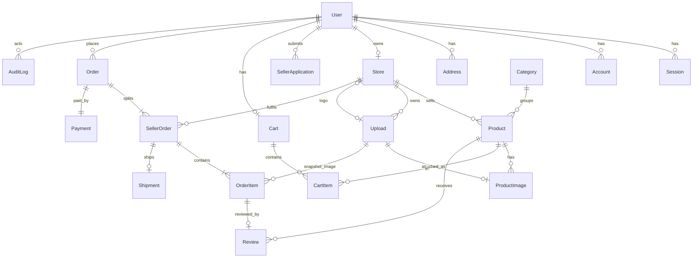

# Data Model

Owner: database agent. This is the **design** for schema v1, corrected on 2026-10-11 after the T-004 planning review ([reviews/T-004-findings.md](reviews/T-004-findings.md)) and the owner answers in [DECISIONS.md](DECISIONS.md) D-025. **No schema file and no migration exist yet.** T-013 writes `prisma/schema.prisma` from this document; from then on the schema file is authoritative and this document must match it.

Items marked **to validate in T-013** or **to validate in T-015** are technical points that depend on the installed Prisma or Better Auth version. They are not asserted here. Items marked **OPEN (owner)** wait for an owner answer and are listed in [section 19](#19-open-points).

## 1. Conventions

- **Ids.** Rows of the application's own tables have a `String` id generated by Prisma (`cuid`; the exact variant is chosen in T-013). Rows created by the auth library (`User`, `Session`, `Account`, `Verification`) get whatever id the library generates, which is not a cuid. Every id is therefore an **opaque string**: no code, check constraint, or URL pattern may assume a length or shape. Two exceptions with non-string ids are stated where they occur (`MarketplaceSettings`).
- **Time.** All timestamps are UTC (`timestamptz`). Display conversion to Asia/Bangkok happens in the presentation layer.
- **Money.** Stored amounts are integer satang in `Int` columns whose names end in `Satang`. No `Float` and no `Decimal`. Aggregates are a different type, see [section 11](#11-money-types-bounds-and-aggregates).
- **Timestamps.** `createdAt` on every table. `updatedAt` only where rows change after insert.
- **Status changes.** Every status column is changed only by a conditional update whose `WHERE` names the expected current value (D-024), see [section 7](#7-concurrency-and-guarded-writes).
- **Foreign keys.** Every foreign key has a stated `onDelete`, see [section 14](#14-foreign-keys-and-deletion-policy). The default is `Restrict`.

## 2. Entity overview



## 3. Enums

| Enum | Values | Note |
| --- | --- | --- |
| `Role` | `CUSTOMER`, `SELLER`, `ADMIN` | One role per user |
| `ApplicationStatus` | `PENDING`, `APPROVED`, `REJECTED` | On `SellerApplication` only |
| `StoreStatus` | `APPROVED`, `SUSPENDED` | A store row exists only after approval, so no `PENDING` or `REJECTED` (finding B3) |
| `ProductStatus` | `DRAFT`, `PUBLISHED`, `ARCHIVED` | The seller's own switch |
| `ModerationStatus` | `PENDING`, `APPROVED`, `REJECTED`, `TAKEN_DOWN` | The admin's decision. `TAKEN_DOWN` is the target state of a takedown (finding S5) |
| `PaymentStatus` | `PENDING`, `PAID`, `FAILED` | `REFUNDED` is removed from v1: the system records no refund (OQ-08), so the value would be unreachable. Adding an enum value later is a non-destructive migration |
| `PaymentProvider` | `MOCK` | Labels simulated payments permanently (D-011) |
| `FulfilmentStatus` | `PENDING`, `PROCESSING`, `SHIPPED`, `DELIVERED`, `CANCELLED` | |

## 4. State machines

Anything not listed is rejected. Each row is one guarded update ([section 7.6](#76-status-columns-and-what-each-guarded-update-needs)).

### 4.1 Seller application, store, and role (B3)

Application status lives on `SellerApplication`. Store status holds only states a store can actually be in.

| Entity | From | To | Who | Effect |
| --- | --- | --- | --- | --- |
| `SellerApplication.status` | (new row) | `PENDING` | Customer | Only when the user has no store (BR-06) and no other `PENDING` application |
| `SellerApplication.status` | `PENDING` | `APPROVED` | Admin | In **one transaction**: the application becomes `APPROVED`; a `Store` row is **created** with status `APPROVED`, taking `name`, `description`, and `contactPhone` from the application and a generated slug; `User.role` changes `CUSTOMER` to `SELLER` |
| `SellerApplication.status` | `PENDING` | `REJECTED` | Admin, reason required | No store is created. The role stays `CUSTOMER`. The user may submit a new application (a new row) |
| `Store.status` | `APPROVED` | `SUSPENDED` | Admin, reason required | Role stays `SELLER`. Sessions are **not** revoked ([section 6.1](#61-auth-tables-s19)) |
| `Store.status` | `SUSPENDED` | `APPROVED` | Admin, reason required | |

- **When the role changes:** exactly once, in the approval transaction, guarded by `WHERE role = 'CUSTOMER'`. It never changes back: a suspended seller is still a `SELLER`. Because a user has a single role, an `ADMIN` cannot become a seller; an application from a user whose role is not `CUSTOMER` cannot be approved.
- Approval always **creates** the store. "Creates or activates" in REQ-A-03 and in the API contract has no second case, because a user who already owns a store cannot apply.
- A user with a `PENDING` or `REJECTED` application and no store is a `CUSTOMER` with no `Store` row. "Seller, any status" therefore means: role `SELLER` with a store that is `APPROVED` or `SUSPENDED`.
- `ADMIN` is written only by the bootstrap script (OQ-13). No service function sets it.

### 4.2 Product status and moderation (S5, OQ-04, OQ-05, OQ-06)

Two independent columns. `Product.status` is the seller's switch; `Product.moderationStatus` is the admin's decision. Approval is always required: there is no setting that turns it off (OQ-04), and `MarketplaceSettings` has no such column.

`Product.status`:

| From | To | Who |
| --- | --- | --- |
| (new row) | `DRAFT` | Seller |
| `DRAFT` | `PUBLISHED` | Seller |
| `PUBLISHED` | `DRAFT` | Seller (unpublish) |
| `DRAFT`, `PUBLISHED` | `ARCHIVED` | Seller (archive, or delete of a product that orders reference) |

`ARCHIVED` is final in v1: no requirement and no endpoint restores an archived product.

`Product.moderationStatus`:

| From | To | Trigger |
| --- | --- | --- |
| (new row) | `PENDING` | Product created |
| `PENDING` | `APPROVED` | Admin approves |
| `PENDING` | `REJECTED` | Admin rejects, reason required |
| `APPROVED` | `TAKEN_DOWN` | Admin takes down, reason required |
| `APPROVED` | `PENDING` | Seller changes a **moderated field** (OQ-05) |
| `REJECTED`, `TAKEN_DOWN` | `PENDING` | Seller corrects a moderated field, which resubmits the product (OQ-06) |

- **Moderated fields:** `title`, `description`, `categoryId`, and the pictures (the set of `ProductImage` rows). Whether changing only the **order** of the pictures counts is **OPEN (owner)**, DM-Q4; until answered the rule is written for the stricter reading (it counts).
- **Not moderated:** `priceSatang`, `stock`, `sku`, and `status`. A change to these applies at once and does not touch `moderationStatus` (OQ-05).
- **Hidden while waiting.** Visibility requires `APPROVED` ([section 5](#5-visibility-and-purchasability)), so a product that returns to `PENDING` disappears from the shop and cannot be bought until it is approved again. No copy of the previously approved content is kept.
- **Resubmission** follows the recommendation the owner accepted for REQUIREMENTS Q9: editing returns the product to `PENDING`. A price-only or stock-only edit of a rejected or taken-down product does not resubmit it, because there is nothing new to review.
- `moderationNote` holds the reason of the last rejection or takedown. It stays readable to the seller while they correct the product and is cleared on approval.
- **Approving what was actually reviewed.** `contentRevision` (an integer) increases by one in the same statement as every change to a moderated field. An admin decision is guarded by `moderationStatus` **and** by the `contentRevision` the admin was shown. Without it a seller could change the text in the moment between the admin opening the product and pressing approve, and the unseen text would go live.
- `moderationRequestedAt` is the time the product last entered `PENDING`; the admin queue is ordered by it, oldest first. Editing a product that is already `PENDING` raises `contentRevision` and leaves `moderationRequestedAt` alone.
- Whether the admin queue lists products the seller has not published yet is **OPEN (owner)**, DM-Q3. It is a query filter and changes no column.

### 4.3 Payment status, on `Order` (M2, OQ-07, D-023)

| From | To | Trigger |
| --- | --- | --- |
| (new row) | `PENDING` | Checkout transaction |
| `PENDING` | `PAID` | Mock provider confirms |
| `PENDING` | `FAILED` | Mock provider declines, or the order stayed `PENDING` past the configured timeout (D-023 point 6) |

`PAID` and `FAILED` are final in v1. A failed order is never paid again (OQ-07); the customer checks out again, which creates a new order with a new idempotency key.

### 4.4 Fulfilment status, on `SellerOrder` (OQ-08, OQ-17)

| From | To | Who | Condition and effect |
| --- | --- | --- | --- |
| (new row) | `PENDING` | Checkout transaction | |
| `PENDING` | `PROCESSING` | Seller | Only when the order's `paymentStatus` is `PAID`, checked in the same statement |
| `PROCESSING` | `SHIPPED` | Seller | Creates the `Shipment` row |
| `SHIPPED` | `DELIVERED` | Seller or admin | Sets `Shipment.deliveredAt`. This is the **only** exit from `SHIPPED` (OQ-17) |
| `PENDING`, `PROCESSING` | `CANCELLED` | Seller or admin | Restores stock once ([section 7.3](#73-stock-is-restored-at-most-once-b5)). Allowed when the order is already `PAID` (OQ-08) |
| `PENDING` | `CANCELLED` | System | Payment failed ([section 7.2](#72-payment-completion-and-payment-failure-oq-07)) |

`DELIVERED` and `CANCELLED` are final.

**Cancelled after payment (OQ-08).** The order's `paymentStatus` stays `PAID`. No refund row, refund amount, or refund status exists anywhere. What the customer is shown is derived, not stored:

| `SellerOrder.fulfilmentStatus` | `Order.paymentStatus` | Meaning |
| --- | --- | --- |
| `CANCELLED` | `PAID` | "ยกเลิกแล้ว คืนเงินนอกระบบ": cancelled, refund handled outside the system |
| `CANCELLED` | `FAILED` | Payment failed; nothing was charged |
| `CANCELLED` | `PENDING` | Cancelled before the payment finished (rare; see section 7.2) |

**Sales and revenue (OQ-08).** A seller order counts in any sales or revenue figure only when `Order.paymentStatus = 'PAID'` **and** `SellerOrder.fulfilmentStatus <> 'CANCELLED'`. The figure is the sum of `SellerOrder.itemsSubtotalSatang` (and `shippingFeeSatang` where a report includes shipping) over those rows.

### 4.5 User activation (OQ-14)

| From | To | Who | Effect |
| --- | --- | --- | --- |
| `isActive = true` | `false` | Admin; not self, not the last active admin | Every `Session` row of the user is deleted in the same transaction |
| `isActive = false` | `true` | Admin | The user must log in again |

Deactivating a user who owns a store does not change `Store.status`. The store and its products are hidden because visibility reads the owner's `isActive` ([section 5](#5-visibility-and-purchasability)). Reactivation therefore restores exactly the state from before, including a suspension that was already in place.

A deactivated seller cannot log in, so their paid seller orders cannot be moved to `PROCESSING` or `SHIPPED` by anyone (an admin may only cancel or mark delivered). What should happen to those orders is **OPEN (owner)**, DM-Q6; no column depends on the answer.

## 5. Visibility and purchasability

One definition, used by the catalog, the cart flags, and checkout.

A product is **visible** when all of these hold:

1. `Product.status = 'PUBLISHED'`
2. `Product.moderationStatus = 'APPROVED'`
3. `Store.status = 'APPROVED'` for its store (BR-14)
4. the store owner's `User.isActive = true` (OQ-14)
5. `Category.isActive = true` for its category (OQ-10)

A store page is public when conditions 3 and 4 hold for the store.

A product is **purchasable** in quantity `q` when it is visible and `stock >= q`. Stock is **not** part of visibility: a visible product with `stock = 0` stays in listings and on its page, marked "สินค้าหมด" (OQ-11).

Switching a category off (OQ-10) hides its products everywhere (search, store pages, product pages) and makes them unbuyable, through condition 5 alone; no product row is changed, so switching it back on restores them.

**Low stock (OQ-12)** means `stock <= 5`. The number is a fixed business rule, not an admin setting, so it is not stored in the database: it is one exported constant, `LOW_STOCK_THRESHOLD = 5`, in the seller product module under `src/modules` (backend-api chooses the file), and nothing else repeats the number.

## 6. Tables

`?` marks a nullable column. "timestamps" means `createdAt` and `updatedAt`.

### 6.1 Auth tables (S19)

The auth library is Better Auth (D-004). It owns four tables. **Their exact model names, column names, types, and nullability are to validate in T-015 against the installed version; the list below is the expected shape and is not asserted.** T-013 creates these tables from the library's published schema for the version that will be pinned; if T-015 finds a difference, the database agent adds a new corrective migration (the applied one is not edited).

| Table | Expected columns (to validate in T-015) |
| --- | --- |
| `User` | `id`, `name`, `email` (unique), `emailVerified`, `image?`, `createdAt`, `updatedAt` |
| `Session` | `id`, `userId` FK, `token` (unique), `expiresAt`, `ipAddress?`, `userAgent?`, `createdAt`, `updatedAt` |
| `Account` | `id`, `userId` FK, `accountId`, `providerId`, `password?` (the password hash), provider token columns and their expiry columns (unused with email and password, kept because the library requires them), `scope?`, `createdAt`, `updatedAt` |
| `Verification` | `id`, `identifier`, `value`, `expiresAt`, `createdAt`, `updatedAt` |

Columns this application adds to `User`:

| Column | Type | Written by | Never written by |
| --- | --- | --- | --- |
| `role` | `Role`, default `CUSTOMER` | The application-approval service (`CUSTOMER` to `SELLER`); the admin bootstrap script (`ADMIN`) | Sign-up, profile update, any request body |
| `isActive` | `Boolean`, default `true` | The admin user-management service | Sign-up, profile update, any request body |
| `phone?` | `String` | The profile service (`PATCH /me`), for the acting user only | Sign-up |

- **Not client-settable.** The three columns are declared to the library as additional fields that do not accept input, so a sign-up or library update request carrying `role`, `isActive`, or `phone` cannot set them. The option that does this is to validate in T-015. The database defaults make a row created without them a plain active customer.
- **Ids.** The library generates the id of every row in these four tables, in its own format. See [section 1](#1-conventions): ids are opaque. The seed and the bootstrap script create users through the library so that ids and password hashes have the library's format.
- **Email** is stored lower-cased and is unique. Whether the library normalises the case itself is to validate in T-015; if it does not, uniqueness moves to a unique index on `lower(email)` in raw SQL.
- `emailVerified` and `image` exist only because the library requires them. No feature reads them in the MVP.

**Sessions, suspension, and deactivation.** D-004 says database sessions allow revocation "on logout, deactivation, and suspension". BR-14 requires a suspended store's seller to stay able to log in and fulfil existing orders. The model resolves it this way:

| Event | Sessions | How the restriction takes effect |
| --- | --- | --- |
| Logout | That `Session` row is deleted | |
| **User deactivation** | **All of the user's `Session` rows are deleted**, in the transaction that sets `isActive = false` | Sign-in is refused while inactive; `requireActor` also reads `isActive` on every request |
| **Store suspension** | **Not touched** | `requireActor` reads `Store.status` from the database on every request, so the suspended seller is blocked from creating, publishing, and selling at once, and keeps access to existing seller orders (BR-14) |

No role, status, or store id is cached in the session or the cookie; the library's session cookie cache stays off (to validate in T-015).

**Login IP address and browser details (OQ-22).** `Session.ipAddress` and `Session.userAgent` are the only place the database stores them. They are personal data. They must disappear when the session ends or expires:

- logout and deactivation delete the row;
- an expired row is deleted by a purge, `DELETE FROM "Session" WHERE "expiresAt" < now()`, which must run at least once an hour (a script owned by auth and scheduled by devops), and the library is expected to delete an expired session when it is presented (to validate in T-015). An expired row can therefore outlive its expiry by at most the purge interval; see [section 19](#19-open-points);
- no other table, and no audit entry, copies these two values.

The address the library writes must be the one derived by SECURITY.md SR-01, never a client-controlled header (to validate in T-015).

Indexes: `Session(userId)` (revocation), `Session(expiresAt)` (purge), `Account(userId)`.

### 6.2 Address

`id`, `userId` FK, `recipientName`, `phone`, `line1`, `subdistrict`, `district`, `province`, `postalCode`, `isDefault`, timestamps.

- Index `(userId)`.
- At most one default per user: partial unique index on `(userId) WHERE "isDefault"` (raw SQL).
- `CHECK ("postalCode" ~ '^[0-9]{5}$')` (raw SQL).
- An address may be hard-deleted: orders copy the address, they do not reference it.

### 6.3 Store

`id`, `ownerId` FK unique, `name`, `slug` unique, `description?`, `logoUploadId?` FK unique, `contactPhone`, `status` (`StoreStatus`, set to `APPROVED` at creation), `statusReason?`, `isSample` (default false), timestamps.

- Created only by the approval transaction ([section 4.1](#41-seller-application-store-and-role-b3)).
- `slug` is generated once and never changes, also when the store is renamed ([section 9](#9-slugs-s11)).
- `statusReason` holds the reason of the last suspension or reinstatement; the history is in `AuditLog`.
- Index `(status)` for the admin store list.

### 6.4 SellerApplication

`id`, `userId` FK, `storeName`, `description`, `contactPhone`, `status` (`ApplicationStatus`, default `PENDING`), `reviewedById?` FK, `reviewNote?` (required by the service on rejection), `reviewedAt?`, timestamps.

- At most one `PENDING` application per user: partial unique index on `(userId) WHERE status = 'PENDING'` (raw SQL).
- Index `(status, createdAt)` for the admin list filtered by status.

### 6.5 Category

`id`, `name`, `slug` unique, `sortOrder`, `isActive` (default true), `isSample` (default false), timestamps. Flat list in the MVP; no hierarchy. Storefront order is `sortOrder`, then `id`.

### 6.6 Product

`id`, `storeId` FK, `categoryId` FK, `title`, `slug` unique, `description`, `sku`, `priceSatang`, `stock`, `status` (default `DRAFT`), `moderationStatus` (default `PENDING`), `moderationNote?`, `moderationRequestedAt`, `contentRevision` (`Int`, default 1), `isSample` (default false), timestamps.

- SKU is unique per store **among products that are not archived**: partial unique index on `(storeId, sku) WHERE status <> 'ARCHIVED'` (raw SQL). An archived product keeps its SKU value for the record, and the seller may use the same SKU on a new product (M6). Reason: deleting a product that orders reference archives it instead, so to the seller it is gone; refusing its SKU afterwards would be an error they cannot resolve. Order history is unaffected because `OrderItem` stores its own copy of the SKU. This is safe only because `ARCHIVED` is final.
- `slug` is unique across all products for ever, archived ones included. It is never released and never reused (M6). This costs nothing because every slug ends in a random suffix ([section 9](#9-slugs-s11)).
- `CHECK ("priceSatang" BETWEEN 100 AND 100000000)` (BR-02).
- `CHECK (stock BETWEEN 0 AND 1000000000)`, see [section 11](#11-money-types-bounds-and-aggregates) for the upper bound.
- `CHECK ("contentRevision" >= 1)`.
- Indexes: `(status, moderationStatus, categoryId, createdAt)` for storefront listings; `(storeId, status)` for the seller's product list and low-stock count; `(moderationStatus, moderationRequestedAt)` for the admin queue. The earlier draft's index on `(priceSatang)` is dropped: at MVP catalog size a single-column price index does not serve the price sort once the visibility filter is applied. Add an index for it only when a measured query needs one.

### 6.7 Upload (S8)

`id`, `storageKey` unique, `storeId` FK, `contentType`, `sizeBytes`, `createdAt`. Rows are immutable: a key is generated once, its bytes are never overwritten, and no column changes after insert. Rules are in [section 8](#8-uploads-and-images-s7-s8).

- `CHECK ("contentType" IN ('image/jpeg', 'image/png', 'image/webp'))`.
- `CHECK ("sizeBytes" BETWEEN 1 AND 5242880)` (5 MB).
- Index `(storeId)`.

### 6.8 ProductImage

`id`, `productId` FK cascade, `uploadId` FK unique, `sortOrder`, `createdAt`. A row is only the link between a product and an upload.

- Unique `(productId, sortOrder)` and `CHECK ("sortOrder" BETWEEN 0 AND 7)`: together they make a ninth picture impossible in the database (REQ-S-05). The picture with the lowest `sortOrder` is the primary one.
- Unique `uploadId`: one upload is attached to at most one product.
- Changing the pictures (add, remove, reorder) replaces the product's link rows inside one transaction (delete, then insert), so the unique constraint on `(productId, sortOrder)` never sees a half-finished order. No deferrable constraint is needed.

### 6.9 Cart and CartItem

`Cart`: `id`, `userId` FK unique, timestamps. Created by the first add-to-cart and never deleted; it is the row checkout locks ([section 7.1](#71-checkout-d-023)).

`CartItem`: `id`, `cartId` FK cascade, `productId` FK cascade, `quantity`, timestamps.

- Unique `(cartId, productId)`.
- `CHECK (quantity BETWEEN 1 AND 99)` (BR-03).
- No price is stored in the cart; prices are read live.

### 6.10 Order

`id`, `orderNumber` unique, `userId` FK, `idempotencyKey`, `paymentStatus` (default `PENDING`), `itemsSubtotalSatang`, `shippingTotalSatang`, `grandTotalSatang`, shipping address copy (`shipRecipientName`, `shipPhone`, `shipLine1`, `shipSubdistrict`, `shipDistrict`, `shipProvince`, `shipPostalCode`), timestamps.

- `orderNumber` is filled by the database, see [section 10](#10-order-numbers-s12).
- Unique `(userId, idempotencyKey)`: the backstop behind the cart lock (D-023 point 2). The key is stored in the one normalised form the API layer defines and compared exactly.
- **`paymentStatus` is the only payment status in the model** (M2).
- Indexes: `(userId, createdAt)` for the customer's history; `(paymentStatus, createdAt)` for the pending-payment timeout sweep and the admin filter.
- Checks: each of the three amounts `>= 0`; `"grandTotalSatang" = "itemsSubtotalSatang"::bigint + "shippingTotalSatang"`; `"grandTotalSatang" <= 2000000000` (BR-04); `"shipPostalCode" ~ '^[0-9]{5}$'`.

### 6.11 SellerOrder

`id`, `orderId` FK, `storeId` FK, `storeName` (the store's name at purchase, OQ-18), `fulfilmentStatus` (default `PENDING`), `itemsSubtotalSatang`, `shippingFeeSatang`, `shippingFeeIsSimulated` (default true), `commissionRateBps` (copy of the setting at purchase), timestamps.

- `storeName` never changes. A later store rename does not alter old orders; order pages read this column, not `Store.name`.
- `shippingFeeIsSimulated` marks the fee as a simulated flat rate, not a carrier quote (M12, BR-08). It is `true` for every row in the MVP and is the stored fact behind the "simulated rate" label.
- Unique `(orderId, storeId)`.
- Index `(storeId, fulfilmentStatus, createdAt)` for the seller's order list.
- Checks: `"itemsSubtotalSatang" >= 0`; `"shippingFeeSatang" BETWEEN 0 AND 100000`; `"commissionRateBps" BETWEEN 0 AND 10000`.

### 6.12 OrderItem

`id`, `sellerOrderId` FK, `productId` FK, `productTitle`, `productSku`, `productImageUploadId?` FK, `unitPriceSatang`, `quantity`, `lineTotalSatang`, `stockRestoredAt?`, `createdAt`.

- `productTitle`, `productSku`, and `unitPriceSatang` are copies taken at purchase. `productId` is kept for reference (reviews, re-adding to the cart) and is never used to read a title or a price for an order.
- `productImageUploadId` points at the upload that was the product's primary picture at purchase. Upload rows and their bytes never change, so the reference is a true snapshot, and the foreign key stops the row, and with it the file, from being deleted ([section 8](#8-uploads-and-images-s7-s8), S7).
- `stockRestoredAt` records that this item's stock was put back, and when. It is null until then and is set at most once ([section 7.3](#73-stock-is-restored-at-most-once-b5)). It is the only column of this table that changes after insert.
- Checks: `quantity BETWEEN 1 AND 99`; `"unitPriceSatang" BETWEEN 100 AND 100000000`; `"lineTotalSatang" = "unitPriceSatang"::bigint * quantity`. The `bigint` cast makes an out-of-range product a constraint failure instead of an arithmetic error.
- Indexes: `(sellerOrderId)`, `(productId)`.

### 6.13 Payment

`id`, `orderId` FK **unique**, `provider` (`MOCK`), `providerReference?`, `amountSatang`, `failureReason?`, timestamps.

- One row per order, created in the checkout transaction. A failed order is not retried (OQ-07), so there is never a second attempt.
- **There is no status column here** (M2). The earlier draft kept a status on both `Order` and `Payment` with no rule for keeping them equal. `Order.paymentStatus` is the single source; this table holds what the provider reported: its reference on success, a short reason code on failure (for example `SIMULATED_DECLINE`, `TIMEOUT`). The table is kept, rather than folded into `Order`, as the place a real gateway's attempts will go (D-011); a per-attempt status is added then, together with its sync rule.
- `provider = 'MOCK'` is the permanent record that the payment was simulated. "Is simulated" in an API response is derived from it; there is no separate column.
- `CHECK ("amountSatang" BETWEEN 0 AND 2000000000)`. The service writes the order's `grandTotalSatang`.

### 6.14 Shipment

`id`, `sellerOrderId` FK unique, `carrierName?`, `trackingNumber?`, `isSimulated` (default true), `shippedAt`, `deliveredAt?`, timestamps.

- Created by the `PROCESSING` to `SHIPPED` transition. Tracking numbers are only ever entered by the seller; none is generated.
- `CHECK ("deliveredAt" IS NULL OR "deliveredAt" >= "shippedAt")`.

### 6.15 Review

`id`, `orderItemId` FK unique, `productId` FK, `userId` FK, `rating`, `comment?`, `createdAt`. No edit path exists, so there is no `updatedAt`.

- `CHECK (rating BETWEEN 1 AND 5)`.
- Index `(productId, createdAt)`.
- `productId` and `userId` repeat what the order item and its order already say, so that a product's reviews can be listed without two joins. The review service copies them from the order item and never from the request.

### 6.16 MarketplaceSettings

Single row: `id` (`Int`, always 1), `flatShippingFeeSatang`, `commissionRateBps`, `updatedById?` FK, `updatedAt`.

- `requireProductApproval` is **removed** (OQ-04).
- Checks: `id = 1`; `"flatShippingFeeSatang" BETWEEN 0 AND 100000` (0 to 1,000 THB, OQ-16); `"commissionRateBps" BETWEEN 0 AND 10000` (0 to 100 percent, OQ-16).
- The row is inserted by the first **migration** with the confirmed initial values (4,000 satang and 500 basis points, D-017), not by the seed, because the seed never runs in production.
- Checkout reads the row inside its transaction and copies both values onto each `SellerOrder`, so a later change never alters an existing order.

### 6.17 AuditLog

`id`, `actorId` FK, `action` (for example `STORE_SUSPENDED`), `targetType`, `targetId`, `metadata` (JSON: reason, before and after summary), `createdAt`.

- Indexes `(createdAt)` and `(targetType, targetId)`.
- Append-only: no update or delete path in application code. Written in the same transaction as the action it records.
- `metadata` never contains a session token, a password hash, an IP address, or a user agent.

## 7. Concurrency and guarded writes

### 7.1 Checkout (D-023)

One transaction:

1. Lock the customer's cart: `SELECT ... FROM "Cart" WHERE "userId" = :actor FOR UPDATE`. No cart row means an empty cart.
2. Inside the lock, look up `Order` by `(userId, idempotencyKey)`. If found, return it. The unique constraint on the pair remains as the backstop.
3. No cart items: the defined empty-cart error. No order.
4. For each cart item, in **product id order**, one statement decrements the stock, requires the product to be purchasable, and returns the price that is charged:

   ```sql
   UPDATE "Product" p
      SET stock = p.stock - :quantity
     FROM "Store" s, "User" u, "Category" c
    WHERE p.id = :productId
      AND s.id = p."storeId" AND u.id = s."ownerId" AND c.id = p."categoryId"
      AND p.status = 'PUBLISHED' AND p."moderationStatus" = 'APPROVED'
      AND s.status = 'APPROVED' AND u."isActive" AND c."isActive"
      AND s."ownerId" <> :actor            -- BR-16
      AND p.stock >= :quantity
   RETURNING p."priceSatang", p.title, p.sku, p."storeId", s.name;
   ```

   Zero rows means the item cannot be bought; the transaction rolls back and nothing is ordered (OQ-09). The statement is the exact shape to validate in T-013 (raw query through the transaction client).
5. Read `MarketplaceSettings`; compute totals from the returned prices; reject above the BR-04 cap.
6. Insert `Order`, `SellerOrder` rows (with `storeName`, fee, and rate copies), `OrderItem` rows (with the title, SKU, price, and primary-picture copies), and the `Payment` row; delete the cart's items.

### 7.2 Payment completion and payment failure (OQ-07)

**Success**, one transaction: `UPDATE "Order" SET "paymentStatus" = 'PAID' WHERE id = :id AND "paymentStatus" = 'PENDING'`. One row affected: write `Payment.providerReference`. Zero rows: someone else finished it; change nothing.

**Failure** (a decline, or the timeout sweep), one transaction:

1. Lock the customer's cart row (`FOR UPDATE`), the same first lock checkout takes.
2. `UPDATE "Order" SET "paymentStatus" = 'FAILED' WHERE id = :id AND "paymentStatus" = 'PENDING'`. Zero rows: stop and change nothing. Everything below is done only by the request whose update affected the row.
3. **Seller orders of the failed order:** `UPDATE "SellerOrder" SET "fulfilmentStatus" = 'CANCELLED' WHERE "orderId" = :id AND "fulfilmentStatus" = 'PENDING'`. They can only be `PENDING` or already `CANCELLED`, because leaving `PENDING` for `PROCESSING` requires `PAID`. After this step no seller order of a failed order is left in a state that can be acted on, so a later cancel request finds nothing to cancel.
4. Claim the items and restore their stock ([section 7.3](#73-stock-is-restored-at-most-once-b5)).
5. **Items return to the cart:** for each item claimed in step 4, insert a `CartItem` into the customer's cart, or, if a line for that product already exists, add the quantity to it, capped at 99. Items of a seller order that was cancelled earlier were not claimed here and are not returned.
6. Write `Payment.failureReason`.

What follows from this:

- The failed order stays in the customer's history as failed and is never retried. Paying again means a new checkout and a new order.
- **Sellers do not see it.** Every seller-facing read of `SellerOrder` (list, detail, counts, sales) must exclude seller orders whose `Order.paymentStatus` is `FAILED`. Whether a seller sees an order whose payment is still `PENDING` is **OPEN (owner)**, DM-Q2; with the recommended answer the filter is simply `Order.paymentStatus = 'PAID'`. Either answer is a query filter and changes no column.
- Admins see failed orders, with the seller orders shown as cancelled because the payment failed ([section 4.4](#44-fulfilment-status-on-sellerorder-oq-08-oq-17)).

### 7.3 Stock is restored at most once (B5)

`OrderItem.stockRestoredAt` is the record. Every path that gives stock back (payment failure, seller cancel, admin cancel) uses the same two steps inside its transaction:

1. **Claim:** `UPDATE "OrderItem" SET "stockRestoredAt" = now() WHERE "sellerOrderId" IN (...) AND "stockRestoredAt" IS NULL RETURNING "productId", quantity`.
2. **Restore:** add the quantity back to `Product.stock` for **exactly the rows the claim returned**, in product id order.

An item that was already claimed is not returned by a second claim, so no interleaving of failure and cancellation can add its stock twice. If the installed Prisma cannot return rows from a conditional update, the same statement runs as a raw query (to validate in T-013, review item V9).

The restore adds to whatever the stock is at that moment, including for an archived or hidden product.

### 7.4 Cancelling a seller order

One transaction: `UPDATE "SellerOrder" SET "fulfilmentStatus" = 'CANCELLED' WHERE id = :id AND "fulfilmentStatus" IN ('PENDING', 'PROCESSING')` (a seller's request also carries `AND "storeId" = :actorStoreId`). Zero rows is a conflict or a not-found. One row: claim and restore as in 7.3. `Order.paymentStatus` is not touched (OQ-08).

### 7.5 Lock order

To keep transactions from deadlocking, every transaction takes its locks in this order and skips the ones it does not need: `Cart` row, then `Order`, then `SellerOrder`, then `OrderItem`, then `Product` rows in ascending id, then `CartItem`. "Not the last admin" locks the active admin `User` rows it counts (`FOR UPDATE`) before it changes one of them.

### 7.6 Status columns and what each guarded update needs

| Column | Guard in the `WHERE` | Other columns the statement needs |
| --- | --- | --- |
| `User.isActive` | `"isActive" = :expected` | `role` (last-admin count); `Session.userId` (revocation) |
| `User.role` | `role = 'CUSTOMER'` | |
| `SellerApplication.status` | `status = 'PENDING'` | `userId`; unique `Store.ownerId` as the backstop against two stores |
| `Store.status` | `status = :expected` | `statusReason` |
| `Product.status` | `status = :expected` | `storeId` (seller scope) |
| `Product.moderationStatus`, admin | `"moderationStatus" = :expected AND "contentRevision" = :seen` | `moderationNote` |
| `Product.moderationStatus`, seller edit | none: the statement sets `PENDING` whenever a moderated field changes | `storeId`, `contentRevision`, `moderationRequestedAt` |
| `Product.stock` | `stock >= :quantity` plus the purchasability conditions (7.1); seller adjustments: `stock + :delta >= 0` | `priceSatang`, `storeId`, `categoryId` |
| `Order.paymentStatus` | `"paymentStatus" = 'PENDING'` | `createdAt` (timeout sweep) |
| `SellerOrder.fulfilmentStatus` | `"fulfilmentStatus" = :expected`; to `PROCESSING` also `EXISTS` an order with `"paymentStatus" = 'PAID'` | `storeId` (seller scope), `orderId` |
| `OrderItem.stockRestoredAt` | `"stockRestoredAt" IS NULL` | `productId`, `quantity` |
| `Category.isActive` | `"isActive" = :expected` | |

Zero affected rows is a conflict error, never a silent success.

## 8. Uploads and images (S7, S8)

**Who owns a key.** Every stored file has one `Upload` row, written by the upload endpoint in the same request that stores the bytes. `Upload.storeId` is the owner, taken from the session, never from the request. `storageKey` is generated by the server and matches the strict pattern that file serving checks (SECURITY.md TM-18).

**How a key is attached.**

| Target | Link | Limit |
| --- | --- | --- |
| Product picture | a `ProductImage` row (`productId`, `uploadId`, `sortOrder`) | 8 per product, one product per upload |
| Store logo | `Store.logoUploadId` | one per store |

**Validating a key the client sends.** A request that names storage keys (a product's pictures, a store's logo) is resolved by `SELECT ... FROM "Upload" WHERE "storageKey" = :key AND "storeId" = :actorStoreId`. A key with no row, or a row of another store, is refused in the same way, without revealing which. A key is never written to a product or a store without passing through this lookup, and the columns that hold the link are foreign keys to `Upload`, so a string that is not a registered upload cannot be stored at all.

**An order's picture cannot be deleted (S7).** `OrderItem.productImageUploadId` is a foreign key to `Upload` with `onDelete: Restrict`. The storage object is deleted only after its `Upload` row has been deleted, and that delete fails while any order item references the row. Editing a product's pictures or deleting the product removes `ProductImage` link rows only; it never deletes an `Upload` row or a file.

**Orphan cleanup.** An upload is an orphan when no `ProductImage`, no `Store.logoUploadId`, and no `OrderItem` references it and it is older than a grace period (24 hours; a constant in the upload module, long enough for a seller to finish a product form). A cleanup job (a script; backend-api writes the function, devops schedules it) deletes orphan rows with one statement that repeats those conditions, and then deletes the storage object of each row it deleted. The foreign keys make this safe against a concurrent attach: either the attach commits first and the delete skips the row, or the delete commits first and the attach fails its foreign key. If deleting the object fails after its row is gone, a file with no row is left in storage: it can no longer be attached and is not served if serving requires a row (a request to backend-api), and the job logs the key so it can be removed by hand. The cleanup scans by age without an index; it is a batch job on a small table.

## 9. Slugs (S11)

One scheme for `Product.slug`, `Store.slug`, and `Category.slug`:

- **Form:** `<readable part>-<suffix>`, or the suffix alone when the readable part is empty.
- **Readable part:** the title or name, normalised to Unicode NFC and lower-cased, keeping letters, combining marks, and digits of any script (**Thai letters, vowels, and tone marks are kept**); every other run of characters becomes one `-`; leading and trailing `-` are removed; cut to 40 code points.
- **Suffix:** 8 random characters from a lower-case alphabet without look-alike characters (Crockford base 32), from a cryptographic random source.
- **Duplicates:** two products or two stores with the same title or name differ in the suffix. The unique constraint is the guarantee; on the rare collision the insert is retried with a new suffix.
- **Renames:** a slug is written once at creation and **never changes**. Renaming a store, a product, or a category keeps its slug, so existing links keep working. Slugs are never accepted from the client.
- **Archived products** keep their slug; it is never reused ([section 6.6](#66-product)).
- **Lookup** is an exact match on the stored value. The page layer must decode a percent-encoded path segment and normalise it to NFC before the lookup (review item V11, frontend).

Reason for keeping Thai in the slug: titles are Thai, and a slug made only of an id says nothing in a shared link. Reason for the suffix on every slug: it removes the duplicate case and the reuse case in one rule. The generator is a function in `src/modules` (backend-api); the database only enforces uniqueness.

## 10. Order numbers (S12)

`Order.orderNumber` is assigned **by the database** as a column default, from a sequence:

- Form: `OD` + the order date in Asia/Bangkok as `YYMMDD` + the sequence value, zero-padded to at least 7 digits. Example: `OD2610110000042`.
- A PostgreSQL sequence (`order_number_seq`, created by hand-written SQL in the migration) hands out each value once, whatever the number of concurrent checkouts, so uniqueness needs no retry. A retry would be a problem here: a unique violation aborts the whole checkout transaction.
- The unique constraint on `orderNumber` stays as the backstop.
- A rolled-back checkout leaves a gap in the numbers. Gaps are expected and mean nothing.
- The value is opaque to clients: treat it as a string of at most 24 characters.

Whether Prisma accepts a database-generated default that calls a hand-created sequence without reporting drift on the next `migrate dev` is to validate in T-013. Fallback with the same guarantee: fetch `nextval` in the checkout transaction and format the number in the service.

Order numbers reveal roughly how many orders the shop has had; see [section 19](#19-open-points).

## 11. Money types, bounds, and aggregates

**Stored amounts** are `Int` satang (32-bit). The bounds below keep every stored value inside the type.

| Value | Bound | Enforced by |
| --- | --- | --- |
| Product price | 100 to 100,000,000 satang (BR-02) | `CHECK` on `Product` and `OrderItem` |
| Cart and order quantity | 1 to 99 (BR-03) | `CHECK` on `CartItem` and `OrderItem` |
| Order grand total | at most 2,000,000,000 satang, which is 20,000,000.00 THB (BR-04) | `CHECK` on `Order` and `Payment`; the service rejects before insert |
| Flat shipping fee | 0 to 100,000 satang, which is 0 to 1,000 THB (OQ-16) | `CHECK` on `MarketplaceSettings` and `SellerOrder` |
| Commission | 0 to 10,000 basis points, which is 0 to 100 percent (OQ-16) | `CHECK` on `MarketplaceSettings` and `SellerOrder` |
| Stock, database bound | 0 to 1,000,000,000 | `CHECK` on `Product` |
| Stock, highest value a seller may enter | **OPEN (owner)**, DM-Q1; recommended 1,000,000 | service validation only |

Why stock has two bounds: the database bound only protects the integer type and must be far above the seller-entry limit, because restoring stock after a cancellation adds to the current value and must never fail. With an entry limit of 1,000,000 the database bound leaves room for about ten million cancelled order lines of one product.

**Line totals.** `unitPriceSatang * quantity` can reach 9.9 billion at the limits, beyond 32 bits. The service computes in JavaScript numbers (exact to 2^53) and rejects any order above the BR-04 cap before writing; the `CHECK` constraints compute in `bigint`. No stored value can overflow.

**Aggregates (S15).** A sum of satang across rows (seller sales total, admin revenue, any report) can pass 2,147,483,647: two orders at the BR-04 cap are enough.

- No aggregate is stored. Each is computed from rows when asked for.
- In SQL the sum of an `Int` column is `bigint`. Aggregate queries must keep it `bigint` and never cast it back to `integer`.
- In the application an aggregate is a `bigint`, or a `number` only after a check that it is a safe integer (below 2^53, about 90 trillion THB). What type Prisma's `_sum` returns for an `Int` column, and whether it can overflow, is to validate in T-013; if it is not `bigint`, aggregates use a raw query with an explicit `::bigint`.
- In API responses an aggregate is still integer satang with a name ending in `Satang`, documented as able to exceed 32 bits (a request to backend-api).

## 12. Integrity rules and where they are enforced

| Rule | Database | Service |
| --- | --- | --- |
| No negative stock | `CHECK` | conditional decrement |
| No overselling under concurrency | conditional `UPDATE` row count | transaction rollback |
| One checkout per cart at a time | cart row lock | |
| No duplicate order per submission | unique `(userId, idempotencyKey)` | lookup inside the cart lock |
| Stock restored at most once | `stockRestoredAt IS NULL` claim | restore only claimed rows |
| Totals consistent | `CHECK` on `Order` and `OrderItem` | computed from database prices |
| Order totals fit in `Int` | `CHECK` (BR-04 cap) | caps validated before insert |
| One store per seller | unique `ownerId` | |
| One open application per user | partial unique index | |
| SKU unique per store among live products | partial unique index | |
| At most 8 pictures per product | unique `(productId, sortOrder)`, `CHECK` 0 to 7 | |
| An order's picture outlives the product | `Restrict` foreign key to `Upload` | cleanup deletes rows before files |
| One review per purchased item | unique `orderItemId` | eligibility check |
| History survives edits | copied columns, `Restrict` foreign keys | archive instead of delete |
| Settings within limits | `CHECK` | validation |
| Sum of seller orders equals the order's totals | not expressible as a `CHECK` | computed once in checkout; covered by an integration test |

## 13. Raw SQL the Prisma schema cannot express

Hand-written in the first migration and kept in sync here. Whether a later `migrate dev` leaves hand-written partial indexes and the sequence alone is to validate in T-013 (review item V9).

**Check constraints**

| Table | Constraint |
| --- | --- |
| `Address` | `postalCode` is 5 digits |
| `Product` | price 100 to 100,000,000; stock 0 to 1,000,000,000; `contentRevision >= 1` |
| `Upload` | `contentType` in the three allowed types; `sizeBytes` 1 to 5,242,880 |
| `ProductImage` | `sortOrder` 0 to 7 |
| `CartItem` | quantity 1 to 99 |
| `Order` | three amounts `>= 0`; grand total equals subtotal plus shipping; grand total at most 2,000,000,000; `shipPostalCode` is 5 digits |
| `SellerOrder` | subtotal `>= 0`; shipping fee 0 to 100,000; commission 0 to 10,000 |
| `OrderItem` | quantity 1 to 99; unit price 100 to 100,000,000; line total equals unit price times quantity |
| `Payment` | amount 0 to 2,000,000,000 |
| `Shipment` | `deliveredAt` null or not before `shippedAt` |
| `Review` | rating 1 to 5 |
| `MarketplaceSettings` | `id = 1`; fee 0 to 100,000; commission 0 to 10,000 |

**Partial unique indexes**

- `Address (userId) WHERE "isDefault"`: one default address per user.
- `SellerApplication (userId) WHERE status = 'PENDING'`: one open application per user.
- `Product (storeId, sku) WHERE status <> 'ARCHIVED'`: SKU unique per store among live products. Because this is partial, the Prisma schema has **no** `@@unique([storeId, sku])`; services cannot use a compound-unique lookup on it and must catch the unique violation by index name.

**Other**

- Sequence `order_number_seq` and the default expression of `Order.orderNumber`.
- The single `MarketplaceSettings` row (id 1, fee 4,000, commission 500).
- A unique index on `lower(email)`, only if T-015 finds the library does not normalise the case.

## 14. Foreign keys and deletion policy

`Restrict` unless listed here:

| Foreign key | `onDelete` | Reason |
| --- | --- | --- |
| `ProductImage.productId` | `Cascade` | Link rows have no meaning without the product. The `Upload` rows stay |
| `CartItem.cartId` | `Cascade` | |
| `CartItem.productId` | `Cascade` | A cart is not history; a hard-deleted product leaves carts (S10) |
| `Session.userId`, `Account.userId` | as the auth library defines (expected `Cascade`; to validate in T-015) | Users are never deleted by the application, so it does not fire |

Named `Restrict` keys that matter: `OrderItem.productId`, `OrderItem.productImageUploadId`, `OrderItem.sellerOrderId`, `SellerOrder.orderId`, `SellerOrder.storeId`, `Order.userId`, `Payment.orderId`, `Shipment.sellerOrderId`, `Review.orderItemId`, `Review.productId`, `Review.userId`, `Product.storeId`, `Product.categoryId`, `Store.ownerId`, `Store.logoUploadId`, `ProductImage.uploadId`, `Upload.storeId`, `AuditLog.actorId`. Orders, seller orders, order items, payments, and audit entries are never reachable by a cascade.

| Entity | Policy |
| --- | --- |
| Product referenced by any `OrderItem` | Never deleted. A delete request sets `status = 'ARCHIVED'` (BR-12). Its cart lines stay and are flagged as unavailable; its reviews and order items are untouched |
| Product referenced by no `OrderItem` | Hard-deleted. `ProductImage` and `CartItem` rows go with it by cascade; its uploads become orphans and are cleaned up later (section 8). Such a product cannot have reviews, because a review needs an order item; `Review.productId` is `Restrict` as the backstop (S10) |
| Archived product | Keeps its slug for ever; its SKU can be used by a new product (section 6.6) |
| User | Never deleted. Deactivated (`isActive = false`), sessions deleted |
| Store | Never deleted. Suspended, or hidden through its owner's deactivation |
| Category with products | Deactivated, not deleted (the foreign key refuses the delete) |
| Address | May be deleted; orders hold their own copy |
| Upload | Deleted only by the orphan cleanup, never while referenced |
| Order, SellerOrder, OrderItem, Payment, Shipment, AuditLog | Never deleted by the application |

The delete-or-archive decision and the delete itself run in one transaction; if an order item appears in between, the `Restrict` key on `OrderItem.productId` fails the delete and the service archives instead.

## 15. Indexes and text ordering

Indexes are listed with their tables in section 6; each serves a query a requirement names. None is added for a query that does not exist yet.

**Thai sort order (open note from T-012).** The local databases use the default collation `en_US.utf8`, which does not sort Thai text the way a Thai reader expects. The approach:

- No query in v1 orders by a Thai text column. Categories are ordered by `sortOrder`; product lists by `createdAt` or `priceSatang`; orders and audit entries by `createdAt`; every ordering ends with `id` as the tie-breaker so pages are stable.
- The database default collation is left as it is. If a list ordered by name is added later, that query names a Thai ICU collation explicitly (`ORDER BY name COLLATE "th-x-icu"`), which needs no change to existing data.
- **To validate in T-013:** that the collation `th-x-icu` exists in the `postgres:18-trixie` image (`SELECT 1 FROM pg_collation WHERE collname = 'th-x-icu'`). If it does not, record that here before any name ordering is built.
- Search (D-013) is a substring match with `ILIKE`; Thai has no letter case, so the collation does not affect which rows match. Unique slugs and SKUs compare exact stored values and do not depend on the collation either.

## 16. Sample-data and simulation markers (M12)

| What | Marker | Set by |
| --- | --- | --- |
| Sample store | `Store.isSample = true`, and the name prefix "ร้านตัวอย่าง" | Seed only |
| Sample product | `Product.isSample = true`, and the title prefix "สินค้าตัวอย่าง" | Seed only |
| Sample category | `Category.isSample = true` | Seed only |
| Sample accounts | Display name prefix "ผู้ใช้ตัวอย่าง" and an email address under a reserved example domain | Seed only |
| Simulated payment | `Payment.provider = 'MOCK'` | Checkout |
| Simulated shipping fee | `SellerOrder.shippingFeeIsSimulated = true` | Checkout |
| Simulated delivery | `Shipment.isSimulated = true` | Shipping transition |

`isSample` is a column because a name prefix can be edited away and the storefront needs a fact to label sample data from (REQ-C-05, REQ-N-09). No request can set it: only the seed writes `true`, and products created through the application always get `false`.

## 17. Migrations and rollback

- Development: `prisma migrate dev`. Deployment: `prisma migrate deploy`, run as a separate step before the new application version starts.
- **Prisma has no automatic down migrations.** Rolling back means restoring a backup or writing a new corrective migration. Take a backup before every production migration.
- Prefer expand-then-contract for breaking changes: add the new column, deploy code that writes both, backfill, switch reads, drop the old column in a later release.
- Destructive migrations require orchestrator sign-off, a written data plan, and human approval before production.
- A migration that has been applied anywhere shared is never edited; a new one is added.

| Migration | Contents | Rollback |
| --- | --- | --- |
| First migration (T-013, not written yet) | Every table and enum in this document, plus the raw SQL of section 13 | No shared or production database exists yet. In development: reset the local database and re-apply. Nothing to restore |

## 18. Seed data

Local development and tests only; refuses to run when `NODE_ENV` is `production`. Creates sample categories, sample stores, sample products, and sample customer and seller accounts, each marked as in section 16, with credentials documented in the README as local-only. Accounts are created through the auth library so that ids and password hashes have its format (T-014 depends on T-015). Sample stores are created with their `APPROVED` application row and the `SELLER` role, the same end state the approval transaction produces. The seed creates no reviews, no orders presented as real, and no admin; the first admin comes from the bootstrap script.

## 19. Open points

**OPEN (owner).** None of these blocks T-013: each is a validation limit or a query filter, not a column.

| Id | Question, in plain words | Recommendation | Where it shows in this document |
| --- | --- | --- | --- |
| DM-Q1 | What is the largest stock quantity a seller may type in for one product? | 1,000,000 | Section 11 |
| DM-Q2 | Should a seller see an order while its payment is still being processed, or only once it is paid? (With the test payment this lasts a moment, or until the timeout if something stops midway.) | Only once it is paid | Section 7.2 |
| DM-Q3 | Should the admin's approval queue include products the seller has saved but not yet published? | No: show a product for approval once the seller publishes it | Section 4.2 |
| DM-Q4 | If a seller only changes the order of a product's pictures, does the product need approval again (and stay hidden meanwhile)? | Yes, because the first picture is what shoppers see | Section 4.2 |
| DM-Q5 | When a seller deletes a product nobody ever ordered, it disappears from customers' carts without a message. Is that acceptable? | Yes | Section 14 |
| DM-Q6 | When an admin deactivates a seller's account, the seller cannot log in to ship orders already paid for. Should the admin cancel those orders by hand, or is something else wanted? | Admin cancels them by hand in the MVP | Section 4.5 |
| DM-Q7 | Order numbers count upwards, so a customer can estimate how many orders the shop has had. Is that acceptable for now? | Yes for the MVP | Section 10 |

**To validate against installed versions.**

| Item | During |
| --- | --- |
| Auth tables: model names, column names, types, id generation, the option that blocks input to `role`, `isActive`, `phone`, email case handling, deletion of expired sessions, the source of `Session.ipAddress`, cookie cache off | T-015 |
| Checkout statement and claim statement as raw queries inside an interactive transaction; conditional updates that return rows | T-013 |
| Database default with a hand-created sequence, and hand-written partial indexes, survive `migrate dev` without drift | T-013 |
| Type and overflow behaviour of `_sum` on `Int` columns | T-013 |
| Collation `th-x-icu` present in the database image | T-013 |
| Id variant (`cuid`) offered by the installed Prisma | T-013 |

**Known consequence, stated plainly (OQ-22).** The owner's answer is that login IP and browser details are deleted when the session ends or expires. Ending is exact (the row is deleted). Expiry is implemented by an hourly purge, so the values can remain for up to an hour after a session expires.

## 20. Review findings resolved here

| Finding | Section |
| --- | --- |
| B3 | 3, 4.1 |
| B5, D-023, OQ-07 | 4.3, 7.2, 7.3, 6.12 |
| S5, OQ-04, OQ-05, OQ-06 | 3, 4.2, 6.6, 6.16 |
| S7 | 8, 6.12, 14 |
| S8 | 6.7, 6.8, 8 |
| S10 | 14 |
| S11 | 9 |
| S12 | 10 |
| S15 | 11 |
| S19, OQ-22 | 1, 6.1, 4.5 |
| M2 | 4.3, 6.10, 6.13 |
| M6, OQ-16 | 11, 6.6, 6.16, 13 |
| M12 | 16, 6.11 |
| OQ-08 | 4.4 |
| OQ-10, OQ-11, OQ-12 | 5 |
| OQ-13 | 4.1, 18 |
| OQ-14 | 4.5, 5 |
| OQ-17 | 4.4 |
| OQ-18 | 6.11 |
| D-023, D-024 | 7 |
| T-012 collation note | 15 |
