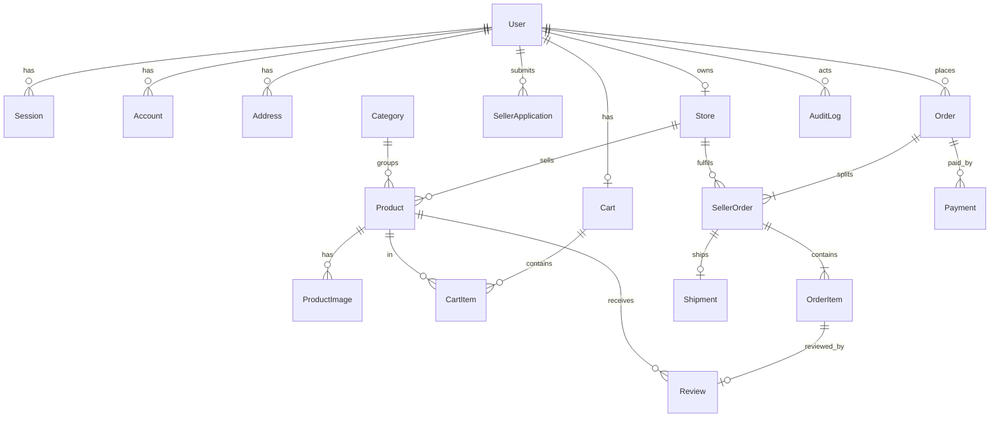

# Data Model

Owner: database agent. This is the **draft design** for schema v1. No migration exists yet. When `prisma/schema.prisma` is written, that file becomes authoritative and this document must match it.

Conventions: ids are `cuid` strings. Timestamps are UTC. Money columns end in `Satang` and are `Int`. `createdAt` on every table; `updatedAt` on mutable tables.

## Entity overview

## Enums

| Enum | Values |
| --- | --- |
| `Role` | `CUSTOMER`, `SELLER`, `ADMIN` |
| `StoreStatus` | `PENDING`, `APPROVED`, `REJECTED`, `SUSPENDED` |
| `ApplicationStatus` | `PENDING`, `APPROVED`, `REJECTED` |
| `ProductStatus` | `DRAFT`, `PUBLISHED`, `ARCHIVED` |
| `ModerationStatus` | `PENDING`, `APPROVED`, `REJECTED` |
| `PaymentStatus` | `PENDING`, `PAID`, `FAILED`, `REFUNDED` |
| `PaymentProvider` | `MOCK` |
| `FulfilmentStatus` | `PENDING`, `PROCESSING`, `SHIPPED`, `DELIVERED`, `CANCELLED` |

## Tables

### User
`id`, `email` (unique, lowercased), `name`, `phone?`, `role` (default `CUSTOMER`), `isActive` (default true), timestamps. Password hash lives in the auth library's `Account` table. `Session`, `Account`, and `Verification` follow the auth library's required shape.

### Address
`id`, `userId` FK, `recipientName`, `phone`, `line1`, `subdistrict`, `district`, `province`, `postalCode` (5 digits), `isDefault`, timestamps. Index `(userId)`. At most one default per user (partial unique index, raw SQL).

### Store
`id`, `ownerId` FK unique, `name`, `slug` unique, `description?`, `logoKey?`, `contactPhone`, `status`, `statusReason?`, timestamps. Index `(status)`.

### SellerApplication
`id`, `userId` FK, `storeName`, `description`, `contactPhone`, `status`, `reviewedById?` FK, `reviewNote?`, `reviewedAt?`, timestamps. At most one `PENDING` application per user (partial unique index, raw SQL).

### Category
`id`, `name`, `slug` unique, `sortOrder`, `isActive`, timestamps. Flat list in the MVP; no hierarchy.

### Product
`id`, `storeId` FK, `categoryId` FK, `title`, `slug` unique, `description`, `sku`, `priceSatang`, `stock`, `status`, `moderationStatus`, `moderationNote?`, timestamps.
- Unique `(storeId, sku)`.
- Indexes: `(status, moderationStatus, categoryId, createdAt)`, `(storeId, status)`, `(priceSatang)`.
- `CHECK (priceSatang BETWEEN 100 AND 100000000)`, `CHECK (stock >= 0)` (raw SQL).

### ProductImage
`id`, `productId` FK cascade, `storageKey`, `sortOrder`, `createdAt`. Index `(productId, sortOrder)`.

### Cart and CartItem
`Cart`: `id`, `userId` FK unique, timestamps.
`CartItem`: `id`, `cartId` FK cascade, `productId` FK, `quantity`, timestamps. Unique `(cartId, productId)`. `CHECK (quantity BETWEEN 1 AND 99)` (raw SQL). No price is stored in the cart; prices are read live.

### Order
`id`, `orderNumber` unique (human-readable), `userId` FK restrict, `idempotencyKey`, `paymentStatus`, `itemsSubtotalSatang`, `shippingTotalSatang`, `grandTotalSatang`, shipping snapshot (`shipRecipientName`, `shipPhone`, `shipLine1`, `shipSubdistrict`, `shipDistrict`, `shipProvince`, `shipPostalCode`), timestamps.
- Unique `(userId, idempotencyKey)`.
- Index `(userId, createdAt)`.
- `CHECK (grandTotalSatang = itemsSubtotalSatang + shippingTotalSatang)` and non-negative checks (raw SQL).

### SellerOrder
`id`, `orderId` FK restrict, `storeId` FK restrict, `fulfilmentStatus`, `itemsSubtotalSatang`, `shippingFeeSatang`, `commissionRateBps` (basis points snapshot), timestamps.
- Unique `(orderId, storeId)`.
- Index `(storeId, fulfilmentStatus, createdAt)`.

### OrderItem
`id`, `sellerOrderId` FK restrict, `productId` FK restrict (reference only), `productTitle`, `productSku`, `productImageKey?`, `unitPriceSatang`, `quantity`, `lineTotalSatang`, `createdAt`.
- `CHECK (quantity > 0)`, `CHECK (lineTotalSatang = unitPriceSatang * quantity)` (raw SQL).
- Index `(sellerOrderId)`, `(productId)`.

### Payment
`id`, `orderId` FK restrict, `provider` (`MOCK`), `providerReference?`, `status`, `amountSatang`, `failureReason?`, timestamps. Index `(orderId)`. One order may have several attempts.

### Shipment
`id`, `sellerOrderId` FK unique, `carrierName?`, `trackingNumber?`, `isSimulated` (true in the MVP), `shippedAt?`, `deliveredAt?`, timestamps. Tracking numbers are only ever seller-entered; none are generated.

### Review
`id`, `orderItemId` FK unique, `productId` FK, `userId` FK, `rating`, `comment?`, timestamps. `CHECK (rating BETWEEN 1 AND 5)` (raw SQL). Index `(productId, createdAt)`.

### MarketplaceSettings
Single row: `id` (fixed), `flatShippingFeeSatang`, `commissionRateBps`, `requireProductApproval`, `updatedById?`, `updatedAt`. Commission is stored here and snapshotted onto `SellerOrder`; a separate commission table is not needed until payouts exist.

### AuditLog
`id`, `actorId` FK restrict, `action` (for example `STORE_SUSPENDED`), `targetType`, `targetId`, `metadata` (JSON: reason, before and after summary), `createdAt`. Index `(createdAt)`, `(targetType, targetId)`. Append-only: no update or delete path in application code.

## Integrity rules and where they are enforced

| Rule | Database | Service |
| --- | --- | --- |
| No negative stock | `CHECK` | conditional decrement |
| No overselling under concurrency | conditional `UPDATE` row count | transaction rollback |
| Totals consistent | `CHECK` on Order and OrderItem | computed from database prices |
| No duplicate order per submission | unique `(userId, idempotencyKey)` | lookup before and catch on conflict |
| One store per seller | unique `ownerId` | |
| One review per purchased item | unique `orderItemId` | eligibility check |
| History survives edits | snapshot columns, `RESTRICT` FKs | archive instead of delete |
| Order totals fit in `Int` | | caps BR-02 to BR-04 validated before insert |

Note on overflow: `unitPriceSatang * quantity` can reach 9.9 billion at the limits, which exceeds a 32-bit integer. The service computes in JavaScript numbers (safe to 2^53) and rejects any order above the BR-04 cap before writing, so no stored value can overflow.

## Raw SQL the Prisma schema cannot express

To be added to the first migration by hand and kept in sync here:

- All `CHECK` constraints listed above.
- Partial unique index: one default address per user.
- Partial unique index: one pending application per user.

## Deletion policy

| Entity | Policy |
| --- | --- |
| Product with order items | `ARCHIVED`, never deleted |
| Product with no orders | may be hard-deleted with its images |
| User with orders | `isActive = false`; sessions revoked |
| Category with products | deactivated, not deleted |
| Order, SellerOrder, OrderItem, Payment, AuditLog | never deleted by the application |

## Migrations and rollback

- Development: `prisma migrate dev`. Deployment: `prisma migrate deploy`, run as a separate step before the new application version starts.
- Prisma generates forward migrations only. Rolling back means restoring a backup or writing a new corrective migration. Take a backup before every production migration.
- Prefer expand-then-contract for breaking changes: add the new column, deploy code that writes both, backfill, switch reads, drop the old column in a later release.
- Destructive migrations require human approval.

## Seed data

Local and test only. Creates sample categories, sample stores (names prefixed "ร้านตัวอย่าง"), sample products, and sample customer and seller accounts whose credentials are documented in the README as local-only. Creates no reviews and no admin.
