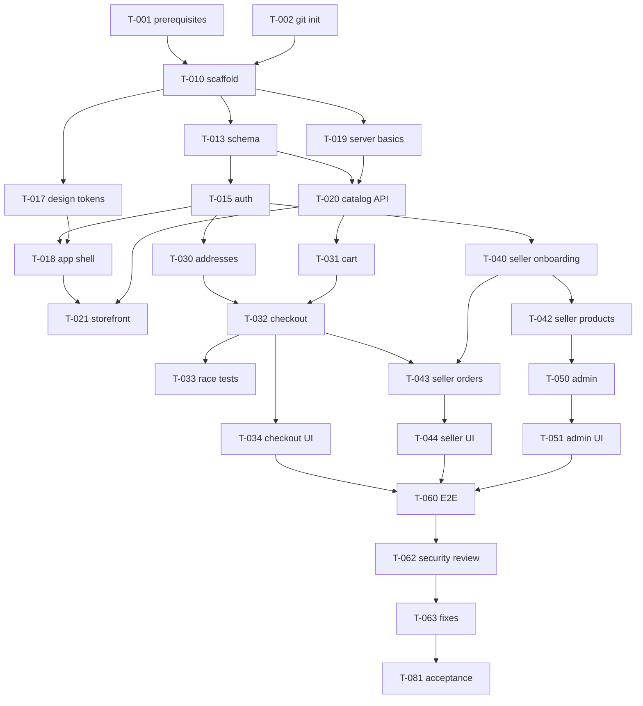

# Project Plan

Task definitions, owners, dependencies, and acceptance checks. Owner: orchestrator.

Status of each task is recorded only in [STATUS.md](STATUS.md). Requirements are in [REQUIREMENTS.md](REQUIREMENTS.md).

## Phases

| Phase | Goal | Exit condition |
| --- | --- | --- |
| 1 Discovery | Know the environment | Tooling installed and versions recorded |
| 2 Planning | Architecture, contracts, plan | Documents reviewed; Q1 to Q6 confirmed (D-017); later questions tracked in STATUS.md |
| 3 Agent team | Working delegation | One real subagent task completed and verified |
| 4 Foundation | Scaffold, database, auth, design system | App runs; register and login work; checks pass |
| 5 Catalog | Storefront browsing | Guest can browse, search, and view products |
| 6 Cart and orders | Purchase flow | Multi-seller mock checkout verified, including race tests |
| 7 Seller platform | Seller self-service | Seller isolation tests pass |
| 8 Admin platform | Governance | Admin permission tests pass; audit log populated |
| 9 Quality review | Independent review | No open Critical or High finding; full suite run |
| 10 CI and staging | Automation and deploy prep | CI green on a real run; staging documented or deployed |
| 11 Acceptance | Release readiness | MVP checklist verified; limitations documented |

## Tasks

`Deps` lists tasks that must be `VERIFIED` first. Tasks with no dependency on each other and disjoint owners may run in parallel.

### Phase 1 to 3

| Id | Task | Owner | Deps | Acceptance |
| --- | --- | --- | --- | --- |
| T-001 | Install prerequisites: Node LTS, pnpm, PostgreSQL (Docker Desktop or native) | user + orchestrator | none | `node -v`, `pnpm -v`, and `docker info` succeed; versions recorded in DECISIONS.md (the database connection is proven by T-012) |
| T-002 | Initialise git repository, `.gitignore`, first commit | orchestrator | none | `git status` clean; no env files tracked |
| T-003 | Verify subagent delegation with one small real task | orchestrator | T-002 | A subagent returns the standard report and its change is confirmed in the tree |
| T-004 | Review planning documents against requirements | product-requirements, code-review | none | Contradictions between docs listed and resolved |

### Phase 4 Foundation

| Id | Task | Owner | Deps | Covers | Acceptance |
| --- | --- | --- | --- | --- | --- |
| T-010 | Scaffold Next.js, TypeScript strict, Tailwind, ESLint, Prettier, Vitest; add all scripts named in CLAUDE.md | orchestrator | T-001, T-002 | N-10 | `pnpm verify` (format check, lint, type check, unit tests, build) passes on the empty app |
| T-011 | Environment validation and health endpoint | devops | T-010, T-012, T-013 | N-07, N-08 | Missing variable fails startup naming the variable; `/api/health` returns 200 with database up |
| T-012 | Docker compose for dev and test databases | devops | T-001 | N-10 | Fresh database starts from documented command |
| T-013 | Prisma schema v1, migrations, raw-SQL constraints | database | T-010, T-012 | BR-01 to 16 | `prisma migrate dev` applies on a fresh database; constraint tests (written with T-023) reject negative stock and price |
| T-023 | Integration-test harness: `vitest.integration.config`, test database reset, factories in `tests/helpers`, schema constraint tests | qa | T-012, T-013 (schema landed) | N-05 | `pnpm test:integration` runs against the test database and passes; reset leaves no rows between files |
| T-014 | Seed sample data (sample accounts need the auth library's password hashing) | database | T-013, T-015 | N-09 | Seed runs twice cleanly; refuses production |
| T-015 | Auth: register, login, logout, sessions, guards | auth | T-013, T-019, T-023 | C-01, C-02, N-04 | Auth and guard tests pass; cookie attributes asserted |
| T-016 | Admin bootstrap script | auth, devops | T-015 | A-11 | Creates admin from env input; rejects a password that fails the REQ-C-01 policy; idempotent |
| T-017 | Design tokens and base UI primitives | ui-ux-design | T-010 | N-01 to 03 | Primitives render; contrast pairs checked and recorded |
| T-018 | App shell: header, footer, navigation, Thai strings file, formatters | frontend | T-015, T-017 | N-01, N-02, N-12 | Shell renders at three widths; formatter unit tests pass; marketplace name comes from one place |
| T-019 | Error envelope, logger, rate limiter, request id | backend-api | T-010 | N-07 | Unit tests pass |

### Phase 5 Catalog

| Id | Task | Owner | Deps | Covers | Acceptance |
| --- | --- | --- | --- | --- | --- |
| T-020 | Catalog module: list, search, filter, sort, paginate, detail, store | backend-api | T-013, T-019 | C-05 to 09, N-06, BR-05 | Integration tests: visibility rule BR-05 holds for every hidden case; page size capped at 50 |
| T-021 | Storefront pages: home, category, search, product, store | frontend | T-014, T-018, T-020 | C-05 to 09, N-03 | Loading, empty, error states present; pages work at three widths; keyboard operable, forms labelled |

### Phase 6 Cart and orders

| Id | Task | Owner | Deps | Covers | Acceptance |
| --- | --- | --- | --- | --- | --- |
| T-030 | Profile and address module and pages | backend-api, frontend | T-015 | C-03, C-04 | Cross-user address access returns 404 |
| T-031 | Cart module | backend-api | T-015, T-020 | C-10, BR-16 | Totals server-computed; unavailable items flagged; own-store product rejected |
| T-032 | Checkout, orders, mock payment, state machines | backend-api | T-030, T-031 | C-11 to 13, BR-03, BR-04, BR-07 to 16, N-09 | Transactional; price tampering ignored; idempotency honoured; mock payment and simulated shipping recorded as such |
| T-033 | Concurrency and duplicate-submission tests | qa | T-032 | N-05 | Last-item race yields exactly one order; stock never negative |
| T-034 | Cart, checkout, confirmation, order history pages | frontend | T-031, T-032 | C-10 to 13, N-03, N-09 | Mock payment labelled; failure path shown; keyboard operable, forms labelled |
| T-035 | Reviews module and UI | backend-api, frontend | T-032 | C-14 | Eligibility rule BR-11 enforced server-side |

### Phase 7 Seller

| Id | Task | Owner | Deps | Covers | Acceptance |
| --- | --- | --- | --- | --- | --- |
| T-040 | Seller application and store module, including the approve and reject service that T-050 later exposes to admins | backend-api | T-015 | S-01, S-02, S-09, BR-06 | A user without an approved store is blocked on every seller endpoint that requires one |
| T-041 | Upload module with storage abstraction (local disk adapter) | backend-api | T-019, T-040 | S-05 | Rejects wrong type, oversize, mismatched content, traversal names |
| T-042 | Seller product and inventory module | backend-api | T-040, T-041 | S-04, S-06 | Cross-store access returns 404 on read, update, delete |
| T-043 | Seller orders, fulfilment, and dashboard summary | backend-api | T-032, T-040, T-042 | S-03, S-07, S-08, BR-14 | Transition table enforced; cross-store access returns 404; a suspended store can still read and fulfil its existing orders; summary computed from real rows |
| T-044 | Seller dashboard pages | frontend | T-040 to T-043 | S-01 to S-09, N-03 | All states present; summaries from real rows; keyboard operable, forms labelled |
| T-045 | Seller isolation test suite | qa, security | T-042, T-043 | N-04 | Every seller endpoint tested with a foreign id |

### Phase 8 Admin

| Id | Task | Owner | Deps | Covers | Acceptance |
| --- | --- | --- | --- | --- | --- |
| T-050 | Admin module: users, applications, suspension, moderation, categories, orders, settings, reports, audit | backend-api | T-040, T-042, T-032 | A-01 to A-10, N-06 | Non-admin rejected on every endpoint; each action writes an audit row; page size capped at 50 |
| T-051 | Admin dashboard pages | frontend | T-050 | A-01 to A-10, N-03 | Pagination and filters work; keyboard operable, forms labelled |
| T-052 | Admin permission and escalation tests | qa, security | T-050 | N-04 | Customer and seller get 403 on every admin endpoint |

### Phase 9 to 11

| Id | Task | Owner | Deps | Acceptance |
| --- | --- | --- | --- | --- |
| T-060 | End-to-end suite (ten journeys) | qa | T-034, T-044, T-051 | Playwright run with real counts reported |
| T-061 | Full code review | code-review | T-060 | Verdict recorded; blocking items resolved |
| T-062 | Full security review, scans, threat model update | security | T-060, T-072 | Findings registered; no open Critical or High |
| T-063 | Fix findings and regression run | owners, qa | T-061, T-062 | Each fix has a regression test; full suite re-run |
| T-070 | GitHub Actions CI workflow | devops | T-010, T-013 | Workflow runs on a real push or pull request and passes |
| T-071 | Dockerfile and staging runbook | devops | T-070 | Image builds locally; health check passes in the container |
| T-072 | Security headers and production config | devops, security | T-021 | Headers asserted by a test; storefront pages still render with the CSP |
| T-080 | Documentation drift audit and README finalisation | documentation | T-063 | README steps followed literally on a clean checkout |
| T-081 | Final acceptance against the MVP checklist | orchestrator | all | Checklist in STATUS.md all `VERIFIED` or explicitly excepted |

## Dependency graph (critical path)

## First vertical slice

T-010 to T-021: a guest opens the homepage, sees seeded sample products, searches, and opens a product page; a visitor registers and logs in. This is the first point at which the app is demonstrably running end to end.

## Milestone report format

At the end of each phase the orchestrator reports:

- Summary of completed work
- Agents actually used
- Files created or changed
- Commands actually executed
- Test results with pass and fail counts
- Security findings and severity
- Build and deployment status
- Known limitations and blockers
- Next tasks

Each claim is labelled as one of: implemented in code, tested locally, verified in staging, deployed to production.
